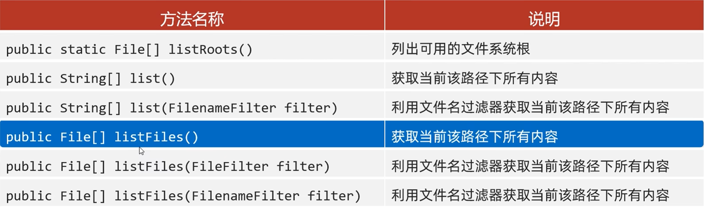

---
tags:
  - Java
  - File
---

# File

File对象表示路径，可以是文件，也可以是文件夹。这个路径可以是存在的，也可以是不存在的。
## 绝对路径和相对路径
绝对路径是带盘符的。
相对路径是不带盘符的，默认从当前项目下查找。
## File的三种构造方法
```java
public File(String pathname);
根据文件路径创建文件对象

public File(String parent,String child);
把父级路径和子级路径进行拼接，根据次路径创建文件对象

public File(File parent,String child);
把父级路径和子级路径进行拼接，根据次路径创建文件对象
```
## File的成员方法
### 判断&获取
```java
public boolean isdirectory();
判断此路径名表示的File是否为文件夹

public boolean isFile();
判断此路径名表示的File是否为文件

public boolean exists();
判断此路径名表示的File是否存在
```
```java
public long length();
返回文件大小(字节数量)
细节1:只能获取文件的大小，单位是字节。若需要单位是M、G，可以不断除以1024。
细节2:此方法无法获取文件夹的大小。若需要获取文件夹的大小，需要把此文件夹里的所有文件都累加。
```
```java
public String getAbsolutePath();
返回文件的绝对路径

public String getPath();
返回定义文件时使用的路径

public long lastModified();
返回文件的最后修改时间(时间毫秒值)
```
```java
public String getName();
返回文件的名称，带后缀。
细节:若为文件夹，则返回文件夹的名字
```
***
### 创建&删除
```java
public boolean createNewFile();
创建一个新的空文件夹
细节1:如果当前路径表示的文件是不存在的，则创建成功，返回true，反之创建失败，返回false。
细节2:如果父级路径是不存在的，那么方法会有异常IOException。
细节3:createNewFile方法创建的一定是文件，若路径中不包含后缀名，则创建一个没有后缀的文件。
```
```java
public boolean mkdir();
创建单级文件夹
细节1:windows当中路径是唯一的，若当前路径已经存在，则创建失败，返回false。
细节2:mkdir方法只能创建单级文件夹，无法创建多级文件夹。
```
```java
public boolean mkdirs();
创建多级文件夹
细节:既可以创建多级也可以创建单级文件夹
```
```java
public boolean delate();
删除文件、空文件夹
细节:若删除的是文件和空文件夹，则直接删除，不走回收站;若删除的是有内容的文件夹，则删除失败。
```
***
### 获取&遍历
```java
public File[] listFiles();
获取当前路径下所有内容
细节:
当调用者File表示的路径不存在时，返回null
当调用者File表示的路径是文件时，返回null
当调用者File表示的路径是一个空文件夹时，返回一个长度为0的数组
当调用者File表示的路径是一个有内容的文件夹时，将里面所有文件和文件夹的路径放在File数组中返回
当调用者File表示的路径是一个有隐藏文件的文件夹时，将里面所有文件和文件夹的路径放在File数组中返回，包含隐藏文件
当调用者File表示的路径是需要权限才能访问的文件夹时，返回null
```
#### 其他获取&遍历的方法

### 通用遍历文件夹方法
```java
File src = new File(pathname:"***");

public static void find(File src){
	//1.进入文件夹
	File[] files = src.listFiles();
	//2.遍历数组，依次得到src里的每个文件或文件夹
	for(File file : files){
		if(file.isFile()){
			//3.判断是否为文件，若是，执行逻辑
			String name = file.getName();
			System.out.println(name);
		}else{
			//4.判断为文件夹，则进行递归
			find(file);
		}
	}
}
```

## 相关笔记

- [[IO流]]

