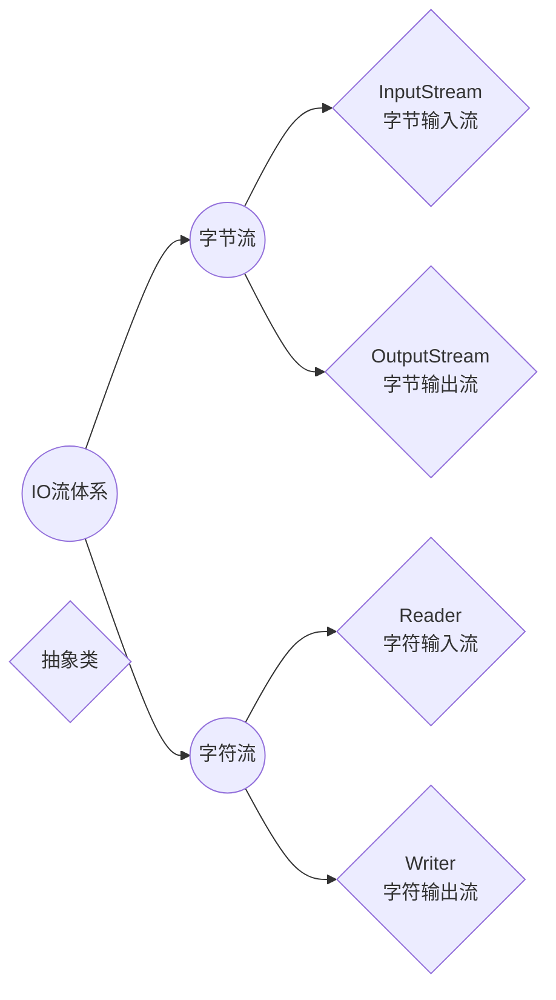
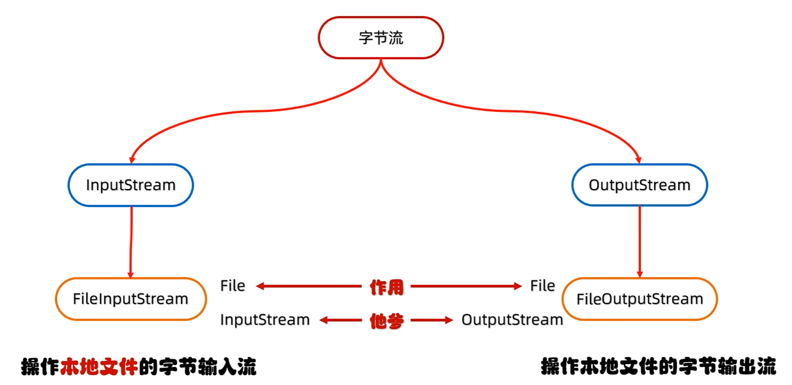
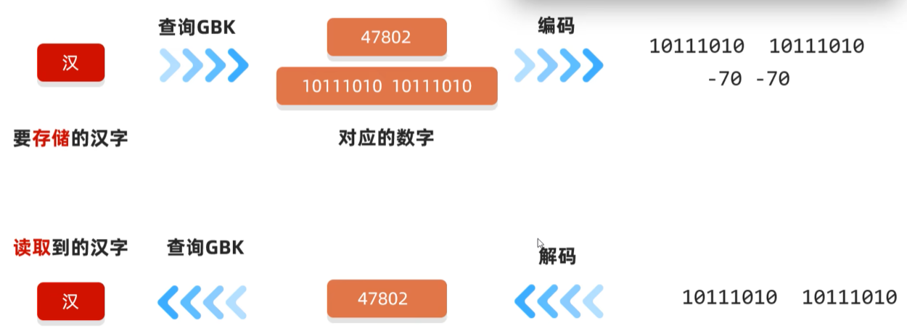
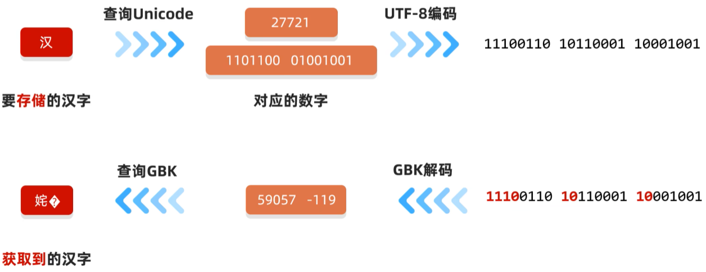
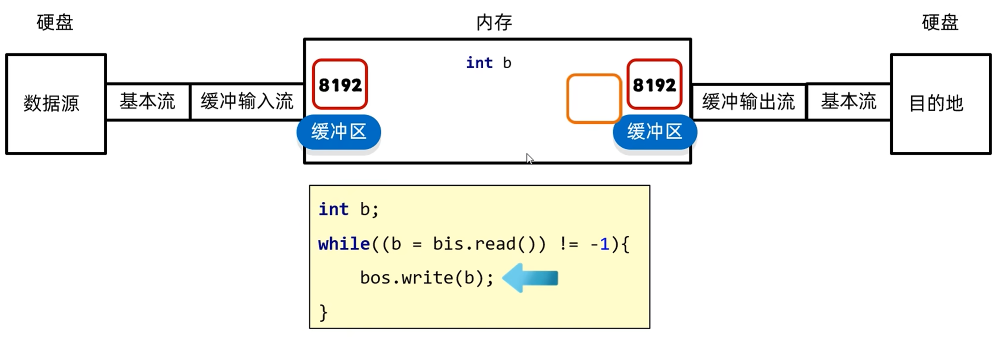
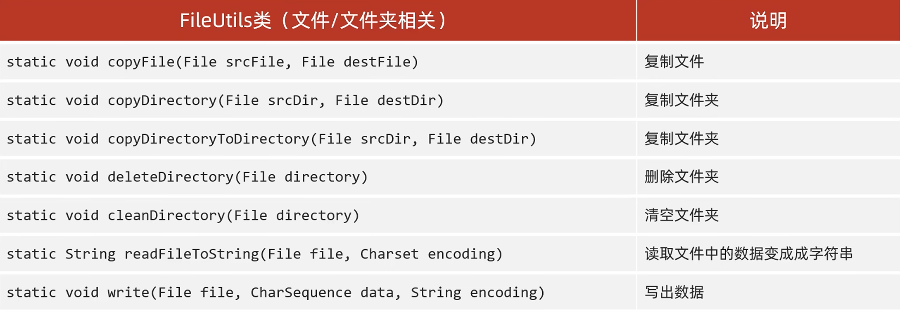
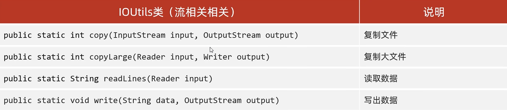

---
tags:
  - Java
  - IO流
---

# IO流

io流是存储和读取数据的解决方案
.
作用：读写数据（本地文件，网络）
.
按流向分类：输出流（程序到文件），输入流（文件到程序）
.
按操作类型分类：字节流（操作所有类型的文件），字符流（只能操作纯文本文件）
## 纯文本文件
.txt    .md    .xml    .lrc等
## IO流体系

## 基本流
### 字节流

#### 字节输出流
##### 创建对象
```java
FileOutputStream fos = new FileOutputStream("xxx",true/false);

注意：
1.参数是字符串表示的路径或File对象
2.若文件不存在会创建一个新的文件，但是要保证文件的父级路径是存在的
3.若文件已经存在，则会清空文件
4.第二个参数表示是否续写，默认false
```
##### 写出数据
```java
fos.write(int b);                       一次写一个字节数据
fos.write(byte[] b);                    一次写一个字节数组数据
fos.write(byte[] b,int off,int len );   一次写一个字节数组的部分数据（off起始索引，len个数）

注意：
write方法的参数是整数，但实际上写到文件中的是ASCII表上对应的字符
```
##### 释放资源
```java
fos.close();

注意：
每次使用完流后必须要释放资源
```
##### 换行书写
```java
String str = "\r\n";
byte bytes = str.getByte();
write(bytes);
```

***
#### 字节输入流
#### 创建对象
```java
FileInputStream fis = new FileInputStream("xxx");

注意：若文件不存在，直接报错
```
##### 读取数据
```java
int b1 = fis.read();
sout(b1);

int b2;
while((b2 = fis.read()) != -1){
	sout((char)b);
}

重载：read(byte[] buffer)    一次读一个字节数组的数据
int len;
byte[] bytes = new bytep[2];//长度通常为1024整数倍，例1024*1024*5（5MB）
len = fis.read(bytes);
sout(new String(bytes,0,len));

注意：
1.一次读一个字节，读出来的是数据在ASCII表上对应的数字
2.读到文件末尾，read方法返回-1
3.read()函数与迭代器类似，读取完数据后指针后移一格。故使用循环时，要使用第三方变量记录
```
##### 释放资源
```java
fis.close();

注意：每次使用完流后要释放资源
```

### 字符流
#### 字符输入流
格式与上文一致
```java
FileReader fr = new FileReader("xxx");

空参read():默认仍为一个字节一个字节的读取，在读取后进行解码转成十进制,返回一个int(需要强转)
int ch;
while((ch = fr,read()) != -1){
	sout((char)ch);
}

带参read(char[] biffer):将读取数据，解码，强转三部合并，将强转后的字符放入数组中
char[] chars = new char[2];
int len;
while((len = fr,read(char)) != -1){
	sout(new Sreing(chars,0,len));
}

fr.close;
```
#### 字符输出流
```java
FileWriter fw = new FileWriter("xxx",true/false);第二参数为续写开关

注意：
1.参数是字符串表示的路径或File对象
2.若文件不存在会新建一个文件，但其父级路径必须存在
3.想要续写就打开续写开关

void write(int c);                           写出一个字符
void write(String str);                      写出一个字符串
void write(String str,int off,int len);      写出一个字符串的一部分
void write(char[] cbuf);                     写出一个字符数组
void write(char[] cbuf,int off,int len);     写出字符串的一部分

注意：
若write方法的参数是整数，但实际上写到本地文件中的是整数在字符集上对应的字符
```
## 字符集
### GBK

简中Windows中，默认使用GBK
GBK完全兼容ASCII字符集
#### 汉字存储规则
1. 两个字节存储一个汉字
2. 高位字节二进制一定以1开头，转成十进制后是一个负数
例：**1**0111010 10111010(汉)
#### 英文存储规则
1. 一个字节存储一个英文字母，兼容ASCII，二进制前面补0
例：**0**110001(a)
### Unicode
常用UTF-8编码规则，用1~4个字节保存

ASCII(1个字节),叙利亚文等(2个字节),简中日韩(3个字节),其他语言(4个字节)
### 乱码
原因1：读取数据时未读完整个汉字，字节流一个字节一个字节读，而汉字有二/三个字节;
原因2：编码和解码时方式不统一

## 高级流
### 缓冲流
#### 字节缓冲流
```java
public BufferedInputStream(InputStream is);
public BufferedOutputStream(OutputSteam os);

原理：底层自带了长度为8192字节(8k)的缓冲区提高性能
```

#### 字符缓冲流
```java
public BufferedReader(Reader r);
独有方法:
public String readLine();        读取一行数据，若无数据可读了，返回null

public BufferedWriter(Writer w);
独有方法:
public void newLine();           跨操作系统的换行
原理：底层自带了长度为8192字符(16k)的缓冲区提高性能
```

### 转换流
是字符流和字节流之间的桥梁，其本质就是字符流
当字节流想用字符流中的方法就可以使用转换流
```java
public InputStreamReader(InputStream in);
public OutputStreamWriter(OutputStream out);
```
### 序列化流
#### 序列化流/对象操作输出流
可以把Java中的对象写到本地文件中
```java
public ObjectOutputStream(OutputStream out);将基本流包装成高级流

成员方法：
public final void writObject(Object obj);把对象序列化(写出)到文件中去
```
#### 反序列化流/对象操作输入流
可以将序列化到本地文件中的对象，读取到程序中来
```java
public ObjectInputStream(Inputstream in);

成员方法：
public Object readObject();将序列化到本地文件中的对象，读取到程序中来
```
***
注意：
1. 使用对象输出流将对象保存到文件时会出现NotSerializableException异常，需要让Javabean类实现Serializable接口
2. 序列化流写到文件中的数据是不能修改的，一旦修改就无法再次读回
3. 若在序列化对象后，反序列化前修改了Javabean类，则需将版本号固定，在类中开头加上
```java
private static final long serialVersionUID = numberl;
```
4. 若不想讲Javabean类中的某一属性序列化，可加入瞬态关键字`transient`
其作用为：不会家那个当前属性序列化到本地文件中
例：
```java
private transient String name;
```
### 打印流
一般指：PrintStream,PrintWriter两个类
打印流只操作文件目的地，不操作数据源
#### 字节打印流
默认自动刷新
```java
构造方法:
public PrintStream(OutputStream/File/String);                               关联字节输出流/文件/文件路径
public PrintStream(String fileName,Charset charset);                        指定字符编码
public PrintStream(OutputStream out,boolean autoFlush);                     自动刷新
public PrintStream(OutputStream out,boolean autoFlush,String encoding);     指定字符编码且自动刷新

成员方法:
public void write(int b);                              常规方法：规则跟之前一样，将指定的字节写出
public void println(Xxx xx);                           打印任意数据，自动刷新，自动换行
public void print(Xxx xx);                             打印任意数据，不换行
public void printf(String format,Object... args);      带有占位符的打印语句，不换行
```
#### 字符打印流
想要自动刷新必须开启
```java
构造方法:
public PrintWriter(OutputStream/File/String);                               关联字节输出流/文件/文件路径
public PrintWriter(String fileName,Charset charset);                        指定字符编码
public PrintWriter(OutputStream out,boolean autoFlush);                     自动刷新
public PrintWriter(OutputStream out,boolean autoFlush,String encoding);     指定字符编码且自动刷新
成员方法与上面一致
```
***
热知识：System.out.println 是一个特殊的打印流，他是系统中的标准输出流，是不能关闭在系统中是唯一的。此打印流在虚拟机启动时由虚拟机创建，默认指向控制台
### 解压缩流/压缩流
压缩包里的每一个文件和文件夹实际上都是一个`Zipentry`对象
解压缩流：`ZipInpurStream`
成员方法：`getNextEntry`
压缩流：`ZipOutputSream`
***
### Commons-io工具包


### Hutool工具包
***

## 相关笔记

- [[File]]
- [[Stream流]]
- [[网络编程]]

