# Java基础

## 泛型
### 泛型
可以在编译阶段约束操作的数据类型，并进行检查；

Java里的泛型是伪泛型，底层是仅在入口出增加一层检查机制，目的是统一集合合的数据类型；而在集合内数据仍被当做Object类型处理；当集合内数据向外获取时，再将数据强转为泛型。
#### 细节
1. 泛型中不能写基本数据类型，必须写其包装类型
2. 指定泛型的具体类型后，传递数据时，可以传入该类型或其子类类型
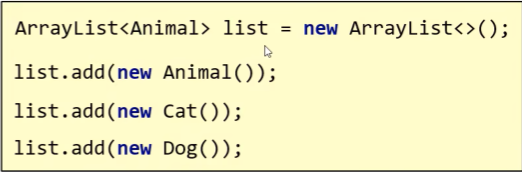
3. 集合类型默认为Object
### 泛型类
当类的类型不确定时，其可以定义为泛型类
常用‘E’‘V’等
当创建对象时，必须规定一个类型，否则默认为Object
### 泛型方法
方法中形参类型不确定时
1. 使用类名后定义的泛型(所有方法都能用)
2. 在方法声明上定义自己的泛型(只有本方法能用)
```java
格式：
修饰符<类型>  返回值类型 方法名(类型 变量名){})
例如
public<T> void method(T t){
}
```
### 泛型接口
```java
格式：
修饰符 interface 接口名<类型>{}
例如
public interface List<E>{
 }
```
 使用方法
 1. 实现类给出具体类型
 2. 实现类延续泛型，创建对象时在确定
### 继承与通配符
1. 泛型不具备继承性，泛型里写的什么类型，那么只能传递什么类型的数据，但是其数据有继承性
2. 当不确定类型，但是对类型的范围有限制时，可以使用泛型的通配符：
```java
?(表示不确定的类型)
? extends E:表示可以传递E或者E所有的子类类型
? super E:表示可以传递E或者E的所有父类类型
```
## 红黑树
### 红黑规则
1. 每个节点或是红色，或是黑色
2. 根节点必须是黑色
3. 如果一个节点没有子节点或父节点，则该节点相对应的指针属性值为Nil，这些Nil视为叶节点，每个叶节点(Nil)是黑色的
4. 如果某个节点为红色，那么他的子节点必须是黑色(不能出现两个红色节点相连的情况)
5. 对每个节点，从该节点到其所有后代叶节点的简单路径上，均包含相同数目的黑色节点；
### 节点结构
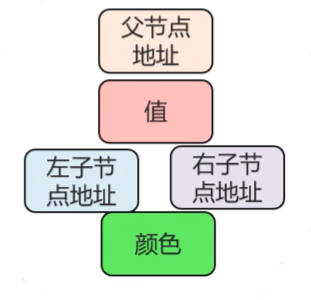
### 节点添加规则
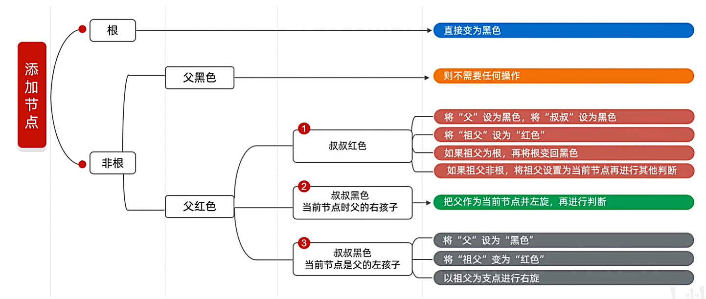
***
## lambda表达式
lambda表达式是一个匿名函数
```java
lambda表达式：
Arrays.sort(arr,new Comperator<Integer>(){
	@Override
		publci int compare(Integer o1,Integer o2){
				return o1-o2;
		}
});
改为：
Arrays.sort(arr,(Integer o1,Integer o2)->{
	return o1-o2
		}
);
```
细节：
1. lambda表达式用来简化匿名内部类的书写
2. lambda表达式只能用来简化函数式接口的匿名内部类的书写
3. 函数式接口：有且仅有一个抽象方法的接口叫做函数式接口，接口上方可以加`@Functionallnterface`注解是否为函数式接口

省略写法：
4. 参数类型可以省略
5. 如果只有一个参数，参数类型可以省略，同时()也可以省略
6. 如果lambda表达式的方法体只有一行，大括号，分号，return可以省略，三者省略时需要同时省略
### 常见Lambda表达式
遍历集合:
```java
list.forEach (str -> System.out.println (str));
```
集合排序(整数升序):
```java
numList.sort ((a, b) -> a - b);
```
集合排序(字符串长度):
```java
strList.sort ((s1, s2) -> s1.length () - s2.length ());
```
过滤集合(Stream):
```java
list.stream ().filter (num -> num > 5).forEach (System.out::println);
```
映射集合(Stream):
```java
list.stream ().map (str -> str.toUpperCase ()).forEach (System.out::println);
```
线程创建:
```java
new Thread (() -> System.out.println ("Lambda 线程运行")).start ();
```
函数式接口实现(Supplier):
```java
Supplier<String> sup = () -> "Hello Lambda";String result = sup.get();
```
比较器(Comparator):
```java
Comparator<Integer> comp = (x, y) -> y - x; // 降序
```


***
## 集合
### 单列集合Collection
#### 结构
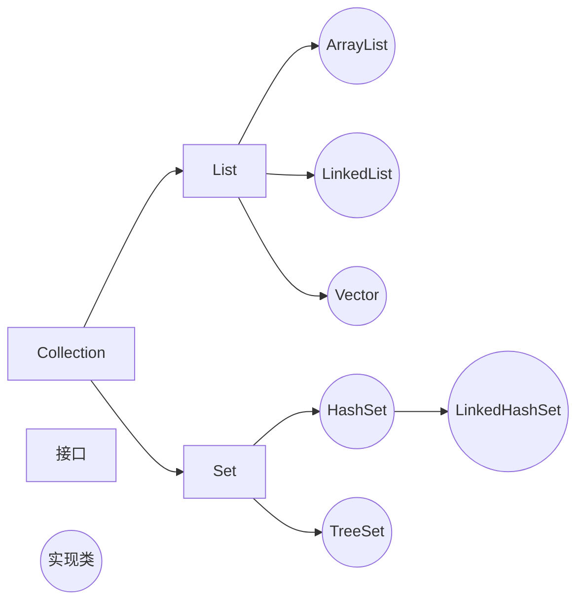

***
#### 常见成员方法
```java
add();添加指定元素
claer();清空集合中所有元素
remove();删除指定元素
contains();判断当前集合是否有指定元素
isEmpty();判断集合是否为空
size();返回集合长度/元素个数
```

***
#### 通用遍历方法
##### 增强for遍历
增强for底层就是iterator迭代器，简化迭代器书写而出现
只有单列集合合数组才能用增强for遍历
```java
格式：
for(String s:list){
	System.out.println(s);
}
s位第三方变量，修改s并不能修改集合，循环过程中依次表示集合中的每一个数据
```
***
##### lambda表达式遍历
```java
遍历表达式：
list.forEach(s -> System.out.println(s));
```

***
##### 迭代器遍历
迭代器在遍历集合时是不依赖索引的，是通过创建指针病移动指针的方式获取集合的元素
###### 迭代器的方法
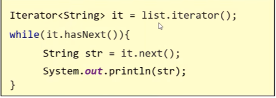
```java
name(集合名).iterator();获取迭代器对象
name(迭代器名).hasNext();判断当前指向的位置是否有元素
name(迭代器名).next();获取当前指向的元素并移动迭代器的指针至下一个
name(迭代器名).add("abc");在集合中向迭代器指向后添加元素
```
###### 细节
1. 如果当前位置无元素，仍要强行获取，会报错：NoSuchElementException
2. 迭代器遍历完毕，其指针不回复位，如仍想遍历，只好再创建一个迭代器对象
3. 循环中只能使用一次next方法
4. 迭代器遍历时，不能用集合的方法进行增加或删除
***
#### List
##### 特点
数据元素有序，可重复，有索引
##### 方法
```java
Collection中所有方法

void add(int index,E element);在此集合中指定位置插入指定元素

E remove(int index);删除指定索引出的元素，返回被删元素
若删除元素值与索引数值相同，优先使用索引
原理：在调用方法时，如果出现了方法重载，优先调用，实参与形参一致的方法

E set(int index,E element)；修改指定索引处元素，返回呗修改的元素

E get(int index);返回索引处元素
```
***
##### ArrayList底层原理
1. 利用空参创建的集合，在底层创建一个默认长度为0的数组(名为elementData)
2. 添加第一个元素时，底层会创建一个新的长度为10的数组，生成一个变量size，指向第二个元素，添加下一个元素时在size处添加，并且调用size()方法时，返回size所在处索引
3. 存满时，会创建扩容1.5倍的新数组，并将老数组数据复制到新数组
4. 如果一次添加多个元素，1.5倍不够，则新创建的数组长度以实际为准
***
##### LinkedList集合
底层是双链表，查询慢，增删快，但如果操作元素为首尾元素，速度也极快
```java
特有方法：
public void addFirst(E e);在该列表开头插入指定元素
public void addLast(E e);将指定的元素追加到此列表的末尾
public E getFirst();返回第一个元素
public E getLast();返回最后一个元素
public E removeFirst();从列表中删除并返回第一个元素
public E removeLast();从列表中删除并返回最后一个元素
```
#### Set
##### 特点
数据元素无序，不重复，无索引
HashSet:无序，不重复，无索引
LinkedHashSet:**有序**，不重复，无索引
TreeSet:**可排序**，不重复，无索引
***

##### 方法
基本与Collection的API一致
***

##### HashSet
底层采取**哈希表**存储数据
哈希表是一种对于增删改查数据性能都较好的结构
###### 哈希表组成
**数组+链表+红黑树**
###### 哈希值
根据hashCode方法算出的int类整数
该方法定义在Object类中，所有对象都可以调用，默认使用地址值进行计算
一般情况下，会重写hashCode方法，利用对象内部的属性值计算哈希值
###### 对象的哈希值特点
如果没有重写hashCode方法，不同对象计算出的哈希值是不同的
如果已经重写hashCode方法，不同对象只要属性值相同，计算出的哈希值就是一样的
在小部分情况下，不同的属性值或不同的地址值计算出来的哈希值也有可能一样(哈希碰撞)
###### 哈希表的底层原理
1. 创建一个默认长度为16，默认加载因子为0.75的数组，名为table
2. 根据元素的哈希值与数组长度计算出应存入的位置
3. 判断当前位置是否为null，如果是null，则直接存入
4. 如果不是null，表示有元素，则调用equals方法比较属性值
5. 一样：不存              不一样：存入数组，新元素直接挂在老元素下面（JDK8以后）形成链表
6. 当数组存了16*0.75（加载因子）=12个元素时，数组将扩容为两倍
7. 当链表长度**大于8**而且数组长度**大于等于64**时，当前链表将自动转为红黑树
如果集合中存储的是自定义对象，则**必须重写hashCode和equals**方法
***

##### LinkedHashSet
**有序**，不重复，无索引
有序：指保证存入和取出的顺序一致
###### 底层原理
底层数据结构依然是哈希表，只是每个元素又额外多了一个双向链表的机制记录存储的顺序
***

##### TreeSet
不重复，无索引，**可排序**
可排序：按照元素的默认规则（由小到大）排序
TreeSet集合底层是基于**红黑树**的数据结构实现排序的，增删改查的性能都较好
###### 集合默认的规则
对于数值类型：Integer，Double，默认按照从大到小的顺序进行排序
对于字符、字符串类型：按照字符在ASCII码中的数字升序进行排序
###### TreeSet的两种比较方法
默认用方法一，当方法一不能满足当前需求，使用方法二
###### 方法一
默认/自然排序：Javabean类实现Comparable接口指定比较规则
重写comparaTo方法
```java
例：
@Override
public int comparaTo(Student o){
	//指定排序规则
	//只看年龄，按年龄升序排列
	return this.getAge()-o.getAge();
}
	this:表示当前要添加的元素
	o:表示已经在红黑树存在的元素

	返回值：
		负数：认为要添加的元素是小的，存左边
		正数：认为要添加的元素是大的，存右边
		0：认为要添加的元素已经存在，舍弃
```
###### 方法二
比较器排序：创建TreeSet对象的时候，传递比较器Comparator指定规则
```java
例：
TreeSet<String> text=new TreeSet<>(new Comparator<String>(){
	@Override
	public int compare(String o1,String o2){
		//按照长度排序
		int i=o1.length()-o2.length();
		//如果长度一样按照首字母排序
		i=i==0?o1.comparaTo(o2):i;
		return i;
	}
};
//可改为lambda表达式
```
***

##### 应用场景
1. 元素可重复
	用**ArrayList**集合，基于数组（**用的最多**）
2. 元素可重复，且当前**增删操作明显多余查询**
	用**LinkedList**集合，基于链表
3. 元素要去重
	用**HashSet**集合，基于哈希表（**用的最多**）
4. 元素要去重，且**保证存取顺序**
	用**LinkedHashSet**集合，基于哈希表和双链表，效率低于HashSet
5. 要对元素进行排序
	用**TreeSet**集合，基于红黑树。后续可用List集合实现排序
***

### 双列集合Map
#### 特点
1. 双列集合一次存一对数据，键和值
2. 键不能重复，值可以重复
3. 键和值是一一对应的，每个键只能找到自己对应的值
4. “值+键”的整体称之为“键值对（对象）”，Java中称之为“Entry对象”
***

#### 结构
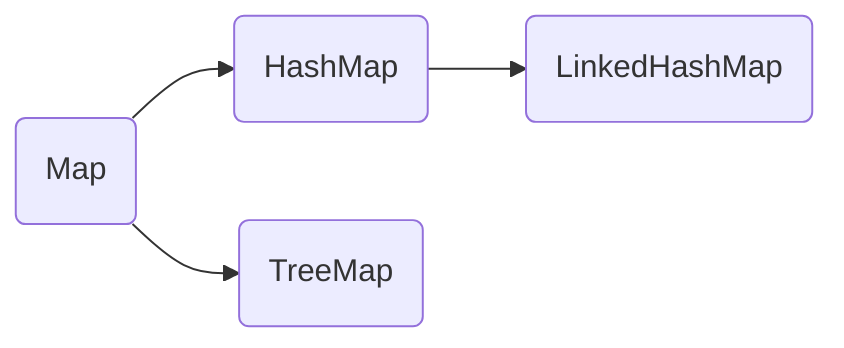
***

#### 常见成员方法
Map是双列集合的顶层接口，它的功能是全部双列集合都可以继承使用的
```java
V put(K key,V value);添加(返回null)/覆盖(返回被覆盖的值)元素
V remove(Object key);根据键删除键值对元素，并返回值
void clear();移除所以的键值对元素
boolean containskey(Object key);判断集合是否包含指定的键
boolean containsvalue(Object value);判断集合是否包含指定的值
boolean isEmpty();判断集合是否为空
int size();返回集合长度，键值对个数
```
***

#### 通用遍历方法
##### 键找值
```java
//获取所有键，将这些键放入一个单列集合中
Set<String> keys=map.keySet();
//遍历单列集合，得到每个键
for(String key:keys){
	//利用map集合中的键获取对应的值->.get()
	String value = map.get(key);
	干事
}
```
##### 通过键值对对象进行遍历
```java
//通过一个方法获取所有键值对对象，返回一个Set集合
Set<Map.Entry<String, String>> entries = map.entrySet();//嵌套泛型
//遍历entries这个集合，得到每一个键值对对象
for(Map.Entry<string, String> entry:entries){
	//利用entry调用get方法获取键和值
	String key = entry.getKey();
	String value = entry.getValue();
	干事
}
```
##### lambda表达式遍历
```java
map.forEach(new Biconsumer<string, String>(){
	@Override
	public void accept(String key,String vale){
		干事
	}
});
lambda:
map.forEach((key,value)-> 干事));
```
***

#### HashMap
1. 方法与Map方法一致，无其他需要学习的特有方法
2. 功能由键决定，与值无关
3. HashMap底层原理是哈希表结构
依赖hashCode方法和equals方法保证**键的唯一**
若键存储的对象是自定义对象，则需重写hashCode和equals方法
若值，则无需重写

***
#### LinkedHashMap
1. 方法与Map一致
2. 由键决定：**有序**，不重复，无索引
3. 有序指保证存入和取出的顺序一致
4. 底层数据结构依然是**哈希表**，只是每个键值对元素又额外多了一个双链表的记录机制记录存储的顺序

***
#### TreeMap
1. 与TreeSet底层原理一致，都是红黑树结构
2. 由键决定：不重复，无索引，可排序
3. 可排序指对键进行排序
##### 代码书写两种排序规则
同上TreeSet：
1. 实现Comparable接口，指定比较规则
2. 创建集合时传递Comparator比较器对象，指定比较规则

### Collections 集合工具类
常见方法：
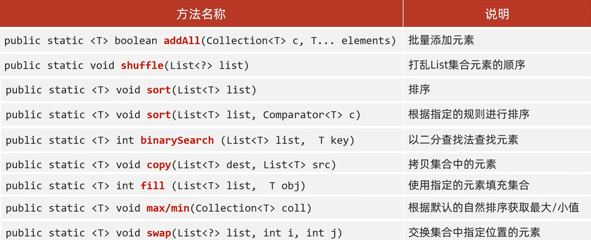


***
## 异常
### 异常的处理
1. 虚拟机默认处理:把异常信息以红色字体打印在控制台，并结束程序
2. 捕获,try...catch:一般在调用处，能让代码继续执行下去
3. 抛出,throw throws:在方法中出现异常了，方法就没有继续运行的意义了，采取抛出处理，让该方法结束运行并告诉调用者出现了问题
#### JVM虚拟机默认处理方法
1. 将异常名称，异常原因以及异常出现的位置等信息输出在控制台
2. 程序停止执行，异常下面的代码不会再执行了
#### 捕获处理异常
```java
try{
	可能出现异常的代码;
}catch(异常类名 变量名){
	异常的处理代码;
}
```
目的：当代码出现异常时，让程序继续向下执行
1. 若try中没有遇到问题，会把try中代码全部执行，不会执行catch中的代码
2. 若try中遇到很多问题，要写多个catch与之对应，且父类异常要写在下面
3. 若try中遇到的问题未被捕获，相当于白写try...catch，当前异常会交给虚拟机处理
4. 若try中有问题，则try后面的代码不会执行，执行将直接跳转至相应的catch
#### 抛出处理异常
##### throws
注意：写在方法定义处，表示声明一个异常，告诉调用者，使用本方法可能会有哪些异常
```java
public void method()throws 异常类名1,异常类名2,...{
	...
}
```
编译时异常必须写，运行时异常可以不写
##### throw
注意：写在方法内，结束方法，手动抛出异常，交给调用者，方法中下面的代码不再执行
```java
public void method(){
	throw new NullPointerException();
}
```

### Throwable的成员方法
```java
public String getMessage();       返回此throwable的详细消息字符串
public String toString();         返回此可抛出的简短描述
public void printStachTrace();    利用System.err,println把异常的错误信息以红色字体输出在控制台(仅打印，不会停止程序运行)
```
### 自定义异常
意义：为了让控制台的报错信息更见名知义
1. 定义异常类，类名要见名知义
2. 要写继承关系(RunTimeException(运行时异常)或Exception(编译时异常))
3. 写空参构造和带参构造(Alt+Insert自动生成)


## File
File对象表示路径，可以是文件，也可以是文件夹。这个路径可以是存在的，也可以是不存在的。
### 绝对路径和相对路径
绝对路径是带盘符的。
相对路径是不带盘符的，默认从当前项目下查找。
### File的三种构造方法
```java
public File(String pathname);
根据文件路径创建文件对象

public File(String parent,String child);
把父级路径和子级路径进行拼接，根据次路径创建文件对象

public File(File parent,String child);
把父级路径和子级路径进行拼接，根据次路径创建文件对象
```
### File的成员方法
#### 判断&获取
```java
public boolean isdirectory();
判断此路径名表示的File是否为文件夹

public boolean isFile();
判断此路径名表示的File是否为文件

public boolean exists();
判断此路径名表示的File是否存在
```
```java
public long length();
返回文件大小(字节数量)
细节1:只能获取文件的大小，单位是字节。若需要单位是M、G，可以不断除以1024。
细节2:此方法无法获取文件夹的大小。若需要获取文件夹的大小，需要把此文件夹里的所有文件都累加。
```
```java
public String getAbsolutePath();
返回文件的绝对路径

public String getPath();
返回定义文件时使用的路径

public long lastModified();
返回文件的最后修改时间(时间毫秒值)
```
```java
public String getName();
返回文件的名称，带后缀。
细节:若为文件夹，则返回文件夹的名字
```
***
#### 创建&删除
```java
public boolean createNewFile();
创建一个新的空文件夹
细节1:如果当前路径表示的文件是不存在的，则创建成功，返回true，反之创建失败，返回false。
细节2:如果父级路径是不存在的，那么方法会有异常IOException。
细节3:createNewFile方法创建的一定是文件，若路径中不包含后缀名，则创建一个没有后缀的文件。
```
```java
public boolean mkdir();
创建单级文件夹
细节1:windows当中路径是唯一的，若当前路径已经存在，则创建失败，返回false。
细节2:mkdir方法只能创建单级文件夹，无法创建多级文件夹。
```
```java
public boolean mkdirs();
创建多级文件夹
细节:既可以创建多级也可以创建单级文件夹
```
```java
public boolean delate();
删除文件、空文件夹
细节:若删除的是文件和空文件夹，则直接删除，不走回收站;若删除的是有内容的文件夹，则删除失败。
```
***
#### 获取&遍历
```java
public File[] listFiles();
获取当前路径下所有内容
细节:
当调用者File表示的路径不存在时，返回null
当调用者File表示的路径是文件时，返回null
当调用者File表示的路径是一个空文件夹时，返回一个长度为0的数组
当调用者File表示的路径是一个有内容的文件夹时，将里面所有文件和文件夹的路径放在File数组中返回
当调用者File表示的路径是一个有隐藏文件的文件夹时，将里面所有文件和文件夹的路径放在File数组中返回，包含隐藏文件
当调用者File表示的路径是需要权限才能访问的文件夹时，返回null
```
##### 其他获取&遍历的方法
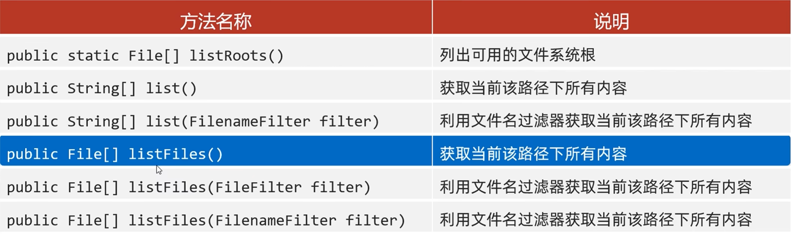
#### 通用遍历文件夹方法
```java
File src = new File(pathname:"***");

public static void find(File src){
	//1.进入文件夹
	File[] files = src.listFiles();
	//2.遍历数组，依次得到src里的每个文件或文件夹
	for(File file : files){
		if(file.isFile()){
			//3.判断是否为文件，若是，执行逻辑
			String name = file.getName();
			System.out.println(name);
		}else{
			//4.判断为文件夹，则进行递归
			find(file);
		}
	}
}
```
## Stream流
### 获取Stream流
#### 单列集合
Collection中的默认方法
```java
default Stream<E> stream();

ArrayList<String> list = new ArrayList<>();
list.stream().forEach(s -> System.out.print(s));
```
#### 双列集合
无法直接使用stream流
```java
无

HashMap<String,Integer> hm = new HashMap<>();
//获取键
hm.keySet().stream().forEach(s -> System.out.print(s));
//获取键值对
hm.entrySet().stream().forEach(s -> System.out.print(s));
```
#### 数组
Arrays工具类中的静态方法
```java
public static<T> Stream<T> stream(T[] array);

Arrays.stream(arr).forEach(s -> System.out.print(s));
```
#### 零散数据
Stream接口中的静态方法
```java
public static<T> Stream<T> of(T...values);

Stream.of(arr).forEach(s -> System.out.print(s));
//细节
//方法的形参是一个可变同类型参数，可以传递一堆零散数据，也可以传递数组
//但是数组必须是引用数据类型的，如果传递基本数据类型，是会把整个数组当做一个元素放入Stream中，返回地址值
```
### 中间方法
```java
Stream<T> filter(Predicate<? super T> predicate);
过滤
```
```java
Stream<T> limit(long maxSize);
获取前面几个元素
```
```java
Stream<T> skip(long n);
跳过前几个元素
```
```java
Stream<T> distinct();
元素去重，依赖hashCode和equals方法，必要时必须重写方法
```
```java
static<T> Stream<T> concat(Stream a,Stream b);
合并a和b两个流为一个流，数据类型尽量一致，否则会变成二者的父类
```
```java
Stream<R> map(Function<T,R> mapper);
转换流中的数据类型
例:
//"张无忌-15"
list.stream()
	.map(s -> Integer.parseInt(s.split("-")[1]))
	.forEach(s -> System.out.print(s));
```
细节:
1. 中间方法，返回新的Stream流，原来的Stream流只能使用一次，建议使用链式编程
2. 修改Stream流中的数据，不会影响原来集合或数组中的数据
###  终结方法
#### 遍历
```java
void forEach(Consumer action);
```
#### 统计
```java
long count();
long count = list.stream().count();
sout(count);
```
#### 收集流中数据，放入数组
```java
toArray();
//1.空参
Object[] arr=list.stream().toArray();
sout(Arrays.toString(arr));
//2.有参(IntFunction的泛型)
String[] arr=list.stream().toArray(valus -> new String[valus]);
sout(Arrays.toString(arr));
```
#### 收集流中数据，放入集合(List,Set,Map)
```java
collect(Collector collector);

eg:
ArrayList<String> list = new ArrayList<>();
Collections.addAll(list,"张无忌-男-15","周芷若-女-14","赵敏-女-13","张强-男-20",
	"张三丰-男-100","张翠山-男-40","张亮-男-35","王二-男-37","韩立-男-18");
```
##### List
```java
List<String> newList = list.stream()
	.filter(s -> "男".equals(s.split("-")[1]))
	.collect(Collectors.toList());
```
##### Set
```java
Set<String> newList = list.stream()
	.filter(s -> "男".equals(s.split("-")[1]))
	.collect(Collectors.toSet());
```
##### Map
需求：收集男性；姓名作为键，年龄作为值。
```java
Map<String,Integer> map = list.stream()
	.filter(s -> "男".equals(s.split("-")[1]))
	.collect(Collectors.toMap(
		new Function<String,String>(){
			@Override
			public String apply(String s){
				return s.split("-")[0];
			}
		},
		new Function<String,Integer>(){
			@Override
			public Integer apply(String s){
				return Integer.parseInt(s.split("-")[2]);
			}
		}));

改Lambda:
Map<String,Integer> map = list.stream()
	.filter(s -> "男".equals(s.split("-")[1]))
	.collect(Collectors.toMap(
		s -> s.split("-")[0],
		s -> Integer.parseInt(s.split("-")[2])));
```
toMap：
参数一表示键的生成规则
参数二表示值的生成规则
.
参数一：
Function
泛型一：表示流中每个数据的类型；
泛型二：表示Map集合中键的数据类型；
方法apply
形参：依次表示流里面的每个数据；
方法体：生成键的代码；
返回值：已经生成的键；
.
参数二：
Function
泛型一：表示流中每个数据的类型；
泛型二：表示Map集合中键的数据类型；
方法apply
形参：依次表示流里面的每个数据；
方法体：生成值的代码；
返回值：已经生成的值；
**注意**：数据的键不能重复，否则会报错

## 方法引用
将已经有的方法拿来使用，当做函数式接口中抽象方法的方法体
### 前提要求
1. 引用处必须是函数式接口
2. 被引用的方法必须已经存在
3. 被引用方法的形参和返回值需要跟抽象方法保持一致
4. 被引用方法的功能要满足当前要求
### 分类
#### 引用静态方法
格式：**类名::静态方法**
范例：Integer::parseInt
```java
ArrayList<String> list = new ArrayList<>():
collections.addAll(list,"1","2","3","4","5");

/*
list.stream().map(new Function<String,Integer>(){
	@Override
	pblic Integer apply(String s){
		int i=Integer.parseInt(s);
		return i;
	}
}).forEach(s -> sout(s));
*/

↓

list.stream()
	.map(Integer::parseInt)
	.forEach(s -> sout(s));
```
#### 引用成员方法
格式：**对象::成员方法**
1. 其他类：**其他类对象::方法名**
2. 本类：**this::方法名**
3. 父类：**super::方法名**

2、3引用处不能在static静态方法下
#### 引用构造方法
格式：类名::new
### 类名引用成员方法
格式：类名::成员方法
.
规则：
1. 需要有函数式接口
2. 被引用的方法必须已经存在
3. 被引用方法的形参，需要与抽象方法的第二个形参到最后一个形参保持一致，返回值要保持一致
4. 被引用方法的功能需满足当前需求

抽象方法形参详解：
第一个参数：
表示被引用方法的调用者，决定了可以引用哪些类中的方法
在Stream流中，第一个参数一般都表示流里的每一个数据
假设流里的数据是字符串，那么使用这种方式进行方法引用，只能引用String这个类中的方法
第二个参数到最后一个参数：
跟被引用方法的形参保持一致，如果没有第二个参数，说明被引用的方法需要是无参的成员方法
.
局限性：
不能引用所有类中的成员方法
跟抽象方法的第一个参数有关，这个参数是什么类型，那么就只能引用这个类中的方法

## IO流
io流是存储和读取数据的解决方案
.
作用：读写数据（本地文件，网络）
.
按流向分类：输出流（程序到文件），输入流（文件到程序）
.
按操作类型分类：字节流（操作所有类型的文件），字符流（只能操作纯文本文件）
### 纯文本文件
.txt    .md    .xml    .lrc等
### IO流体系
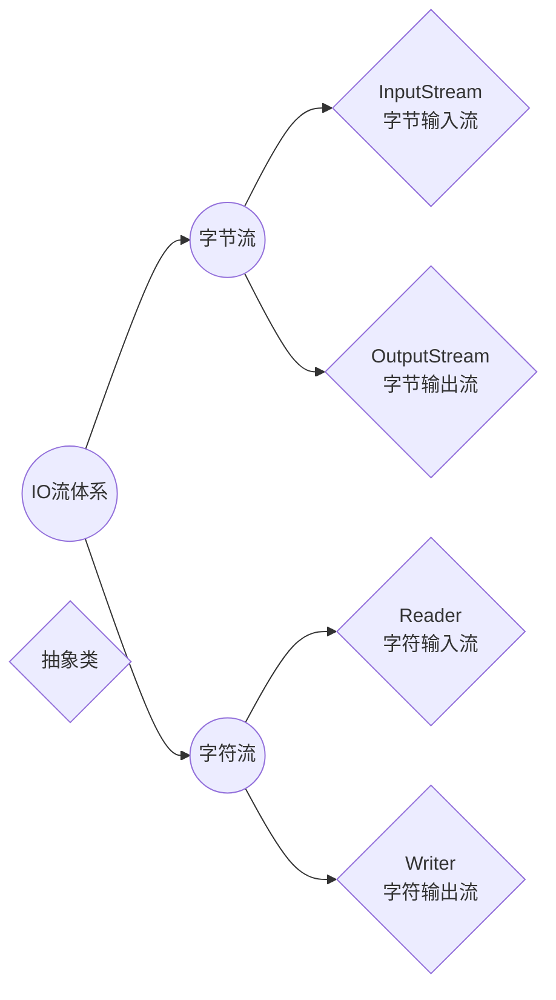
### 基本流
#### 字节流
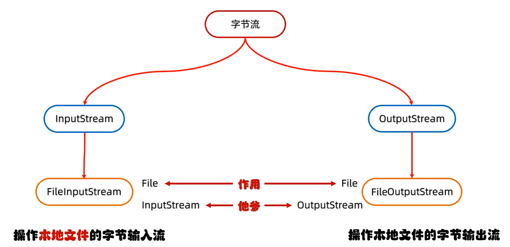
##### 字节输出流
###### 创建对象
```java
FileOutputStream fos = new FileOutputStream("xxx",true/false);

注意：
1.参数是字符串表示的路径或File对象
2.若文件不存在会创建一个新的文件，但是要保证文件的父级路径是存在的
3.若文件已经存在，则会清空文件
4.第二个参数表示是否续写，默认false
```
###### 写出数据
```java
fos.write(int b);                       一次写一个字节数据
fos.write(byte[] b);                    一次写一个字节数组数据
fos.write(byte[] b,int off,int len );   一次写一个字节数组的部分数据（off起始索引，len个数）

注意：
write方法的参数是整数，但实际上写到文件中的是ASCII表上对应的字符
```
###### 释放资源
```java
fos.close();

注意：
每次使用完流后必须要释放资源
```
###### 换行书写
```java
String str = "\r\n";
byte bytes = str.getByte();
write(bytes);
```

***
##### 字节输入流
##### 创建对象
```java
FileInputStream fis = new FileInputStream("xxx");

注意：若文件不存在，直接报错
```
###### 读取数据
```java
int b1 = fis.read();
sout(b1);

int b2;
while((b2 = fis.read()) != -1){
	sout((char)b);
}

重载：read(byte[] buffer)    一次读一个字节数组的数据
int len;
byte[] bytes = new bytep[2];//长度通常为1024整数倍，例1024*1024*5（5MB）
len = fis.read(bytes);
sout(new String(bytes,0,len));

注意：
1.一次读一个字节，读出来的是数据在ASCII表上对应的数字
2.读到文件末尾，read方法返回-1
3.read()函数与迭代器类似，读取完数据后指针后移一格。故使用循环时，要使用第三方变量记录
```
###### 释放资源
```java
fis.close();

注意：每次使用完流后要释放资源
```

#### 字符流
##### 字符输入流
格式与上文一致
```java
FileReader fr = new FileReader("xxx");

空参read():默认仍为一个字节一个字节的读取，在读取后进行解码转成十进制,返回一个int(需要强转)
int ch;
while((ch = fr,read()) != -1){
	sout((char)ch);
}

带参read(char[] biffer):将读取数据，解码，强转三部合并，将强转后的字符放入数组中
char[] chars = new char[2];
int len;
while((len = fr,read(char)) != -1){
	sout(new Sreing(chars,0,len));
}

fr.close;
```
##### 字符输出流
```java
FileWriter fw = new FileWriter("xxx",true/false);第二参数为续写开关

注意：
1.参数是字符串表示的路径或File对象
2.若文件不存在会新建一个文件，但其父级路径必须存在
3.想要续写就打开续写开关

void write(int c);                           写出一个字符
void write(String str);                      写出一个字符串
void write(String str,int off,int len);      写出一个字符串的一部分
void write(char[] cbuf);                     写出一个字符数组
void write(char[] cbuf,int off,int len);     写出字符串的一部分

注意：
若write方法的参数是整数，但实际上写到本地文件中的是整数在字符集上对应的字符
```
### 字符集
#### GBK
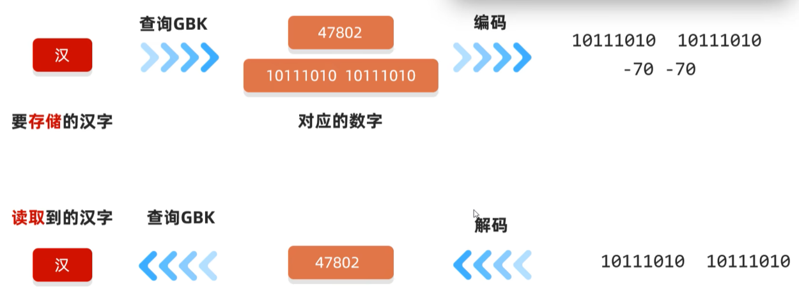
简中Windows中，默认使用GBK
GBK完全兼容ASCII字符集
##### 汉字存储规则
1. 两个字节存储一个汉字
2. 高位字节二进制一定以1开头，转成十进制后是一个负数
例：**1**0111010 10111010(汉)
##### 英文存储规则
1. 一个字节存储一个英文字母，兼容ASCII，二进制前面补0
例：**0**110001(a)
#### Unicode
常用UTF-8编码规则，用1~4个字节保存
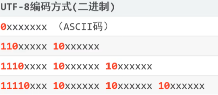
ASCII(1个字节),叙利亚文等(2个字节),简中日韩(3个字节),其他语言(4个字节)
#### 乱码
原因1：读取数据时未读完整个汉字，字节流一个字节一个字节读，而汉字有二/三个字节;
原因2：编码和解码时方式不统一
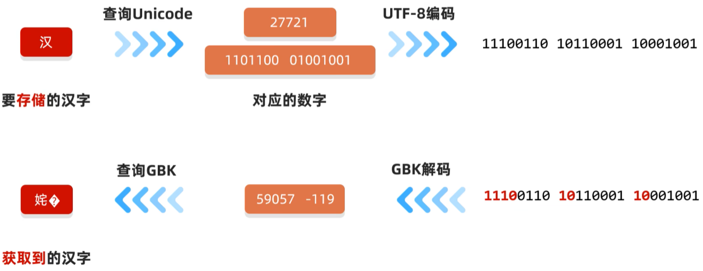
### 高级流
#### 缓冲流
##### 字节缓冲流
```java
public BufferedInputStream(InputStream is);
public BufferedOutputStream(OutputSteam os);

原理：底层自带了长度为8192字节(8k)的缓冲区提高性能
```
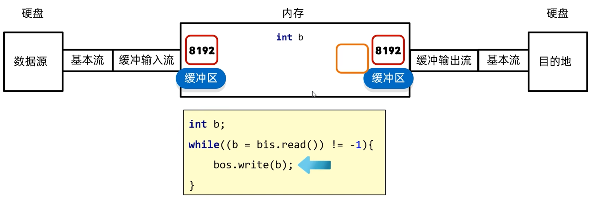
##### 字符缓冲流
```java
public BufferedReader(Reader r);
独有方法:
public String readLine();        读取一行数据，若无数据可读了，返回null

public BufferedWriter(Writer w);
独有方法:
public void newLine();           跨操作系统的换行
原理：底层自带了长度为8192字符(16k)的缓冲区提高性能
```

#### 转换流
是字符流和字节流之间的桥梁，其本质就是字符流
当字节流想用字符流中的方法就可以使用转换流
```java
public InputStreamReader(InputStream in);
public OutputStreamWriter(OutputStream out);
```
#### 序列化流
##### 序列化流/对象操作输出流
可以把Java中的对象写到本地文件中
```java
public ObjectOutputStream(OutputStream out);将基本流包装成高级流

成员方法：
public final void writObject(Object obj);把对象序列化(写出)到文件中去
```
##### 反序列化流/对象操作输入流
可以将序列化到本地文件中的对象，读取到程序中来
```java
public ObjectInputStream(Inputstream in);

成员方法：
public Object readObject();将序列化到本地文件中的对象，读取到程序中来
```
***
注意：
1. 使用对象输出流将对象保存到文件时会出现NotSerializableException异常，需要让Javabean类实现Serializable接口
2. 序列化流写到文件中的数据是不能修改的，一旦修改就无法再次读回
3. 若在序列化对象后，反序列化前修改了Javabean类，则需将版本号固定，在类中开头加上
```java
private static final long serialVersionUID = numberl;
```
4. 若不想讲Javabean类中的某一属性序列化，可加入瞬态关键字`transient`
其作用为：不会家那个当前属性序列化到本地文件中
例：
```java
private transient String name;
```
#### 打印流
一般指：PrintStream,PrintWriter两个类
打印流只操作文件目的地，不操作数据源
##### 字节打印流
默认自动刷新
```java
构造方法:
public PrintStream(OutputStream/File/String);                               关联字节输出流/文件/文件路径
public PrintStream(String fileName,Charset charset);                        指定字符编码
public PrintStream(OutputStream out,boolean autoFlush);                     自动刷新
public PrintStream(OutputStream out,boolean autoFlush,String encoding);     指定字符编码且自动刷新

成员方法:
public void write(int b);                              常规方法：规则跟之前一样，将指定的字节写出
public void println(Xxx xx);                           打印任意数据，自动刷新，自动换行
public void print(Xxx xx);                             打印任意数据，不换行
public void printf(String format,Object... args);      带有占位符的打印语句，不换行
```
##### 字符打印流
想要自动刷新必须开启
```java
构造方法:
public PrintWriter(OutputStream/File/String);                               关联字节输出流/文件/文件路径
public PrintWriter(String fileName,Charset charset);                        指定字符编码
public PrintWriter(OutputStream out,boolean autoFlush);                     自动刷新
public PrintWriter(OutputStream out,boolean autoFlush,String encoding);     指定字符编码且自动刷新
成员方法与上面一致
```
***
热知识：System.out.println 是一个特殊的打印流，他是系统中的标准输出流，是不能关闭在系统中是唯一的。此打印流在虚拟机启动时由虚拟机创建，默认指向控制台
#### 解压缩流/压缩流
压缩包里的每一个文件和文件夹实际上都是一个`Zipentry`对象
解压缩流：`ZipInpurStream`
成员方法：`getNextEntry`
压缩流：`ZipOutputSream`
***
#### Commons-io工具包
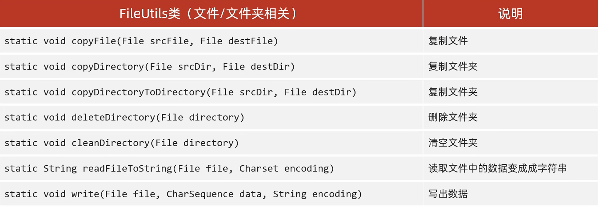
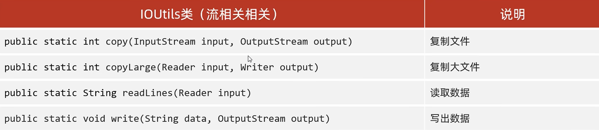
#### Hutool工具包
***

## 多线程
多个线程随机占领CPU的线程执行，使程序同时运行
### 并发和并行
并发：在同一时刻，有多个指令在单个CPU上交替执行
并行：在同一时刻，有多个指令在多个CPU上同时执行
### 多线程的三种实现方式
#### 继承Thread类
1. 自己定义一个类继承Thread
2. 重写run方法
3. 创建子类对象，并启动线程
```java
public class MyThread extends Thread{
	@Override
	public void run(){
		//书写线程执行代码
	}
}
public class Demo{
	public static void main(String[] args){
		MyThread t = new MyThread();
		t.start();
	}
}
```
***

#### 实现Runnable接口
1. 自己定义一个类实现Runnable接口
2. 重写其中的run方法
3. 创建自己类的对象
4. 创建一个Thread类的对象，并开启线程
```java
public class MyRun implements Runnable{
	@Override
	public void run(){
		//书写线程执行代码
	}
}
public class Demo{
	public static void main(String[] args){
		MyRun mr = new MyRun();
		Thread t = new Thread(mr);
		t.start();
	}
}
```
***

#### 利用Callable接口和Future接口
特点：可以获取到多线程运行的结果
1. 创建一个自己的类实现Callable接口
2. 重写call（是有返回值的，表示多线程运行的结果）
3. 创建自己类的对象（表示多线程要执行的任务）
4. 创建FutureTask的对象（作用管理多线程运行的结果）
5. 创建Thread类的对象，并启动（表示线程）
```java
public class Mycallable implements Callable<Integer>{
	@Override
	public Integer call(){
		//执行代码
		return aaa；
	}
}
public class Demo{
	public static void main(String[] args){
		MyCallable mc = new MyCallable();
		FutureTask<Integer> ft = new FutureTask<>(mc);
		Thread t = new Thread(ft);
		t.start();
		Integer rusult = ft.get();
		sout(result);
	}
}
```
***

### 成员方法
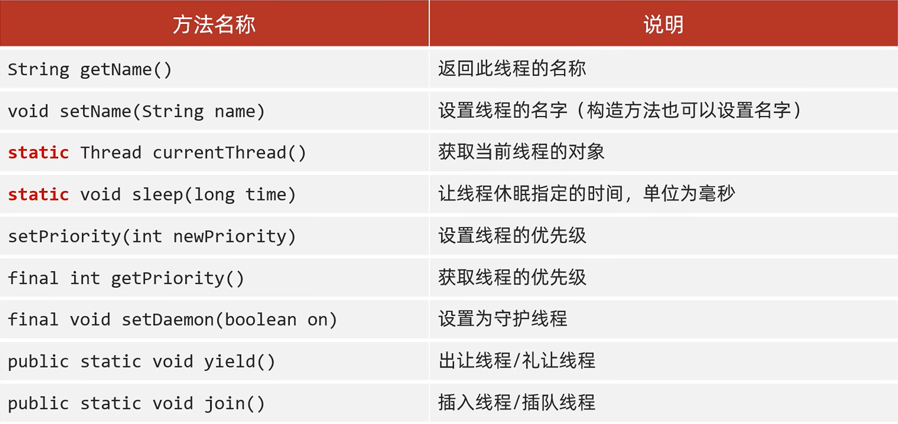
注意：
1. 守护线程（备胎）：当非守护线程执行完毕后，守护线程会陆续结束
2. 出让线程/礼让线程：表示出让当前CPU线程的执行权
3. 插入线程：将此线程插入到当前线程之前
### 生命周期
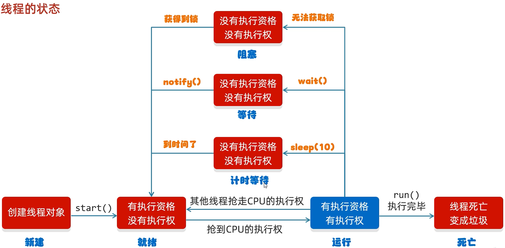
### 多线程数据的安全
#### 同步代码块
将操作共享数据的代码锁起来
```java
synchonized(锁对象){
	//操作共享代码块
}
```
注意：
1. 锁默认打开，与一个线程进去了，锁自动关闭
2. 里面的代码全部执行完毕，线程出来，锁自动打开
3. 要保证锁对象是唯一的（加static关键字），常用此类的字节码文件对象（类名.class）
***

#### 同步方法
将synchronized关键字加到方法上
```java
修饰符 synchronized 返回值类型 方法名(方法参数){...}
```
注意：
1. 同步方法是锁住方法里的所有代码
2. 锁对象不能自己指定（非静态：this；静态：当前类的字节码文件对象）
***

#### Lock锁
```java
Lock lock = new ReentrantLock();
lock.lock();上锁
lock.unlock();取锁
```
***

#### 等待唤醒机制
俗称生产者与消费者
方法(皆通过锁对象调用)：
```java
void wait();               使当前线程等待，直到被其他线程唤醒
void motify();             随机唤醒单个线程
void nitifyAll();          唤醒所有线程（常用）
```
##### 阻塞队列
###### 继承结构
接口：Iterable/Collection/Queue/BlockingQueue
实现类：
1. ArrayBlockingQueue：底层是数组，有界
2. LinkedBlockingQueue：底层是链表，几乎无界，最大为int的最大值

生产者和消费者必须使用同一个阻塞队列
###### 使用流程
1. 在线程运行类创建阻塞队列对象
```java
ArrayBlockingQueue<String> queue = new ArrayBlockingQueue<>(capacity);
```
2. 在每个线程实现类中利用构造方法将阻塞队列传入
```java
ArrayBlockingQueue<String> queue;
public 类名(ArrayBlockingQueue<String> queue){
	this.queue = queue;
}
```
3. 方法
```java
queue.put(String);
queue.take(String);
```
注意：方法中自带锁，无需再创建
***

### 线程池
#### 核心原理
1. 创建一个池子，池子中是空的
2. 提交任务时，池子会创建新的线程对象，任务执行完毕，线程归还给线程池，下次再提交任务时，不需要创建新的线程，直接服用已有线程即可
3. 但若提交任务时，池子中没有空闲的线程，也无法创建新的线程，任务就会排队等待

#### 基本流程
```java
public static ExecutorService newCachedThreaPool();               创建一个几乎无上限的线程池
public static ExecutorService newFixedThreadPool(int nThreads);   创建有上限的线程池

//1.获取线程池对象
ExecutorService pool1 = Executors.newCachedThreadPool();
//2.提交任务
pool1.submit(new Class());
//3.销毁线程池
pool1.shutdown();
```
#### 自定义线程池
```java
ThreadPoolExecutor threadPoolExecutor = new ThreadPoolExecutor
(核心线程数量，最大线程数量，空闲线程最大存活时间，时间单位，任务队列，创建线程工厂，任务的拒绝策略);

参数一：不能小于0
参数二：不能小于等于0，最大数量>=核心线程数量
参数三：不能小于0
参数四：用TimeUnit指定
参数五：不能为null
参数六：不能为null
参数七：不能为null

示例:
ThreadPoolExecutor pool = new ThreadPoolExecutor(
	3,
	6,
	60,
	TimeUnit.SECONDS,
	new ArrayBlockingQueue<>(3),
	Executor.defaultThreadFactory(),
	new ThreadPoolExecutor.AbortPolicy()
);

注意:
任务提交顺序为：核心线程->任务等待队列->临时线程(总线程-核心线程)->拒绝
```
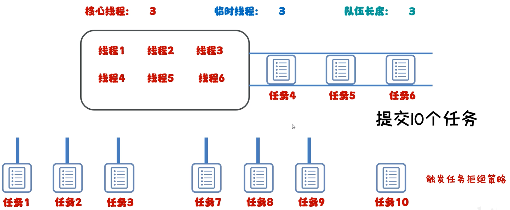
##### 拒绝策略*
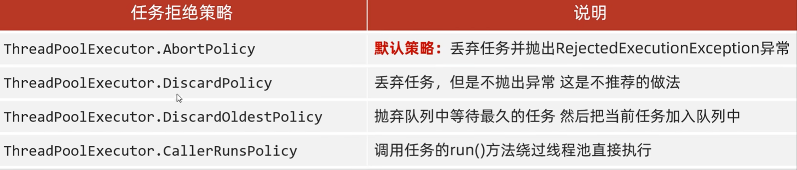
## 网络编程
### BS/CS架构的优缺点
CS：客户端服务器模式需要开发客户端，适合定制专业化的软件，IDEA网游等
BS：浏览器服务端模式不需要开发客户端，适合移动互联网应用，可以在任何地方随时访问的系统
### 网编三要素
1. IP：设备在网络中的地址，是唯一标识(127.0.0.1永远表示本机)
2. 端口号：应用程序在设备中的唯一标识
3. 协议：数据在网络中的传输规则，常见协议有UDP,TCP,http,https,ftp
### IP
```java
static InetAddress getByName(String host)
确定主机名称的IP地址，主机名称可以是机器名称，也可以是IP地址

String getHostName()
获取此IP地址的主机名

String getHostAddress()
返回文本显示中的IP地址字符串

InetAddress address = InetAddress.getByName("XXX");
String name = address.getHostName();
String ip = address.getHostAddress();
```

### 字符集
#### GBK

简中Windows中，默认使用GBK
GBK完全兼容ASCII字符集
##### 汉字存储规则
1. 两个字节存储一个汉字
2. 高位字节二进制一定以1开头，转成十进制后是一个负数
例：**1**0111010 10111010(汉)
##### 英文存储规则
1. 一个字节存储一个英文字母，兼容ASCII，二进制前面补0
例：**0**110001(a)
#### Unicode
常用UTF-8编码规则，用1~4个字节保存

ASCII(1个字节),叙利亚文等(2个字节),简中日韩(3个字节),其他语言(4个字节)
#### 乱码
原因1：读取数据时未读完整个汉字，字节流一个字节一个字节读，而汉字有二/三个字节;
原因2：编码和解码时方式不统一


### 字符流
#### 字符输入流
格式与上文一致
```java
FileReader fr = new FileReader("xxx");

空参read():默认仍为一个字节一个字节的读取，在读取后进行解码转成十进制,返回一个int,需要强转
int ch;
while((ch = fr,read()) != -1){
	sout((char)ch);
}

带参read(char[] biffer):将读取数据，解码，强转三部合并，将强转后的字符放入数组中
char[] chars = new char[2];
int len;
while((len = fr,read(char)) != -1){
	sout(new Sreing(chars,0,len));
}

fr,close;
```

