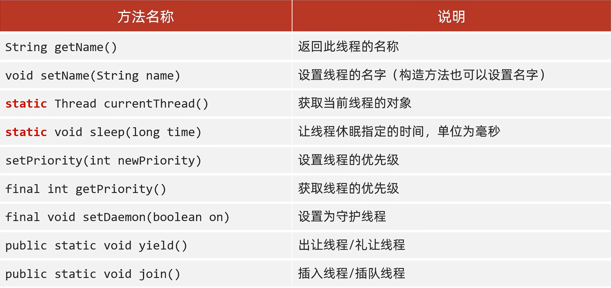
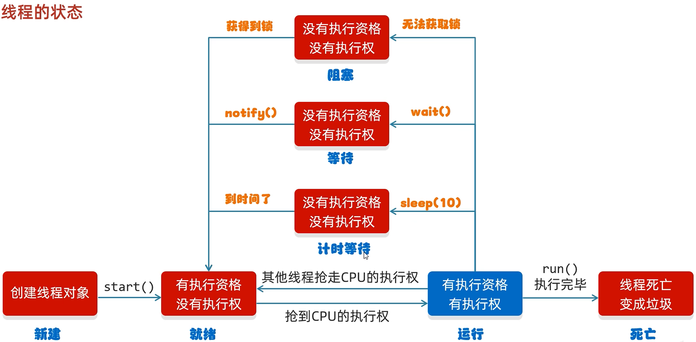
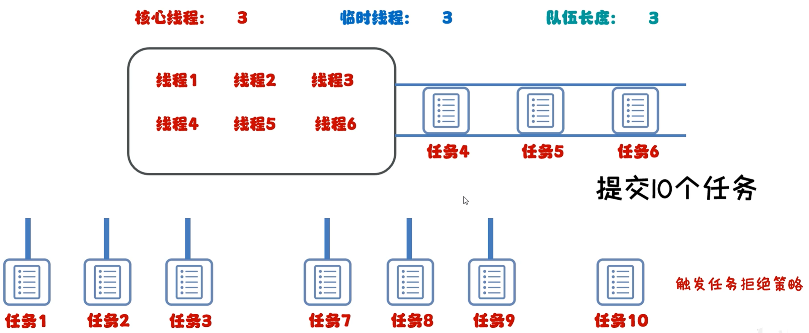
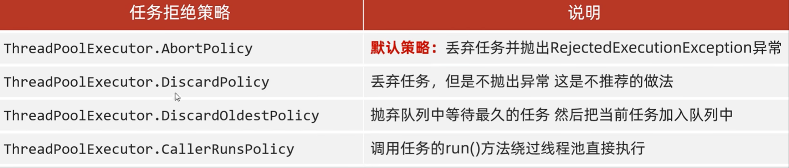

---
tags:
  - Java
  - 多线程基础
---

# 多线程

多个线程随机占领CPU的线程执行，使程序同时运行
## 并发和并行
并发：在同一时刻，有多个指令在单个CPU上交替执行
并行：在同一时刻，有多个指令在多个CPU上同时执行
## 多线程的三种实现方式
### 继承Thread类
1. 自己定义一个类继承Thread
2. 重写run方法
3. 创建子类对象，并启动线程
```java
public class MyThread extends Thread{
	@Override
	public void run(){
		//书写线程执行代码
	}
}
public class Demo{
	public static void main(String[] args){
		MyThread t = new MyThread();
		t.start();
	}
}
```
***

### 实现Runnable接口
1. 自己定义一个类实现Runnable接口
2. 重写其中的run方法
3. 创建自己类的对象
4. 创建一个Thread类的对象，并开启线程
```java
public class MyRun implements Runnable{
	@Override
	public void run(){
		//书写线程执行代码
	}
}
public class Demo{
	public static void main(String[] args){
		MyRun mr = new MyRun();
		Thread t = new Thread(mr);
		t.start();
	}
}
```
***

### 利用Callable接口和Future接口
特点：可以获取到多线程运行的结果
1. 创建一个自己的类实现Callable接口
2. 重写call（是有返回值的，表示多线程运行的结果）
3. 创建自己类的对象（表示多线程要执行的任务）
4. 创建FutureTask的对象（作用管理多线程运行的结果）
5. 创建Thread类的对象，并启动（表示线程）
```java
public class Mycallable implements Callable<Integer>{
	@Override
	public Integer call(){
		//执行代码
		return aaa；
	}
}
public class Demo{
	public static void main(String[] args){
		MyCallable mc = new MyCallable();
		FutureTask<Integer> ft = new FutureTask<>(mc);
		Thread t = new Thread(ft);
		t.start();
		Integer rusult = ft.get();
		sout(result);
	}
}
```
***

## 成员方法

注意：
1. 守护线程（备胎）：当非守护线程执行完毕后，守护线程会陆续结束
2. 出让线程/礼让线程：表示出让当前CPU线程的执行权
3. 插入线程：将此线程插入到当前线程之前
## 生命周期

## 多线程数据的安全
### 同步代码块
将操作共享数据的代码锁起来
```java
synchonized(锁对象){
	//操作共享代码块
}
```
注意：
1. 锁默认打开，与一个线程进去了，锁自动关闭
2. 里面的代码全部执行完毕，线程出来，锁自动打开
3. 要保证锁对象是唯一的（加static关键字），常用此类的字节码文件对象（类名.class）
***

### 同步方法
将synchronized关键字加到方法上
```java
修饰符 synchronized 返回值类型 方法名(方法参数){...}
```
注意：
1. 同步方法是锁住方法里的所有代码
2. 锁对象不能自己指定（非静态：this；静态：当前类的字节码文件对象）
***

### Lock锁
```java
Lock lock = new ReentrantLock();
lock.lock();上锁
lock.unlock();取锁
```
***

### 等待唤醒机制
俗称生产者与消费者
方法(皆通过锁对象调用)：
```java
void wait();               使当前线程等待，直到被其他线程唤醒
void motify();             随机唤醒单个线程
void nitifyAll();          唤醒所有线程（常用）
```
#### 阻塞队列
##### 继承结构
接口：Iterable/Collection/Queue/BlockingQueue
实现类：
1. ArrayBlockingQueue：底层是数组，有界
2. LinkedBlockingQueue：底层是链表，几乎无界，最大为int的最大值

生产者和消费者必须使用同一个阻塞队列
##### 使用流程
1. 在线程运行类创建阻塞队列对象
```java
ArrayBlockingQueue<String> queue = new ArrayBlockingQueue<>(capacity);
```
2. 在每个线程实现类中利用构造方法将阻塞队列传入
```java
ArrayBlockingQueue<String> queue;
public 类名(ArrayBlockingQueue<String> queue){
	this.queue = queue;
}
```
3. 方法
```java
queue.put(String);
queue.take(String);
```
注意：方法中自带锁，无需再创建
***

## 线程池
### 核心原理
1. 创建一个池子，池子中是空的
2. 提交任务时，池子会创建新的线程对象，任务执行完毕，线程归还给线程池，下次再提交任务时，不需要创建新的线程，直接服用已有线程即可
3. 但若提交任务时，池子中没有空闲的线程，也无法创建新的线程，任务就会排队等待

### 基本流程
```java
public static ExecutorService newCachedThreaPool();               创建一个几乎无上限的线程池
public static ExecutorService newFixedThreadPool(int nThreads);   创建有上限的线程池

//1.获取线程池对象
ExecutorService pool1 = Executors.newCachedThreadPool();
//2.提交任务
pool1.submit(new Class());
//3.销毁线程池
pool1.shutdown();
```
### 自定义线程池
```java
ThreadPoolExecutor threadPoolExecutor = new ThreadPoolExecutor
(核心线程数量，最大线程数量，空闲线程最大存活时间，时间单位，任务队列，创建线程工厂，任务的拒绝策略);

参数一：不能小于0
参数二：不能小于等于0，最大数量>=核心线程数量
参数三：不能小于0
参数四：用TimeUnit指定
参数五：不能为null
参数六：不能为null
参数七：不能为null

示例:
ThreadPoolExecutor pool = new ThreadPoolExecutor(
	3,
	6,
	60,
	TimeUnit.SECONDS,
	new ArrayBlockingQueue<>(3),
	Executor.defaultThreadFactory(),
	new ThreadPoolExecutor.AbortPolicy()
);

注意:
任务提交顺序为：核心线程->任务等待队列->临时线程(总线程-核心线程)->拒绝
```

#### 拒绝策略*


## 相关笔记

- [[线程状态]]
- [[线程池]]

