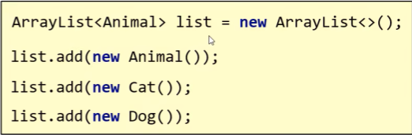

---
tags:
  - Java
  - 泛型
---

# 泛型

可以在编译阶段约束操作的数据类型，并进行检查；

Java里的泛型是伪泛型，底层是仅在入口出增加一层检查机制，目的是统一集合合的数据类型；而在集合内数据仍被当做Object类型处理；当集合内数据向外获取时，再将数据强转为泛型。
### 细节
1. 泛型中不能写基本数据类型，必须写其包装类型
2. 指定泛型的具体类型后，传递数据时，可以传入该类型或其子类类型

3. 集合类型默认为Object
## 泛型类
当类的类型不确定时，其可以定义为泛型类
常用‘E’‘V’等
当创建对象时，必须规定一个类型，否则默认为Object
## 泛型方法
方法中形参类型不确定时
1. 使用类名后定义的泛型(所有方法都能用)
2. 在方法声明上定义自己的泛型(只有本方法能用)
```java
格式：
修饰符<类型>  返回值类型 方法名(类型 变量名){})
例如
public<T> void method(T t){
}
```
## 泛型接口
```java
格式：
修饰符 interface 接口名<类型>{}
例如
public interface List<E>{
 }
```
 使用方法
 1. 实现类给出具体类型
 2. 实现类延续泛型，创建对象时在确定
## 继承与通配符
1. 泛型不具备继承性，泛型里写的什么类型，那么只能传递什么类型的数据，但是其数据有继承性
2. 当不确定类型，但是对类型的范围有限制时，可以使用泛型的通配符：
```java
?(表示不确定的类型)
? extends E:表示可以传递E或者E所有的子类类型
? super E:表示可以传递E或者E的所有父类类型
```

## 相关笔记

- [[集合]]

