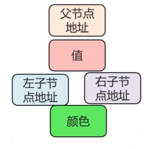
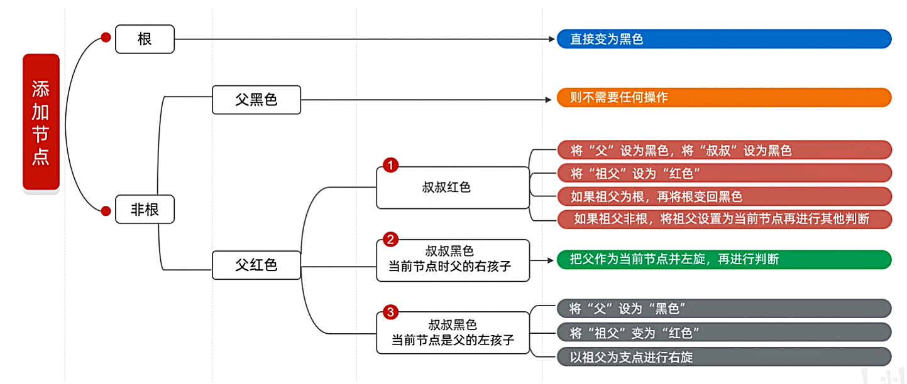

---
tags:
  - Java
  - 红黑树
---

# 红黑树

## 红黑规则
1. 每个节点或是红色，或是黑色
2. 根节点必须是黑色
3. 如果一个节点没有子节点或父节点，则该节点相对应的指针属性值为Nil，这些Nil视为叶节点，每个叶节点(Nil)是黑色的
4. 如果某个节点为红色，那么他的子节点必须是黑色(不能出现两个红色节点相连的情况)
5. 对每个节点，从该节点到其所有后代叶节点的简单路径上，均包含相同数目的黑色节点；
## 节点结构

## 节点添加规则

***

## 相关笔记

- [[集合]]

