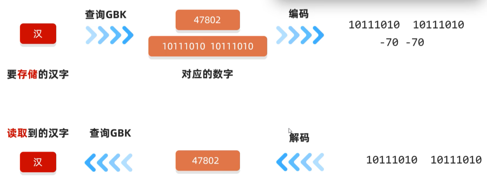
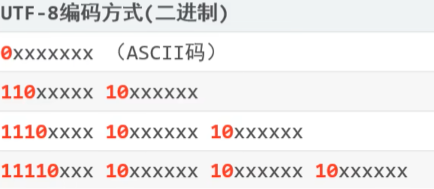
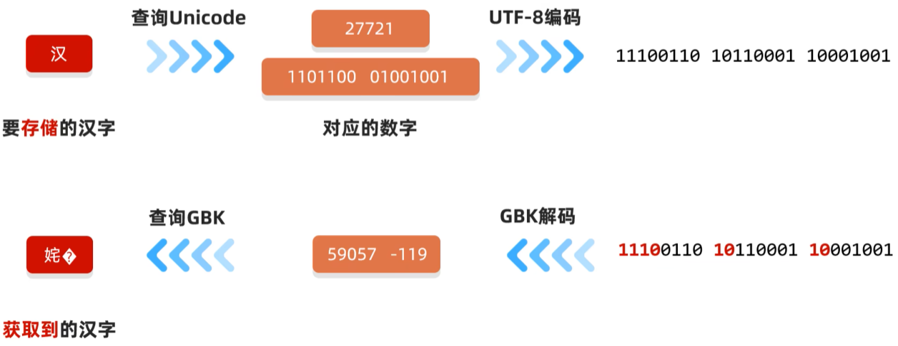

---
tags:
  - Java
  - 网络编程
---

# 网络编程

## BS/CS架构的优缺点
CS：客户端服务器模式需要开发客户端，适合定制专业化的软件，IDEA网游等
BS：浏览器服务端模式不需要开发客户端，适合移动互联网应用，可以在任何地方随时访问的系统
## 网编三要素
1. IP：设备在网络中的地址，是唯一标识(127.0.0.1永远表示本机)
2. 端口号：应用程序在设备中的唯一标识
3. 协议：数据在网络中的传输规则，常见协议有UDP,TCP,http,https,ftp
## IP
```java
static InetAddress getByName(String host)
确定主机名称的IP地址，主机名称可以是机器名称，也可以是IP地址

String getHostName()
获取此IP地址的主机名

String getHostAddress()
返回文本显示中的IP地址字符串

InetAddress address = InetAddress.getByName("XXX");
String name = address.getHostName();
String ip = address.getHostAddress();
```

## 字符集
### GBK

简中Windows中，默认使用GBK
GBK完全兼容ASCII字符集
#### 汉字存储规则
1. 两个字节存储一个汉字
2. 高位字节二进制一定以1开头，转成十进制后是一个负数
例：**1**0111010 10111010(汉)
#### 英文存储规则
1. 一个字节存储一个英文字母，兼容ASCII，二进制前面补0
例：**0**110001(a)
### Unicode
常用UTF-8编码规则，用1~4个字节保存

ASCII(1个字节),叙利亚文等(2个字节),简中日韩(3个字节),其他语言(4个字节)
### 乱码
原因1：读取数据时未读完整个汉字，字节流一个字节一个字节读，而汉字有二/三个字节;
原因2：编码和解码时方式不统一


## 字符流
### 字符输入流
格式与上文一致
```java
FileReader fr = new FileReader("xxx");

空参read():默认仍为一个字节一个字节的读取，在读取后进行解码转成十进制,返回一个int,需要强转
int ch;
while((ch = fr,read()) != -1){
	sout((char)ch);
}

带参read(char[] biffer):将读取数据，解码，强转三部合并，将强转后的字符放入数组中
char[] chars = new char[2];
int len;
while((len = fr,read(char)) != -1){
	sout(new Sreing(chars,0,len));
}

fr,close;
```

## 相关笔记

- [[IO流]]

