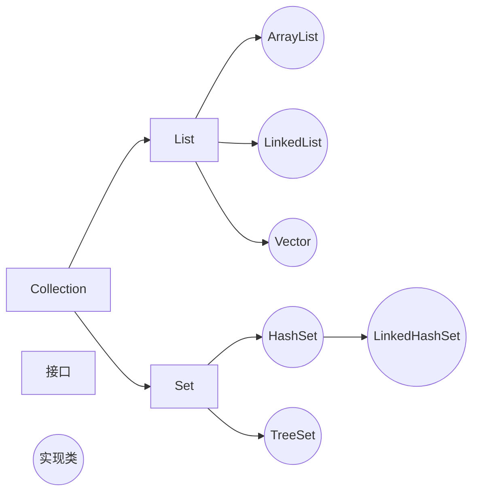
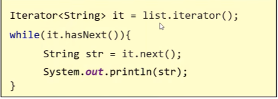
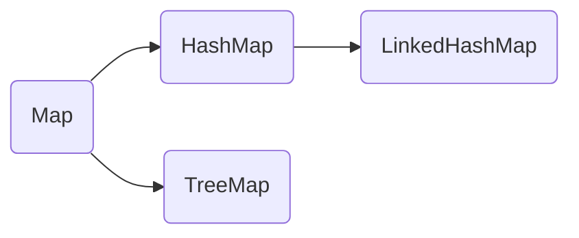
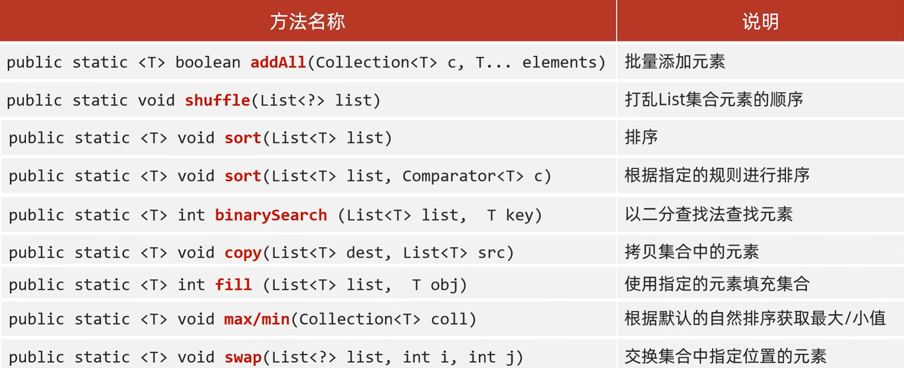

---
tags:
  - Java
  - 集合
---

# 集合

## 单列集合Collection
### 结构


***
### 常见成员方法
```java
add();添加指定元素
claer();清空集合中所有元素
remove();删除指定元素
contains();判断当前集合是否有指定元素
isEmpty();判断集合是否为空
size();返回集合长度/元素个数
```

***
### 通用遍历方法
#### 增强for遍历
增强for底层就是iterator迭代器，简化迭代器书写而出现
只有单列集合合数组才能用增强for遍历
```java
格式：
for(String s:list){
	System.out.println(s);
}
s位第三方变量，修改s并不能修改集合，循环过程中依次表示集合中的每一个数据
```
***
#### lambda表达式遍历
```java
遍历表达式：
list.forEach(s -> System.out.println(s));
```

***
#### 迭代器遍历
迭代器在遍历集合时是不依赖索引的，是通过创建指针病移动指针的方式获取集合的元素
##### 迭代器的方法

```java
name(集合名).iterator();获取迭代器对象
name(迭代器名).hasNext();判断当前指向的位置是否有元素
name(迭代器名).next();获取当前指向的元素并移动迭代器的指针至下一个
name(迭代器名).add("abc");在集合中向迭代器指向后添加元素
```
##### 细节
1. 如果当前位置无元素，仍要强行获取，会报错：NoSuchElementException
2. 迭代器遍历完毕，其指针不回复位，如仍想遍历，只好再创建一个迭代器对象
3. 循环中只能使用一次next方法
4. 迭代器遍历时，不能用集合的方法进行增加或删除
***
### List
#### 特点
数据元素有序，可重复，有索引
#### 方法
```java
Collection中所有方法

void add(int index,E element);在此集合中指定位置插入指定元素

E remove(int index);删除指定索引出的元素，返回被删元素
若删除元素值与索引数值相同，优先使用索引
原理：在调用方法时，如果出现了方法重载，优先调用，实参与形参一致的方法

E set(int index,E element)；修改指定索引处元素，返回呗修改的元素

E get(int index);返回索引处元素
```
***
#### ArrayList底层原理
1. 利用空参创建的集合，在底层创建一个默认长度为0的数组(名为elementData)
2. 添加第一个元素时，底层会创建一个新的长度为10的数组，生成一个变量size，指向第二个元素，添加下一个元素时在size处添加，并且调用size()方法时，返回size所在处索引
3. 存满时，会创建扩容1.5倍的新数组，并将老数组数据复制到新数组
4. 如果一次添加多个元素，1.5倍不够，则新创建的数组长度以实际为准
***
#### LinkedList集合
底层是双链表，查询慢，增删快，但如果操作元素为首尾元素，速度也极快
```java
特有方法：
public void addFirst(E e);在该列表开头插入指定元素
public void addLast(E e);将指定的元素追加到此列表的末尾
public E getFirst();返回第一个元素
public E getLast();返回最后一个元素
public E removeFirst();从列表中删除并返回第一个元素
public E removeLast();从列表中删除并返回最后一个元素
```
### Set
#### 特点
数据元素无序，不重复，无索引
HashSet:无序，不重复，无索引
LinkedHashSet:**有序**，不重复，无索引
TreeSet:**可排序**，不重复，无索引
***

#### 方法
基本与Collection的API一致
***

#### HashSet
底层采取**哈希表**存储数据
哈希表是一种对于增删改查数据性能都较好的结构
##### 哈希表组成
**数组+链表+红黑树**
##### 哈希值
根据hashCode方法算出的int类整数
该方法定义在Object类中，所有对象都可以调用，默认使用地址值进行计算
一般情况下，会重写hashCode方法，利用对象内部的属性值计算哈希值
##### 对象的哈希值特点
如果没有重写hashCode方法，不同对象计算出的哈希值是不同的
如果已经重写hashCode方法，不同对象只要属性值相同，计算出的哈希值就是一样的
在小部分情况下，不同的属性值或不同的地址值计算出来的哈希值也有可能一样(哈希碰撞)
##### 哈希表的底层原理
1. 创建一个默认长度为16，默认加载因子为0.75的数组，名为table
2. 根据元素的哈希值与数组长度计算出应存入的位置
3. 判断当前位置是否为null，如果是null，则直接存入
4. 如果不是null，表示有元素，则调用equals方法比较属性值
5. 一样：不存              不一样：存入数组，新元素直接挂在老元素下面（JDK8以后）形成链表
6. 当数组存了16*0.75（加载因子）=12个元素时，数组将扩容为两倍
7. 当链表长度**大于8**而且数组长度**大于等于64**时，当前链表将自动转为红黑树
如果集合中存储的是自定义对象，则**必须重写hashCode和equals**方法
***

#### LinkedHashSet
**有序**，不重复，无索引
有序：指保证存入和取出的顺序一致
##### 底层原理
底层数据结构依然是哈希表，只是每个元素又额外多了一个双向链表的机制记录存储的顺序
***

#### TreeSet
不重复，无索引，**可排序**
可排序：按照元素的默认规则（由小到大）排序
TreeSet集合底层是基于**红黑树**的数据结构实现排序的，增删改查的性能都较好
##### 集合默认的规则
对于数值类型：Integer，Double，默认按照从大到小的顺序进行排序
对于字符、字符串类型：按照字符在ASCII码中的数字升序进行排序
##### TreeSet的两种比较方法
默认用方法一，当方法一不能满足当前需求，使用方法二
##### 方法一
默认/自然排序：Javabean类实现Comparable接口指定比较规则
重写comparaTo方法
```java
例：
@Override
public int comparaTo(Student o){
	//指定排序规则
	//只看年龄，按年龄升序排列
	return this.getAge()-o.getAge();
}
	this:表示当前要添加的元素
	o:表示已经在红黑树存在的元素

	返回值：
		负数：认为要添加的元素是小的，存左边
		正数：认为要添加的元素是大的，存右边
		0：认为要添加的元素已经存在，舍弃
```
##### 方法二
比较器排序：创建TreeSet对象的时候，传递比较器Comparator指定规则
```java
例：
TreeSet<String> text=new TreeSet<>(new Comparator<String>(){
	@Override
	public int compare(String o1,String o2){
		//按照长度排序
		int i=o1.length()-o2.length();
		//如果长度一样按照首字母排序
		i=i==0?o1.comparaTo(o2):i;
		return i;
	}
};
//可改为lambda表达式
```
***

#### 应用场景
1. 元素可重复
	用**ArrayList**集合，基于数组（**用的最多**）
2. 元素可重复，且当前**增删操作明显多余查询**
	用**LinkedList**集合，基于链表
3. 元素要去重
	用**HashSet**集合，基于哈希表（**用的最多**）
4. 元素要去重，且**保证存取顺序**
	用**LinkedHashSet**集合，基于哈希表和双链表，效率低于HashSet
5. 要对元素进行排序
	用**TreeSet**集合，基于红黑树。后续可用List集合实现排序
***

## 双列集合Map
### 特点
1. 双列集合一次存一对数据，键和值
2. 键不能重复，值可以重复
3. 键和值是一一对应的，每个键只能找到自己对应的值
4. “值+键”的整体称之为“键值对（对象）”，Java中称之为“Entry对象”
***

### 结构

***

### 常见成员方法
Map是双列集合的顶层接口，它的功能是全部双列集合都可以继承使用的
```java
V put(K key,V value);添加(返回null)/覆盖(返回被覆盖的值)元素
V remove(Object key);根据键删除键值对元素，并返回值
void clear();移除所以的键值对元素
boolean containskey(Object key);判断集合是否包含指定的键
boolean containsvalue(Object value);判断集合是否包含指定的值
boolean isEmpty();判断集合是否为空
int size();返回集合长度，键值对个数
```
***

### 通用遍历方法
#### 键找值
```java
//获取所有键，将这些键放入一个单列集合中
Set<String> keys=map.keySet();
//遍历单列集合，得到每个键
for(String key:keys){
	//利用map集合中的键获取对应的值->.get()
	String value = map.get(key);
	干事
}
```
#### 通过键值对对象进行遍历
```java
//通过一个方法获取所有键值对对象，返回一个Set集合
Set<Map.Entry<String, String>> entries = map.entrySet();//嵌套泛型
//遍历entries这个集合，得到每一个键值对对象
for(Map.Entry<string, String> entry:entries){
	//利用entry调用get方法获取键和值
	String key = entry.getKey();
	String value = entry.getValue();
	干事
}
```
#### lambda表达式遍历
```java
map.forEach(new Biconsumer<string, String>(){
	@Override
	public void accept(String key,String vale){
		干事
	}
});
lambda:
map.forEach((key,value)-> 干事));
```
***

### HashMap
1. 方法与Map方法一致，无其他需要学习的特有方法
2. 功能由键决定，与值无关
3. HashMap底层原理是哈希表结构
依赖hashCode方法和equals方法保证**键的唯一**
若键存储的对象是自定义对象，则需重写hashCode和equals方法
若值，则无需重写

***
### LinkedHashMap
1. 方法与Map一致
2. 由键决定：**有序**，不重复，无索引
3. 有序指保证存入和取出的顺序一致
4. 底层数据结构依然是**哈希表**，只是每个键值对元素又额外多了一个双链表的记录机制记录存储的顺序

***
### TreeMap
1. 与TreeSet底层原理一致，都是红黑树结构
2. 由键决定：不重复，无索引，可排序
3. 可排序指对键进行排序
#### 代码书写两种排序规则
同上TreeSet：
1. 实现Comparable接口，指定比较规则
2. 创建集合时传递Comparator比较器对象，指定比较规则

## Collections 集合工具类
常见方法：



***

## 相关笔记

- [[泛型]]
- [[红黑树]]
- [[Stream流]]

