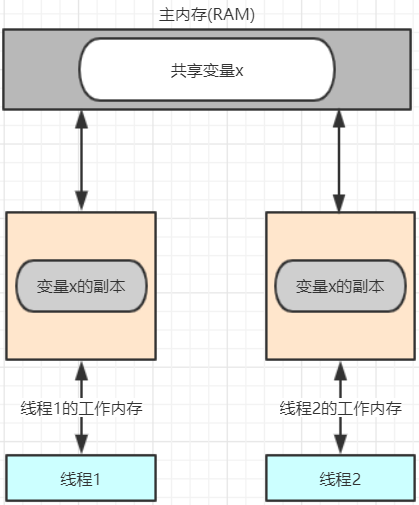
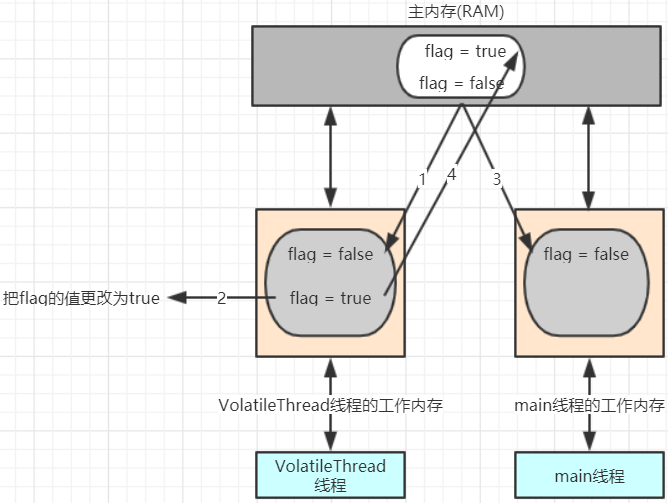
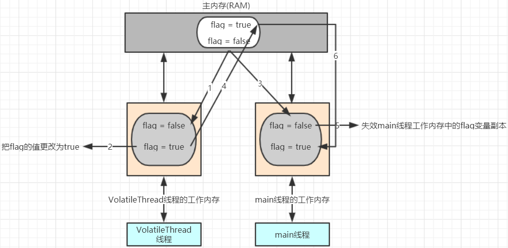

---
tags:
  - Java
  - volatile关键字
---

# 3 volatile关键字

## 3.1 看程序说结果

分析如下程序，说出在控制台的输出结果。

Thread的子类

```java
public class VolatileThread extends Thread {

    // 定义成员变量
    private boolean flag = false ;
    public boolean isFlag() { return flag;}

    @Override
    public void run() {

        // 线程休眠1秒
        try {
            Thread.sleep(1000);
        } catch (InterruptedException e) {
            e.printStackTrace();
        }

        // 将flag的值更改为true
        this.flag = true ;
        System.out.println("flag=" + flag);

    }
}
```

测试类

```java
public class VolatileThreadDemo01 {

    public static void main(String[] args) {

        // 创建VolatileThread线程对象
        VolatileThread volatileThread = new VolatileThread() ;
        volatileThread.start();

        // 在main线程中获取开启的线程中flag的值
        while(true) {
            System.out.println("main线程中获取开启的线程中flag的值为" + volatileThread.isFlag());
        }

    }
}
```

控制台输出结果

```java
前面是false，过了一段时间之后就变成了true
```

按照我们的分析，当我们把volatileThread线程启动起来以后，那么volatileThread线程开始执行。在volatileThread线程的run方法中，线程休眠1s，休眠一秒以后那么flag的值应该为

true，此时我们在主线程中不停的获取flag的值。发现前面释放false，后面是true

信息，那么这是为什么呢？要想知道原因，那么我们就需要学习一下JMM。

## 3.2 JMM

概述：JMM(Java Memory Model)Java内存模型,是java虚拟机规范中所定义的一种内存模型。

Java内存模型(Java Memory Model)描述了Java程序中各种变量(线程共享变量)的访问规则，以及在JVM中将变量存储到内存和从内存中读取变量这样的底层细节。

特点：

1. 所有的共享变量都存储于主内存(计算机的RAM)这里所说的变量指的是实例变量和类变量。不包含局部变量，因为局部变量是线程私有的，因此不存在竞争问题。

2. 每一个线程还存在自己的工作内存，线程的工作内存，保留了被线程使用的变量的工作副本。

3. 线程对变量的所有的操作(读，写)都必须在工作内存中完成，而不能直接读写主内存中的变量，不同线程之间也不能直接访问对方工作内存中的变量，线程间变量的值的传递需要通过主

   内存完成。



## 3.3 问题分析

了解了一下JMM,那么接下来我们就来分析一下上述程序产生问题的原因。



产生问题的流程分析：

1. VolatileThread线程从主内存读取到数据放入其对应的工作内存

2. 将flag的值更改为true，但是这个时候flag的值还没有回写主内存

3. 此时main线程读取到了flag的值并将其放入到自己的工作内存中，此时flag的值为false

4. VolatileThread线程将flag的值写回到主内存，但是main函数里面的while(true)调用的是系统比较底层的代码，速度快，快到没有时间再去读取主内存中的值，所以while(true)

   读取到的值一直是false。(如果有一个时刻main线程从主内存中读取到了flag的最新值，那么if语句就可以执行，main线程何时从主内存中读取最新的值，我们无法控制)

我们可以让主线程执行慢一点，执行慢一点以后，在某一个时刻，可能就会读取到主内存中最新的flag的值，那么if语句就可以进行执行。

测试类

```java
public class VolatileThreadDemo02 {

    public static void main(String[] args) throws InterruptedException {

        // 创建VolatileThread线程对象
        VolatileThread volatileThread = new VolatileThread() ;
        volatileThread.start();

        // main方法
        while(true) {
            if(volatileThread.isFlag()) {
                System.out.println("执行了======");
            }

            // 让线程休眠100毫秒
            TimeUnit.MILLISECONDS.sleep(100);
        }

    }
}
```

控制台输出结果

```java
flag=true
执行了======
执行了======
执行了======
....
```

此时我们可以看到if语句已经执行了。当然我们在真实开发中可能不能使用这种方式来处理这个问题，那么这个问题应该怎么处理呢？我们就需要学习下一小节的内容。

## 3.4 问题处理

### 3.4.1 加锁

第一种处理方案，我们可以通过加锁的方式进行处理。

测试类

```java
public class VolatileThreadDemo03 {

    public static void main(String[] args) throws InterruptedException {

        // 创建VolatileThread线程对象
        VolatileThread volatileThread = new VolatileThread() ;
        volatileThread.start();

        // main方法
        while(true) {

            // 加锁进行问题处理
            synchronized (volatileThread) {
                if(volatileThread.isFlag()) {
                    System.out.println("执行了======");
                }
            }

        }

    }
}
```

控制台输出结果

```java
flag=true
执行了======
执行了======
执行了======
....
```


工作原理说明

对上述代码加锁完毕以后，某一个线程支持该程序的过程如下：

a.线程获得锁

b.清空工作内存

c.从主内存拷贝共享变量最新的值到工作内存成为副本

d.执行代码

e.将修改后的副本的值刷新回主内存中

f.线程释放锁

### 3.4.2 volatile关键字

第二种处理方案，我们可以通过volatile关键字来修饰flag变量。

线程类

```java
public class VolatileThread extends Thread {

    // 定义成员变量
    private volatile boolean flag = false ;
    public boolean isFlag() { return flag;}

    @Override
    public void run() {

        // 线程休眠1秒
        try {
            Thread.sleep(1000);
        } catch (InterruptedException e) {
            e.printStackTrace();
        }

        // 将flag的值更改为true
        this.flag = true ;
        System.out.println("flag=" + flag);

    }
}
//--------------------------------更新之后的案例-------------------------------------------
public class VolatileTest extends Thread{
    boolean flag = false;
    int i = 0;

    public void run() {
        while (!flag) {
            i++;
        }
        System.out.println("stope" + i);
    }

    public static void main(String[] args) throws Exception {
        VolatileTest vt = new VolatileTest();
        vt.start();

        Thread.sleep(10);
        vt.flag = true;

    }
}
```

控制台输出结果

```java
flag=true
执行了======
执行了======
执行了======
....
```


工作原理说明



执行流程分析

1. VolatileThread线程从主内存读取到数据放入其对应的工作内存
2. 将flag的值更改为true，但是这个时候flag的值还没有回写主内存
3. 此时main线程读取到了flag的值并将其放入到自己的工作内存中，此时flag的值为false
4. VolatileThread线程将flag的值写到主内存
5. main线程工作内存中的flag变量副本失效
6. main线程再次使用flag时，main线程会从主内存读取最新的值，放入到工作内存中，然后在进行使用


总结： volatile保证不同线程对共享变量操作的可见性，也就是说一个线程修改了volatile修饰的变量，当修改写回主内存时，另外一个线程立即看到最新的值。

​      但是volatile不保证原子性(关于原子性问题，我们在下面的小节中会介绍)。


volatile与synchronized的区别：

1. volatile只能修饰实例变量和类变量，而synchronized可以修饰方法，以及代码块。

2. volatile保证数据的可见性，但是不保证原子性(多线程进行写操作，不保证线程安全);而synchronized是一种排他（互斥）的机制(因此有时我们也将synchronized这种锁称

   之为排他（互斥）锁)，synchronized修饰的代码块，被修饰的代码块称之为同步代码块，无法被中断可以保证原子性，也可以间接的保证可见性。

## 相关笔记

- [[原子性]]

