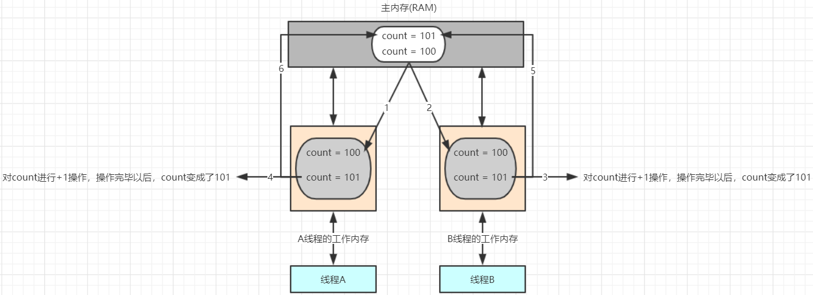
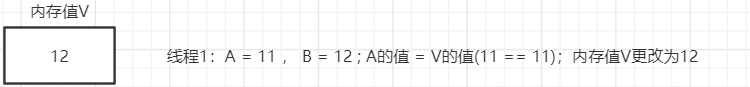

---
tags:
  - Java
  - 原子性
---

# 4 原子性

概述：所谓的原子性是指在一次操作或者多次操作中，要么所有的操作全部都得到了执行并且不会受到任何因素的干扰而中断，要么所有的操作都不执行，多个操作是一个不可以分割的整体。

//比如说：你喂你女朋友吃冰淇淋，如果没有女朋友，你就假想一下，实在不行，你就喂你旁边的哥们吃一口冰淇淋。这就是一个不可分割的整体，一个是你喂，一个是她吃。这就是一个整体，如果没有她吃，那么你喂就没有意义，如果没有你喂，她吃就没有意义。

//比如：从张三的账户给李四的账户转1000元，这个动作将包含两个基本的操作：从张三的账户扣除1000元，给李四的账户增加1000元。这两个操作必须符合原子性的要求，要么都成功要么

都失败。

## 4.1 看程序说结果

分析如下程序的执行结果

线程类

```java
public class VolatileAtomicThread implements Runnable {

    // 定义一个int类型的变量
    private int count = 0 ;

    @Override
    public void run() {

        // 对该变量进行++操作，100次
        for(int x = 0 ; x < 100 ; x++) {
            count++ ;
            System.out.println("冰淇淋的个数 =========>>>> " + count);
        }

    }

}
```

测试类

```java
public class VolatileAtomicThreadDemo {

    public static void main(String[] args) {

        // 创建VolatileAtomicThread对象
        VolatileAtomicThread volatileAtomicThread = new VolatileAtomicThread() ;

        // 开启100个线程对count进行++操作
        for(int x = 0 ; x < 100 ; x++) {
            new Thread(volatileAtomicThread).start();
        }

    }

}
```

程序分析：我们在主线程中通过for循环启动了100个线程，每一个线程都会对VolatileAtomicThread类中的count加100次。那么直接结果应该是10000。但是真正的执行结果和我们分析

的是否一样呢？运行程序(多运行几次)，查看控制台输出结果

```java
....
count =========>>>> 9997
count =========>>>> 9998
count =========>>>> 9999
```

通过控制台的输出，我们可以看到最终count的结果可能并不是10000。接下来我们就来分析一下问题产生的原因。

## 4.2 问题分析说明

以上问题主要是发生在count++操作上：

count++操作包含3个步骤：

- 从主内存中读取数据到工作内存
- 对工作内存中的数据进行++操作
- 将工作内存中的数据写回到主内存

count++操作不是一个原子性操作，也就是说在某一个时刻对某一个操作的执行，有可能被其他的线程打断。



产生问题的执行流程分析：

1. 假设此时count的值是100，线程A需要对改变量进行自增1的操作，首先它需要从主内存中读取变量count的值。由于CPU的切换关系，此时CPU的执行权被切换到了B线程。A线程就处

   于就绪状态，B线程处于运行状态。

2. 线程B也需要从主内存中读取count变量的值,由于线程A没有对count值做任何修改因此此时B读取到的数据还是100

3. 线程B工作内存中对count执行了+1操作，但是未刷新之主内存中

4. 此时CPU的执行权切换到了A线程上，由于此时线程B没有将工作内存中的数据刷新到主内存，因此A线程工作内存中的变量值还是100，没有失效。A线程对工作内存中的数据进行了+1操作。

5. 线程B将101写入到主内存
6. 线程A将101写入到主内存

虽然计算了2次，但是只对A进行了1次修改。

## 4.3 volatile原子性测试

我们刚才说到了volatile在多线程环境下只保证了共享变量在多个线程间的可见性，但是不保证原子性。那么接下来我们就来做一个测试。测试的思想，就是使用volatile修饰count。

线程类

```java
public class VolatileAtomicThread implements Runnable {

    // 定义一个int类型的变量,并且使用volatile修饰
    private volatile int count = 0 ;

    @Override
    public void run() {

        // 对该变量进行++操作，100次
        for(int x = 0 ; x < 100 ; x++) {
            count++ ;
            System.out.println("count =========>>>> " + count);
        }

    }

}
```

控制台输出结果(需要运行多次)

```java
...
count =========>>>> 9997
count =========>>>> 9998
count =========>>>> 9999
```

通过控制台结果的输出，我们可以看到程序还是会出现问题。因此也就证明volatile关键字是不保证原子性的。

## 4.4 volatile使用场景

volatile关键字不保证原子性操作，那么同学们可能会存在一些疑问，volatile关键字在什么情况下进行使用呢？这里我们举两个基本的使用场景。

### 4.4.1 状态标志

比如现在存在一个线程不断向控制台输出一段话"传智播客中国IT教育的标杆....",当这个线程执行5秒以后，将该线程结束。

实现思路：定义一个boolean类型的变量，这个变量就相当于一个标志。当这个变量的值为true的时候，线程一直执行，10秒以后我们把这个变量的值更改为false，此时结束该线程的执行。

为了保证一个线程对这个变量的修改，另外一个线程立马可以看到，这个变量就需要通过volatile关键字进行修饰。

线程类

```java
public class VolatileUseThread implements Runnable {

    // 定义标志变量
    private volatile boolean shutdown = false ;

    @Override
    public void run() {

        while(!shutdown) {
            System.out.println("传智播客中国IT教育的标杆....");
        }

    }

    // 关闭线程
    public void shutdown() {
        this.shutdown = true ;
    }

}
```

测试类

```java
public class VolatileUseThreadDemo01 {

    public static void main(String[] args) throws InterruptedException {

        // 创建线程任务类对象
        VolatileUseThread volatileUseThread = new VolatileUseThread() ;

        // 创建线程对象
        Thread thread = new Thread(volatileUseThread);

        // 启动线程
        thread.start();

        // 主线程休眠
        TimeUnit.SECONDS.sleep(5);

        // 关闭线程
        volatileUseThread.shutdown();

    }

}
```

观察控制台输出，volatileUseThread线程执行5秒以后程序结束。

### 4.4.2 独立观察

//AI养猪。。。。

//设备区测量温度

//当温度高了。。。需要给猪开空调。。。加冰棍。。。加喝的水。。。


volatile的另一种简单使用场景是：定期"发布"观察结果供程序内部使用。例如，假设有一种环境传感器能够感觉环境温度。一个后台线程可能会每隔几秒读取一次该传感器数据，并更新包

含这个volatile变量的值。然后，其他线程可以读取这个变量，从而随时能够看到最新的温度值。这种使用就是多个线程操作共享变量，但是是有一个线程对其进行写操作，其他的线程都是读。

我们可以设计一个程序，模拟上面的温度传感器案例。

实现步说明

1. 定义一个温度传感器(TemperatureSensor)的类,在该类中定义两个成员变量(temperature(温度值)，type(传感器的类型))，temperature变量需要被volatile修饰
2. 定义一个读取温度传感器的线程的任务类(ReadTemperatureRunnable)，该类需要定义一个TemperatureSensor类型的成员变量(该线程需要读取温度传感器的数据)
3. 定义一个定时采集温度的线程任务类(GatherTemperatureRunnable)，该类需要定义一个TemperatureSensor类型的成员变量(该线程需要将读到的温度设置给传感器)

4. 创建测试类(TemperatureSensorDemo)
   1. 创建TemperatureSensor对象
   2. 创建ReadTemperatureRunnable类对象，把TemperatureSensor作为构造方法的参数传递过来
   3. 创建GatherTemperatureRunnable类对象，把TemperatureSensor作为构造方法的参数传递过来
   4. 创建2个Thread对象，并启动，把第二步所创建的对象作为构造方法参数传递过来，这两个线程负责读取TemperatureSensor中的温度数据
   5. 创建1个Thread对象，并启动，把第三步所创建的对象作为构造方法参数传递过来，这个线程负责读取定时采集数据中的温度数据

TemperatureSensor类

```java
public class TemperatureSensor {        // 温度传感器类

    private volatile int temperature ;  // 温度值

    private String type ;               // 传感器的类型

    public int getTemperature() {
        return temperature;
    }

    public void setTemperature(int temperature) {
        this.temperature = temperature;
    }

    public String getType() {
        return type;
    }

    public void setType(String type) {
        this.type = type;
    }
}
```

ReadTemperatureRunnable类

```java
public class ReadTemperatureRunnable implements Runnable {

    // 温度传感器
    private TemperatureSensor temperatureSensor ;
    public ReadTemperatureRunnable(TemperatureSensor temperatureSensor) {
        this.temperatureSensor = temperatureSensor ;
    }

    @Override
    public void run() {

        // 不断的读取温度传感器中的数据
        while(true) {

            // 读取数据
            System.out.println(Thread.currentThread().getName() + "---读取到的温度数据为------>>> " + temperatureSensor.getTemperature());

            try {
                // 让线程休眠100毫秒，便于观察
                TimeUnit.MILLISECONDS.sleep(100);
            } catch (InterruptedException e) {
                e.printStackTrace();
            }

        }

    }

}
```

GatherTemperatureRunnable类

```java
public class GatherTemperatureRunnable implements Runnable {

    // 温度传感器
    private TemperatureSensor temperatureSensor ;
    public GatherTemperatureRunnable(TemperatureSensor temperatureSensor) {
        this.temperatureSensor = temperatureSensor ;
    }

    @Override
    public void run() {

        // 定义一个变量，表示环境初始温度
        int temperature = 23 ;

        // 不断进行数据采集
        while(true) {

            // 将采集到的数据设置给温度传感器
            System.out.println(Thread.currentThread().getName() + "-----采集到的数据为----->>> " + temperature);
            temperatureSensor.setTemperature(temperature);

            try {
                // 线程休眠2秒,模拟每隔两秒采集一次数据
                TimeUnit.SECONDS.sleep(2);
            } catch (InterruptedException e) {
                e.printStackTrace();
            }

            // 环境温度改变
            temperature += 2 ;

        }

    }

}
```

测试类

```java
public class TemperatureSensorDemo {

    public static void main(String[] args) {

        // 创建TemperatureSensor对象
        TemperatureSensor temperatureSensor = new TemperatureSensor();

        // 创建ReadTemperatureRunnable类对象
        ReadTemperatureRunnable readTemperatureRunnable = new ReadTemperatureRunnable(temperatureSensor) ;

        // 创建GatherTemperatureRunnable类对象
        GatherTemperatureRunnable gatherTemperatureRunnable = new GatherTemperatureRunnable(temperatureSensor) ;

        // 创建2个Thread对象，并启动; 这两个线程负责读取TemperatureSensor中的温度数据
        for(int x = 0 ; x < 2 ; x++) {
            new Thread(readTemperatureRunnable).start();
        }

        // 创建1个Thread对象，并启动，这个线程负责读取定时采集数据中的温度数据
        Thread gatherThread = new Thread(gatherTemperatureRunnable);
        gatherThread.setName("温度采集线程");
        gatherThread.start();

    }

}
```

控制台输出结果

```java
...
温度采集线程-----采集到的数据为----->>> 23
Thread-0---读取到的温度数据为------>>> 23
...
温度采集线程-----采集到的数据为----->>> 25
Thread-1---读取到的温度数据为------>>> 25
...
```

通过控制台的输出，我们可以看到当温度采集线程刚采集到环境温度以后，那么此时两个温度读取线程就可以立即感知到环境温度的变化。

## 4.5 问题处理

接下来我们就来讲解一下我们上述案例(引入原子性问题的案例)的解决方案。

### 4.5.1 锁机制

我们可以给count++操作添加锁，那么count++操作就是临界区中的代码，临界区中的代码一次只能被一个线程去执行，所以count++就变成了原子操作。

线程任务类

```java
public class VolatileAtomicThread implements Runnable {

    // 定义一个int类型的变量,
    private int count = 0 ;

    // 定义一个Object类型的变量，该变量将作为同步代码块的锁
    private Object obj = new Object();

    @Override
    public void run() {

        // 对该变量进行++操作，100次
        for(int x = 0 ; x < 100 ; x++) {
            synchronized (obj){
                count++ ;
                System.out.println("count =========>>>> " + count);
            }

        }

    }

}
```

控制台输出结果

```java
count =========>>>> 9998
count =========>>>> 9999
count =========>>>> 10000
```

### 4.5.2 原子类

#### 1) AtomicInteger

概述：java从JDK1.5开始提供了java.util.concurrent.atomic包(简称Atomic包)，这个包中的原子操作类提供了一种用法简单，性能高效，线程安全地更新一个变量的方式。因为变

量的类型有很多种，所以在Atomic包里一共提供了13个类，属于4种类型的原子更新方式，分别是原子更新基本类型、原子更新数组、原子更新引用和原子更新属性(字段)。本次我们只讲解

使用原子的方式更新基本类型，使用原子的方式更新基本类型Atomic包提供了以下3个类：

AtomicBoolean： 原子更新布尔类型

AtomicInteger： 原子更新整型

AtomicLong：	原子更新长整型

以上3个类提供的方法几乎一模一样，所以本节仅以AtomicInteger为例进行讲解，AtomicInteger的常用方法如下：

```java
public AtomicInteger()：	   				初始化一个默认值为0的原子型Integer
public AtomicInteger(int initialValue)： 初始化一个指定值的原子型Integer

int get():   			 				 获取值
int getAndIncrement():      			 以原子方式将当前值加1，注意，这里返回的是自增前的值。
int incrementAndGet():     				 以原子方式将当前值加1，注意，这里返回的是自增后的值。
int addAndGet(int data):				 以原子方式将输入的数值与实例中的值（AtomicInteger里的value）相加，并返回结果。
int getAndSet(int value):   			 以原子方式设置为newValue的值，并返回旧值。
```

案例演示AtomicInteger的基本使用：

```java
public class AtomicIntegerDemo01 {

    // 原子型Integer
    public static void main(String[] args) {

        // 构造方法
        // public AtomicInteger()：初始化一个默认值为0的原子型Integer
        // AtomicInteger atomicInteger = new AtomicInteger() ;
        // System.out.println(atomicInteger);

        // public AtomicInteger(int initialValue)： 初始化一个指定值的原子型Integer
        AtomicInteger atomicInteger = new AtomicInteger(5) ;
        System.out.println(atomicInteger);

        // 获取值
        System.out.println(atomicInteger.get());

        // 以原子方式将当前值加1，这里返回的是自增前的值
        System.out.println(atomicInteger.getAndIncrement());
        System.out.println(atomicInteger.get());

        // 以原子方式将当前值加1，这里返回的是自增后的值
        System.out.println(atomicInteger.incrementAndGet());

        // 以原子方式将输入的数值与实例中的值（AtomicInteger里的value）相加，并返回结果
        System.out.println(atomicInteger.addAndGet(8));

        // 以原子方式设置为newValue的值，并返回旧值
        System.out.println(atomicInteger.getAndSet(20));
        System.out.println(atomicInteger.get());

    }

}
```

#### 2) 案例改造

使用AtomicInteger对案例进行改造。

```java
public class VolatileAtomicThread implements Runnable {

    // 定义一个int类型的变量
    private AtomicInteger atomicInteger = new AtomicInteger() ;

    @Override
    public void run() {

        // 对该变量进行++操作，100次
        for(int x = 0 ; x < 100 ; x++) {
            int i = atomicInteger.incrementAndGet();
            System.out.println("count =========>>>> " + i);
        }

    }

}
```

控制台输出结果

````java
...
count =========>>>> 9998
count =========>>>> 9999
count =========>>>> 10000
````

通过控制台的执行结果，我们可以看到最终得到的结果就是10000，因此也就证明AtomicInteger所提供的方法是原子性操作方法。

## 4.6 AtomicInteger原理

### 4.6.1 原理介绍

AtomicInteger的本质：自旋锁 + CAS算法

CAS的全成是： Compare And Swap(比较再交换); 是现代CPU广泛支持的一种对内存中的共享数据进行操作的一种特殊指令。CAS可以将read-modify-write转换为原子操作，这个原子操作

直接由处理器保证。CAS有3个操作数，内存值V，旧的预期值A，要修改的新值B。当且仅当旧预期值A和内存值V相同时，将内存值V修改为B并返回true，否则什么都不做，并返回false。

举例说明：

1. 在内存值V当中，存储着值为10的变量。


2. 此时线程1想要把变量的值增加1。对线程1来说，旧的预期值 A = 10 ，要修改的新值 B = 11。


3. 在线程1要提交更新之前，另一个线程2抢先一步，把内存值V中的变量值率先更新成了11。


4. 线程1开始提交更新，首先进行A和内存值V的实际值比较（Compare），发现A不等于V的值，提交失败。


5. 线程1重新获取内存值V作为当前A的值，并重新计算想要修改的新值。此时对线程1来说，A = 11，B = 12。这个重新尝试的过程被称为<font color="red" size="4">**自旋**</font>。


6. 这一次比较幸运，没有其他线程改变V的值。线程1进行Compare，发现A和V的值是相等的。


7. 线程1进行SWAP，把内存V的值替换为B，也就是12。



举例说明：这好比春节的时候抢火车票，下手快的会抢先买到票，而下手慢的可以再次尝试，直到买到票。

### 4.6.2 源码分析

那么接下来我们就来查看一下AtomicInteger类中incrementAndGet方法的源码。

```java
public class AtomicInteger extends Number implements java.io.Serializable {

    // cas算法的实现类
    private static final jdk.internal.misc.Unsafe U = jdk.internal.misc.Unsafe.getUnsafe();

    // 表示变量值在内存中的偏移量地址，unsafe类就是根据内存偏移量地址获取数据值。
    private static final long VALUE = U.objectFieldOffset(AtomicInteger.class, "value");
    private volatile int value;

    // 以原子方式将当前值加1，这里返回的是自增后的值
    public final int incrementAndGet() {

        /* this表示当前AtomicInteger对象 ，1表示要增加的值 */
        return U.getAndAddInt(this, VALUE, 1) + 1;		// 调用Unsafe类中的getAndAddInt方法

    }

}
```

UnSafe类

```java
public final class Unsafe {

    // Unsafe类中的getAndAddInt方法
    public final int getAndAddInt(Object o, long offset, int delta) {

        int v;

        // do...while就是自旋操作,当CAS成功以后，循环结束
        do {
            // 获取AtomicInteger类中所封装的int类型的值，就相当于旧的预期值A
            v = getIntVolatile(o, offset);

            // 调用本类的weakCompareAndSetInt方法实现比较在交换； o: AtomicInteger对象, v: 相当于旧的预期值A, v + delta：新值B
        } while (!weakCompareAndSetInt(o, offset, v, v + delta));

        return v;
    }

    // Unsafe类中的weakCompareAndSetInt方法
    public final boolean weakCompareAndSetInt(Object o, long offset, int expected, int x) {
        return compareAndSetInt(o, offset, expected, x);
    }

    // 本地方法，调用CPU指令实现CAS
    public final native boolean compareAndSetInt(Object o, long offset, int expected, int x);

}
```

## 4.7 CAS与Synchronized

CAS和Synchronized都可以保证多线程环境下共享数据的安全性。那么他们两者有什么区别？


Synchronized是从悲观的角度出发：

总是假设最坏的情况，每次去拿数据的时候都认为别人会修改，所以每次在拿数据的时候都会上锁，这样别人想拿这个数据就会阻塞直到它拿到锁（**共享资源每次只给一个线程使用，其它线**

**程阻塞，用完后再把资源转让给其它线程**）。因此Synchronized我们也将其称之为悲观锁。jdk中的ReentrantLock也是一种悲观锁。


CAS是从乐观的角度出发:

总是假设最好的情况，每次去拿数据的时候都认为别人不会修改，所以不会上锁，但是在更新的时候会判断一下在此期间别人有没有去更新这个数据。CAS这种机制我们也可以将其称之为乐观锁。

## 相关笔记

- [[volatile关键字]]
- [[并发工具类]]

