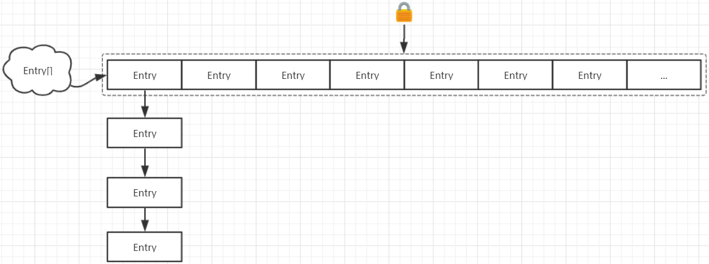
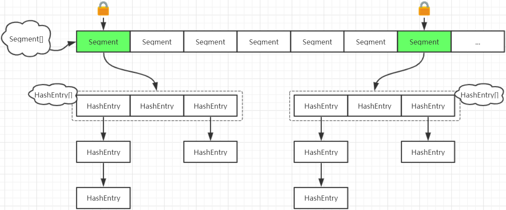
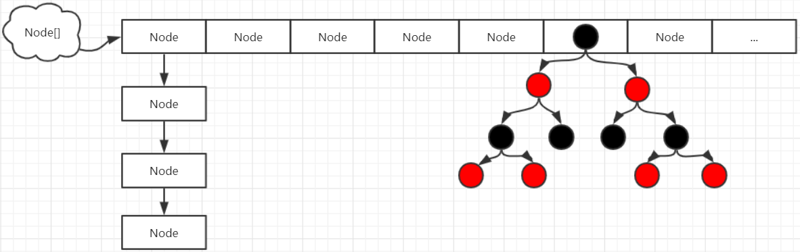

---
tags:
  - Java
  - 并发工具类
---

# 5 并发工具类

在JDK的并发包里提供了几个非常有用的并发容器和并发工具类。供我们在多线程开发中进行使用。

## 5.1 ConcurrentHashMap

### 5.1.1 概述以及基本使用

在集合类中HashMap是比较常用的集合对象，但是HashMap是线程不安全的(多线程环境下可能会存在问题)。为了保证数据的安全性我们可以使用Hashtable，但是Hashtable的效率低下。

基于以上两个原因我们可以使用JDK1.5以后所提供的ConcurrentHashMap。


<font color="blue" size="3">**案例1**</font>：演示HashMap线程不安全

实现步骤

1. 创建一个HashMap集合对象
2. 创建两个线程对象，第一个线程对象向集合中添加元素(1-24),第二个线程对象向集合中添加元素(25-50);
3. 主线程休眠1秒，以便让其他两个线程将数据填装完毕
4. 从集合中找出键和值不相同的数据

测试类

```java
public class HashMapDemo01 {

    public static void main(String[] args) {

        // 创建一个HashMap集合对象
        HashMap<String , String> hashMap = new HashMap<String , String>() ;

        // 创建两个线程对象,我们本次使用匿名内部类的方式去常见线程对象
        Thread t1 = new Thread() {

            @Override
            public void run() {

                // 第一个线程对象向集合中添加元素(1-24)
                for(int x = 1 ; x < 25 ; x++) {
                    hashMap.put(String.valueOf(x) , String.valueOf(x)) ;
                }

            }

        };

        // 线程t2
        Thread t2 = new Thread() {

            @Override
            public void run() {

                // 第二个线程对象向集合中添加元素(25-50)
                for(int x = 25 ; x < 51 ; x++) {
                    hashMap.put(String.valueOf(x) , String.valueOf(x)) ;
                }

            }

        };

        // 启动线程
        t1.start();
        t2.start();

        System.out.println("----------------------------------------------------------");

        try {

            // 主线程休眠2s，以便让其他两个线程将数据填装完毕
            TimeUnit.SECONDS.sleep(2);

        } catch (InterruptedException e) {
            e.printStackTrace();
        }

        // 从集合中找出键和值不相同的数据
        for(int x = 1 ; x < 51 ; x++) {

            // HashMap中的键就是当前循环变量的x这个数据的字符串表现形式 ， 根据键找到值，然后在进行判断
            if( !String.valueOf(x).equals( hashMap.get(String.valueOf(x)) ) ) {
                System.out.println(String.valueOf(x) + ":" + hashMap.get(String.valueOf(x)));
            }

        }


    }

}
```

控制台输出结果

````java
----------------------------------------------------------
5:null
````

通过控制台的输出结果，我们可以看到在多线程操作HashMap的时候，可能会出现线程安全问题。

> 注1：需要多次运行才可以看到具体的效果; 可以使用循环将代码进行改造，以便让问题方便的暴露出来！


<font color="blue" size="3">**案例2**</font>：演示Hashtable线程安全

测试类

```java
public class HashtableDemo01 {

    public static void main(String[] args) {

        // 创建一个Hashtable集合对象
        Hashtable<String , String> hashtable = new Hashtable<String , String>() ;

        // 创建两个线程对象,我们本次使用匿名内部类的方式去常见线程对象
        Thread t1 = new Thread() {

            @Override
            public void run() {

                // 第一个线程对象向集合中添加元素(1-24)
                for(int x = 1 ; x < 25 ; x++) {
                    hashtable.put(String.valueOf(x) , String.valueOf(x)) ;
                }

            }

        };

        // 线程t2
        Thread t2 = new Thread() {

            @Override
            public void run() {

                // 第二个线程对象向集合中添加元素(25-50)
                for(int x = 25 ; x < 51 ; x++) {
                    hashtable.put(String.valueOf(x) , String.valueOf(x)) ;
                }

            }

        };

        // 启动线程
        t1.start();
        t2.start();

        System.out.println("----------------------------------------------------------");

        try {

            // 主线程休眠2s，以便让其他两个线程将数据填装完毕
            TimeUnit.SECONDS.sleep(2);

        } catch (InterruptedException e) {
            e.printStackTrace();
        }

        // 从集合中找出键和值不相同的数据
        for(int x = 1 ; x < 51 ; x++) {

            // Hashtable中的键就是当前循环变量的x这个数据的字符串表现形式 ， 根据键找到值，然后在进行判断
            if( !String.valueOf(x).equals( hashtable.get(String.valueOf(x)) ) ) {
                System.out.println(String.valueOf(x) + ":" + hashtable.get(String.valueOf(x)));
            }

        }

    }

}
```

不论该程序运行多少次，都不会产生数据问题。因此也就证明Hashtable是线程安全的。


<font color="blue" size="3">**Hashtable保证线程安全的原理**</font>：

查看Hashtable的源码

```java
public class Hashtable<K,V> extends Dictionary<K,V> implements Map<K,V>, Cloneable, java.io.Serializable {

    // Entry数组，一个Entry就相当于一个元素
    private transient Entry<?,?>[] table;

    // Entry类的定义
    private static class Entry<K,V> implements Map.Entry<K,V> {
        final int hash;		// 当前key的hash码值
        final K key;		// 键
        V value;			// 值
        Entry<K,V> next;	// 下一个节点
    }

    // 存储数据
    public synchronized V put(K key, V value){...}

    // 获取数据
    public synchronized V get(Object key){...}

    // 获取长度
    public synchronized int size(){...}

    ...

}
```

对应的结构如下图所示



Hashtable保证线程安全性的是使用方法全局锁进行实现的。在线程竞争激烈的情况下HashTable的效率非常低下。因为当一个线程访问HashTable的同步方法，其他线程也访问HashTable

的同步方法时，会进入阻塞状态。如线程1使用put进行元素添加，线程2不但不能使用put方法添加元素，也不能使用get方法来获取元素，所以竞争越激烈效率越低。


<font color="blue" size="3">**案例3**</font>：演示ConcurrentHashMap线程安全

测试类

```java
public class ConcurrentHashMapDemo01 {

    public static void main(String[] args) {

        // 创建一个ConcurrentHashMap集合对象
        ConcurrentHashMap<String , String> concurrentHashMap = new ConcurrentHashMap<String , String>() ;

        // 创建两个线程对象,我们本次使用匿名内部类的方式去常见线程对象
        Thread t1 = new Thread() {

            @Override
            public void run() {

                // 第一个线程对象向集合中添加元素(1-24)
                for(int x = 1 ; x < 25 ; x++) {
                    concurrentHashMap.put(String.valueOf(x) , String.valueOf(x)) ;
                }

            }

        };

        // 线程t2
        Thread t2 = new Thread() {

            @Override
            public void run() {

                // 第二个线程对象向集合中添加元素(25-50)
                for(int x = 25 ; x < 51 ; x++) {
                    concurrentHashMap.put(String.valueOf(x) , String.valueOf(x)) ;
                }

            }

        };

        // 启动线程
        t1.start();
        t2.start();

        System.out.println("----------------------------------------------------------");

        try {

            // 主线程休眠2s，以便让其他两个线程将数据填装完毕
            TimeUnit.SECONDS.sleep(2);

        } catch (InterruptedException e) {
            e.printStackTrace();
        }

        // 从集合中找出键和值不相同的数据
        for(int x = 1 ; x < 51 ; x++) {

            // concurrentHashMap中的键就是当前循环变量的x这个数据的字符串表现形式 ， 根据键找到值，然后在进行判断
            if( !String.valueOf(x).equals( concurrentHashMap.get(String.valueOf(x)) ) ) {
                System.out.println(String.valueOf(x) + ":" + concurrentHashMap.get(String.valueOf(x)));
            }

        }

    }

}
```

不论该程序运行多少次，都不会产生数据问题。因此也就证明ConcurrentHashMap是线程安全的。

### 5.1.2 源码分析

由于ConcurrentHashMap在jdk1.7和jdk1.8的时候实现原理不太相同，因此需要分别来讲解一下两个不同版本的实现原理。

#### 1) jdk1.7版本

<font color="blue" size="3">**ConcurrentHashMap中的重要成员变量**</font>

```java
public class ConcurrentHashMap<K, V> extends AbstractMap<K, V> implements ConcurrentMap<K, V>, Serializable {

    /**
     * Segment翻译中文为"段" , 段数组对象
     */
    final Segment<K,V>[] segments;

    // Segment是一种可重入锁（ReentrantLock），在ConcurrentHashMap里扮演锁的角色，将一个大的table分割成多个小的table进行加锁。
    static final class Segment<K,V> extends ReentrantLock implements Serializable {

        transient volatile int count;    			// Segment中元素的数量，由volatile修饰，支持内存可见性；
        transient int modCount;			 			// 对table的大小造成影响的操作的数量（比如put或者remove操作）;
        transient int threshold;		 			// 扩容阈值;
        transient volatile HashEntry<K,V>[] table;  // 链表数组，数组中的每一个元素代表了一个链表的头部;
        final float loadFactor;			 			// 负载因子

    }

    // Segment中的元素是以HashEntry的形式存放在数组中的，其结构与普通HashMap的HashEntry基本一致，不同的是Segment的HashEntry，其value由		     // volatile修饰，以支持内存可见性，即写操作对其他读线程即时可见。
    static final class HashEntry<K,V> {
        final int hash;					// 当前节点key对应的哈希码值
        final K key;					// 存储键
        volatile V value;				// 存储值
        volatile HashEntry<K,V> next;	// 下一个节点
    }

}
```

对应的结构如下图所示



简单来讲，就是ConcurrentHashMap比HashMap多了一次hash过程，第1次hash定位到Segment，第2次hash定位到HashEntry，然后链表搜索找到指定节点。在进行写操作时，只需锁住写

元素所在的Segment即可(这种锁被称为<font size="3" color="red">**分段锁**</font>)，其他Segment无需加锁，从而产生锁竞争的概率大大减小，提高了并发读写的效率。该种实现方式的缺点是hash过程比普通的HashMap要长

(因为需要进行两次hash操作)。


<font color="blue" size="3">**ConcurrentHashMap的put方法源码分析**</font>

```java
public class ConcurrentHashMap<K, V> extends AbstractMap<K, V> implements ConcurrentMap<K, V>, Serializable {

    public V put(K key, V value) {

        // 定义一个Segment对象
        Segment<K,V> s;

        // 如果value的值为空，那么抛出异常
        if (value == null) throw new NullPointerException();

        // hash函数获取key的hashCode，然后做了一些处理
        int hash = hash(key);

        // 通过key的hashCode定位segment
        int j = (hash >>> segmentShift) & segmentMask;

        // 对定位的Segment进行判断，如果Segment为空，调用ensureSegment进行初始化操作(第一次hash定位)
        if ((s = (Segment<K,V>)UNSAFE.getObject(segments, (j << SSHIFT) + SBASE)) == null)
            s = ensureSegment(j);

        // 调用Segment对象的put方法添加元素
        return s.put(key, hash, value, false);
    }

    // Segment是一种可ReentrantLock，在ConcurrentHashMap里扮演锁的角色，将一个大的table分割成多个小的table进行加锁。
    static final class Segment<K,V> extends ReentrantLock implements Serializable {

        // 添加元素
        final V put(K key, int hash, V value, boolean onlyIfAbsent) {

            // 尝试对该段进行加锁,如果加锁失败，则调用scanAndLockForPut方法;在该方法中就要进行再次尝试或者进行自旋等待
            HashEntry<K,V> node = tryLock() ? null : scanAndLockForPut(key, hash, value);
            V oldValue;
            try {

                // 获取HashEntry数组对象
                HashEntry<K,V>[] tab = table;

                // 根据key的hashCode值计算索引(第二次hash定位)
                int index = (tab.length - 1) & hash;
                HashEntry<K,V> first = entryAt(tab, index);
                for (HashEntry<K,V> e = first;;)

                    // 若不为null
                    if (e != null) {
                        K k;

                        // 判读当前节点的key是否和链表头节点的key相同(依赖于hashCode方法和equals方法)
                        // 如果相同，值进行更新
                        if ((k = e.key) == key || (e.hash == hash && key.equals(k))) {
                            oldValue = e.value;
                            if (!onlyIfAbsent) {
                                e.value = value;
                                ++modCount;
                            }
                            break;
                        }

                        e = e.next;
                    } else {  // 若头结点为null

                        // 将新节点添加到链表中
                        if (node != null)
                            node.setNext(first);
                        else
                            node = new HashEntry<K,V>(hash, key, value, first);
                        int c = count + 1;

                        // 如果超过阈值，则进行rehash操作
                        if (c > threshold && tab.length < MAXIMUM_CAPACITY)
                            rehash(node);
                        else
                            setEntryAt(tab, index, node);
                        ++modCount;
                        count = c;
                        oldValue = null;
                        break;
                    }
                }
            } finally {
                unlock();
            }

            return oldValue;
        }

    }

}

```

> 注：源代码进行简单讲解即可(核心：进行了两次哈希定位以及加锁过程)


#### 2) jdk1.8版本

在JDK1.8中为了进一步优化ConcurrentHashMap的性能，去掉了Segment分段锁的设计。在数据结构方面，则是跟HashMap一样，使用一个哈希表table数组。(数组 + 链表 + 红黑树)

而线程安全方面是结合CAS机制 + 局部锁实现的，减低锁的粒度，提高性能。同时在HashMap的基础上，对哈希表table数组和链表节点的value，next指针等使用volatile来修饰，从而

实现线程可见性。

<font color="blue" size="3">**ConcurrentHashMap中的重要成员变量**</font>

```java
public class ConcurrentHashMap<K,V> extends AbstractMap<K,V> implements ConcurrentMap<K,V>, Serializable {

    // Node数组
    transient volatile Node<K,V>[] table;

    // Node类的定义
    static class Node<K,V> implements Map.Entry<K,V> {

        final int hash;				// 当前key的hashCode值
        final K key;				// 键
        volatile V val;				// 值
        volatile Node<K,V> next;	// 下一个节点

    }

    // TreeNode类的定义
    static final class TreeNode<K,V> extends Node<K,V> {
        TreeNode<K,V> parent;  // 父节点
        TreeNode<K,V> left;	   // 左子节点
        TreeNode<K,V> right;   // 右子节点
        TreeNode<K,V> prev;    // needed to unlink next upon deletion
        boolean red;		   // 节点的颜色状态
    }

}
```

对应的结构如下图




<font color="blue" size="3">**ConcurrentHashMap的put方法源码分析**</font>

```java
public class ConcurrentHashMap<K,V> extends AbstractMap<K,V> implements ConcurrentMap<K,V>, Serializable {

    // 添加元素
    public V put(K key, V value) {
    	return putVal(key, value, false);
	}

    // putVal方法定义
    final V putVal(K key, V value, boolean onlyIfAbsent) {

        // key为null直接抛出异常
        if (key == null || value == null) throw new NullPointerException();

        // 计算key所对应的hashCode值
        int hash = spread(key.hashCode());
        int binCount = 0;
        for (Node<K,V>[] tab = table;;) {
            Node<K,V> f; int n, i, fh;

            // 哈希表如果不存在，那么此时初始化哈希表
            if (tab == null || (n = tab.length) == 0)
                tab = initTable();

            // 通过hash值计算key在table表中的索引，将其值赋值给变量i,然后根据索引找到对应的Node，如果Node为null,做出处理
            else if ((f = tabAt(tab, i = (n - 1) & hash)) == null) {

                // 新增链表头结点，cas方式添加到哈希表table
                if (casTabAt(tab, i, null, new Node<K,V>(hash, key, value, null))) break;
            }
            else if ((fh = f.hash) == MOVED)
                tab = helpTransfer(tab, f);
            else {
                V oldVal = null;

                // f为链表头结点，使用synchronized加锁
                synchronized (f) {
                    if (tabAt(tab, i) == f) {
                        if (fh >= 0) {
                            binCount = 1;
                            for (Node<K,V> e = f;; ++binCount) {
                                K ek;

                                // 节点已经存在，更新value即可
                                if (e.hash == hash && ((ek = e.key) == key || (ek != null && key.equals(ek)))) {
                                    oldVal = e.val;
                                    if (!onlyIfAbsent)
                                        e.val = value;
                                    break;
                                }

                                // 该key对应的节点不存在,则新增节点并添加到该链表的末尾
                                Node<K,V> pred = e;
                                if ((e = e.next) == null) {
                                    pred.next = new Node<K,V>(hash, key, value, null);
                                    break;
                                }

                            }

                        } else if (f instanceof TreeBin) { // 红黑树节点，则往该红黑树更新或添加该节点即可
                            Node<K,V> p;
                            binCount = 2;
                            if ((p = ((TreeBin<K,V>)f).putTreeVal(hash, key, value)) != null) {
                                oldVal = p.val;
                                if (!onlyIfAbsent)
                                    p.val = value;
                            }
                        }
                    }
                }

                // 判断是否需要将链表转为红黑树
                if (binCount != 0) {
                    if (binCount >= TREEIFY_THRESHOLD)
                        treeifyBin(tab, i);
                    if (oldVal != null)
                        return oldVal;
                    break;
                }
            }
        }
        addCount(1L, binCount);
        return null;
    }

    // CAS算法的核心类
    private static final sun.misc.Unsafe U;
    static {
        try {
            U = sun.misc.Unsafe.getUnsafe();
            ...
        } catch (Exception e) {
            throw new Error(e);
        }
    }

    // 原子获取链表节点
    static final <K,V> Node<K,V> tabAt(Node<K,V>[] tab, int i) {
        return (Node<K,V>)U.getObjectVolatile(tab, ((long)i << ASHIFT) + ABASE);
    }

    // CAS更新或新增链表节点
    static final <K,V> boolean casTabAt(Node<K,V>[] tab, int i, Node<K,V> c, Node<K,V> v) {
        return U.compareAndSwapObject(tab, ((long)i << ASHIFT) + ABASE, c, v);
    }

}
```


简单总结：

1. 如果当前需要put的key对应的链表在哈希表table中还不存在，即还没添加过该key的hash值对应的链表，则调用casTabAt方法，基于CAS机制来实现添加该链表头结点到哈希表

   table中，避免该线程在添加该链表头结的时候，其他线程也在添加的并发问题；如果CAS失败，则进行自旋，通过继续第2步的操作；

2. 如果需要添加的链表已经存在哈希表table中，则通过tabAt方法，基于volatile机制，获取当前最新的链表头结点f，由于f指向的是ConcurrentHashMap的哈希表table的某条

   链表的头结点，故虽然f是临时变量，由于是引用共享的该链表头结点，所以可以使用synchronized关键字来同步多个线程对该链表的访问。在synchronized(f)同步块里面则是与

   HashMap一样遍历该链表，如果该key对应的链表节点已经存在，则更新，否则在链表的末尾新增该key对应的链表节点。

## 5.2 CountDownLatch

CountDownLatch允许一个或多个线程等待其他线程完成操作以后，再执行当前线程；比如我们在主线程需要开启2个其他线程，当其他的线程执行完毕以后我们再去执行主线程，针对这

个需求我们就可以使用CountDownLatch来进行实现。CountDownLatch中count down是倒着数数的意思；CountDownLatch是通过一个计数器来实现的，每当一个线程完成了自己的

任务后，可以调用countDown()方法让计数器-1，当计数器到达0时，调用CountDownLatch的await()方法的线程阻塞状态解除，继续执行。

CountDownLatch的相关方法

```java
public CountDownLatch(int count)						// 初始化一个指定计数器的CountDownLatch对象
public void await() throws InterruptedException			// 让当前线程等待
public void countDown()									// 计数器进行减1
```


案例演示：使用CountDownLatch完成上述需求(我们在主线程需要开启2个其他线程，当其他的线程执行完毕以后我们再去执行主线程)

实现思路：在main方法中创建一个CountDownLatch对象，把这个对象作为作为参数传递给其他的两个任务线程

线程任务类1

```java
public class CountDownLatchThread01 implements Runnable {

    // CountDownLatch类型成员变量
    private CountDownLatch countDownLatch ;
    public CountDownLatchThread01(CountDownLatch countDownLatch) {      // 构造方法的作用：接收CountDownLatch对象
        this.countDownLatch = countDownLatch ;
    }

    @Override
    public void run() {

        try {
            Thread.sleep(10000);
            System.out.println("10秒以后执行了CountDownLatchThread01......");
        } catch (InterruptedException e) {
            e.printStackTrace();
        }

        // 调用CountDownLatch对象的countDown方法对计数器进行-1操作
        countDownLatch.countDown();

    }

}
```

线程任务类2

```java
public class CountDownLatchThread02 implements Runnable {

    // CountDownLatch类型成员变量
    private CountDownLatch countDownLatch ;
    public CountDownLatchThread02(CountDownLatch countDownLatch) {      // 构造方法的作用：接收CountDownLatch对象
        this.countDownLatch = countDownLatch ;
    }

    @Override
    public void run() {

        try {
            Thread.sleep(3000);
            System.out.println("3秒以后执行了CountDownLatchThread02......");
        } catch (InterruptedException e) {
            e.printStackTrace();
        }

        // 调用CountDownLatch对象的countDown方法对计数器进行-1操作
        countDownLatch.countDown();

    }

}
```

测试类

```java
public class CountDownLatchDemo01 {

    public static void main(String[] args) {

        //  1. 创建一个CountDownLatch对象
        CountDownLatch countDownLatch = new CountDownLatch(2) ;                 // CountDownLatch中的计数器的默认值就是2

        //  2. 创建线程任务类对象，并且把这个CountDownLatch对象作为构造方法的参数进行传递
        CountDownLatchThread01 countDownLatchThread01 = new CountDownLatchThread01(countDownLatch) ;

        //  3. 创建线程任务类对象，并且把这个CountDownLatch对象作为构造方法的参数进行传递
        CountDownLatchThread02 countDownLatchThread02 = new CountDownLatchThread02(countDownLatch) ;

        //  4. 创建线程对象，并启动线程
        Thread t1 = new Thread(countDownLatchThread01);
        Thread t2 = new Thread(countDownLatchThread02);
        t1.start();
        t2.start();

        //  5. 在主线程中调用 CountDownLatch中的await让主线程处于阻塞状态
        try {
            countDownLatch.await();
        } catch (InterruptedException e) {
            e.printStackTrace();
        }

        //  6. 程序结束的输出
        System.out.println("主线程执行了.... 程序结束了......");
    }

}
```

控制台输出结果

```java
3秒以后执行了CountDownLatchThread02......
10秒以后执行了CountDownLatchThread01......
主线程执行了.... 程序结束了......
```

CountDownLatchThread02线程先执行完毕，此时计数器-1；CountDownLatchThread01线程执行完毕，此时计数器-1；当计数器的值为0的时候，主线程阻塞状态接触，主线程向下执行。

## 5.3 CyclicBarrier

### 5.3.1 概述以及基本使用

CyclicBarrier的字面意思是可循环使用（Cyclic）的屏障（Barrier）。它要做的事情是，让一组线程到达一个屏障（也可以叫同步点）时被阻塞，直到最后一个线程到达屏障时，屏障

才会开门，所有被屏障拦截的线程才会继续运行。

例如：公司召集5名员工开会，等5名员工都到了，会议开始。我们创建5个员工线程，1个开会线程，几乎同时启动，使用CyclicBarrier保证5名员工线程全部执行后，再执行开会线程。


CyclicBarrier的相关方法

```java
public CyclicBarrier(int parties, Runnable barrierAction)   // 用于在线程到达屏障时，优先执行barrierAction，方便处理更复杂的业务场景
public int await()											// 每个线程调用await方法告诉CyclicBarrier我已经到达了屏障，然后当前线程被阻塞
```


案例演示：模拟员工开会

实现步骤：

1. 创建一个员工线程类(EmployeeThread),该线程类中需要定义一个CyclicBarrier类型的形式参数
2. 创建一个开会线程类(MettingThread)
3. 测试类
   1. 创建CyclicBarrier对象
   2. 创建5个EmployeeThread线程对象，把第一步创建的CyclicBarrier对象作为构造方法参数传递过来
   3. 启动5个员工线程

员工线程类

```java
public class EmployeeThread extends Thread {

    // CyclicBarrier类型的成员变量
    private CyclicBarrier cyclicBarrier ;
    public EmployeeThread(CyclicBarrier cyclicBarrier) {        // 使用构造方法对CyclicBarrier进行初始化
        this.cyclicBarrier = cyclicBarrier ;
    }

    @Override
    public void run() {

        try {

            // 模拟开会人员的随机到场
            Thread.sleep((int) (Math.random() * 1000));
            System.out.println(Thread.currentThread().getName() + " 到了! ");
            cyclicBarrier.await();
        } catch (Exception e) {
            e.printStackTrace();
        }

    }

}
```

开会线程类

```java
public class MettingThread extends Thread {

    @Override
    public void run() {
        System.out.println("好了，人都到了，开始开会......");
    }

}
```

测试类

```java
public class CyclicBarrierDemo01 {

    public static void main(String[] args) {

        // 创建CyclicBarrier对象
        CyclicBarrier cyclicBarrier = new CyclicBarrier(5 , new MettingThread()) ;

        // 创建5个EmployeeThread线程对象，把第一步创建的CyclicBarrier对象作为构造方法参数传递过来
        EmployeeThread thread1 = new EmployeeThread(cyclicBarrier) ;
        EmployeeThread thread2 = new EmployeeThread(cyclicBarrier) ;
        EmployeeThread thread3 = new EmployeeThread(cyclicBarrier) ;
        EmployeeThread thread4 = new EmployeeThread(cyclicBarrier) ;
        EmployeeThread thread5 = new EmployeeThread(cyclicBarrier) ;

        // 启动5个员工线程
        thread1.start();
        thread2.start();
        thread3.start();
        thread4.start();
        thread5.start();

    }

}
```

### 5.3.2 使用场景

使用场景：CyclicBarrier可以用于多线程计算数据，最后合并计算结果的场景。

比如：现在存在两个文件，这个两个文件中存储的是某一个员工两年的工资信息(一年一个文件)，现需要对这两个文件中的数据进行汇总；使用两个线程读取2个文件中的数据，当两个文

件中的数据都读取完毕以后，进行数据的汇总操作。


分析：要想在两个线程读取数据完毕以后进行数据的汇总，那么我们就需要定义一个任务类(该类需要实现Runnable接口)；两个线程读取完数据以后再进行数据的汇总，那么我们可以将

​	 两个线程读取到的数据先存储到一个集合中，而多线程环境下最常见的线程集合类就是ConcurrentHashMap，而这个集合需要被两个线程都可以进行使用，那么我们可以将这个集

​	 合作为我们任务类的成员变量，然后我们在这个任务类中去定义一个CyclicBarrier对象，然后在定义一个方法(count)，当调用这个count方法的时候需要去开启两个线程对象，

​	 使用这两个线程对象读取数据，把读取到的数据存储到ConcurrentHashMap对象，当一个线程读取数据完毕以后，调用CyclicBarrier的awit方法(告诉CyclicBarrier我已经

​	 到达了屏障)，然后在任务类的run方法对ConcurrentHashMap的数据进行汇总操作；


实现步骤:

1. 定义一个任务类CyclicBarrierThreadUse(实现了Runnable接口)
2. 定义成员变量：CyclicBarrier ，ConcurrentHashMap

```java
private CyclicBarrier cyclicBarrier = new CyclicBarrier(2 , this) ;
private ConcurrentHashMap<Integer , String> concurrentHashMap = new ConcurrentHashMap<Integer , String>() ;
```

3. 定义一个方法count方法，在count方法中开启两个线程对象(可以使用匿名内部类的方式实现)
4. 在run方法中对ConcurrentHashMap中的数据进行汇总
5. 编写测试类CyclicBarrierThreadUseDemo
6. 创建CyclicBarrierThreadUse对象，调用count方法


任务类代代码：

```java
public class CyclicBarrierThreadUse implements Runnable {

    // 当前我们两个线程到达了屏障点以后，我们需要立即对数据进行汇总, 因此我们需要使用第二个构造方法
    // 并且我们当前这个类就是一个任务类，因此我们可以直接传递参数this
    private CyclicBarrier cyclicBarrier = new CyclicBarrier(2 , this) ;
    private ConcurrentHashMap<Integer , String> concurrentHashMap = new ConcurrentHashMap<Integer , String>() ;  // 存储两个线程所读取的数据

    public void count() {

        // 定义一个方法count方法，在count方法中开启两个线程对象(可以使用匿名内部类的方式实现)
        // 线程1
        new Thread(new Runnable() {

            @Override
            public void run() {

                // 读取数据
                BufferedReader bufferedReader = null ;
                try {


                    bufferedReader = new BufferedReader(new FileReader("D:\\salary\\2017-salary.txt")) ;
                    String line = null ;
                    while((line = bufferedReader.readLine()) != null) {
                        concurrentHashMap.put(Integer.parseInt(line) , "") ;            // 小的问题，工资信息不能重复
                    }

                } catch (Exception e) {
                    e.printStackTrace();
                } finally {
                    if(bufferedReader != null) {
                        try {
                            bufferedReader.close();
                        } catch (IOException e) {
                            e.printStackTrace();
                        }
                    }
                }

                // 模拟任务的执行时间
                try {
                    TimeUnit.SECONDS.sleep(5) ;
                    System.out.println(Thread.currentThread().getName() + "---------------------线程读取数据完毕....");
                    cyclicBarrier.await() ;         //通知cyclicBarrier当前线程已经到达了屏障点
                } catch (Exception e) {
                    e.printStackTrace();
                }


            }

        }).start();

        // 线程2
        new Thread(new Runnable() {

            @Override
            public void run() {

                // 读取数据
                BufferedReader bufferedReader = null ;
                try {


                    bufferedReader = new BufferedReader(new FileReader("D:\\salary\\2019-salary.txt")) ;
                    String line = null ;
                    while((line = bufferedReader.readLine()) != null) {
                        concurrentHashMap.put(Integer.parseInt(line) , "") ;            // 小的问题，工资信息不能重复
                    }

                } catch (Exception e) {
                    e.printStackTrace();
                } finally {
                    if(bufferedReader != null) {
                        try {
                            bufferedReader.close();
                        } catch (IOException e) {
                            e.printStackTrace();
                        }
                    }
                }

                // 模拟任务的执行时间
                try {
                    TimeUnit.SECONDS.sleep(10) ;
                    System.out.println(Thread.currentThread().getName() + "---------------------线程读取数据完毕....");
                    cyclicBarrier.await() ;         //通知cyclicBarrier当前线程已经到达了屏障点
                } catch (Exception e) {
                    e.printStackTrace();
                }


            }

        }).start();


    }

    @Override
    public void run() {

        // 获取concurrentHashMap中的数据进行汇总
        Enumeration<Integer> enumeration = concurrentHashMap.keys();        // 获取concurrentHashMap中所有的键

        /**
         * 这个Enumeration的使用和我们之前所学习过的迭代器类似
         * boolean hasMoreElements(); 判断集合中是否存在下一个元素
         * E nextElement();           获取元素
         */
        int result = 0 ;
        while(enumeration.hasMoreElements()) {
            Integer integer = enumeration.nextElement();
            result += integer ;
        }

        // 输出
        System.out.println(result);

    }


}
```

测试类代码：

```java
public class CyclicBarrierThreadUseDemo01 {

    public static void main(String[] args) {

        // 创建任务类的对象
        CyclicBarrierThreadUse cyclicBarrierThreadUse = new CyclicBarrierThreadUse();

        // 调用count方法进行数据汇总
        cyclicBarrierThreadUse.count();

    }

}
```

## 5.4 Semaphore

Semaphore字面意思是信号量的意思，它的作用是控制访问特定资源的线程数目。

举例：现在有一个十字路口，有多辆汽车需要进经过这个十字路口，但是我们规定同时只能有两辆汽车经过。其他汽车处于等待状态，只要某一个汽车经过了这个十字路口，其他的汽车才可以经

过，但是同时只能有两个汽车经过。如何限定经过这个十字路口车辆数目呢? 我们就可以使用Semaphore。

Semaphore的常用方法

```java
public Semaphore(int permits)						permits 表示许可线程的数量
public void acquire() throws InterruptedException	表示获取许可
public void release()								表示释放许可
```


案例演示：模拟汽车通过十字路口

实现步骤：

1. 创建一个汽车的线程任务类(CarThreadRunnable),在该类中定义一个Semaphore类型的成员变量
2. 创建测试类
   1. 创建线程任务类对象
   2. 创建5个线程对象，并启动。(5个线程对象，相当于5辆汽车)

CarThreadRunnable类

```java
public class CarThreadRunnable implements Runnable {

    // 创建一个Semaphore对象,限制只允许2个线程获取到许可证
    private Semaphore semaphore = new Semaphore(2) ;

    @Override
    public void run() {                         // 这个run只允许2个线程同时执行

        try {

            // 获取许可证
            semaphore.acquire();
            System.out.println(Thread.currentThread().getName() + "----->>正在经过十字路口");

            // 模拟车辆经过十字路口所需要的时间
            Random random = new Random();
            int nextInt = random.nextInt(7);
            TimeUnit.SECONDS.sleep(nextInt);

            System.out.println(Thread.currentThread().getName() + "----->>驶出十字路口");

            // 释放许可证
            semaphore.release();

        } catch (InterruptedException e) {
            e.printStackTrace();
        }

    }

}
```

测试类

```java
public class SemaphoreDemo01 {

    public static void main(String[] args) {

        // 创建线程任务类对象
        CarThreadRunnable carThreadRunnable = new CarThreadRunnable() ;

        // 创建5个线程对象，并启动。
        for(int x = 0 ; x < 5 ; x++) {
            new Thread(carThreadRunnable).start();
        }

    }

}
```

控制台输出结果

```java
Thread-0----->>正在经过十字路口
Thread-1----->>正在经过十字路口
Thread-1----->>驶出十字路口
Thread-2----->>正在经过十字路口
Thread-0----->>驶出十字路口
Thread-3----->>正在经过十字路口
Thread-2----->>驶出十字路口
Thread-4----->>正在经过十字路口
Thread-4----->>驶出十字路口
Thread-3----->>驶出十字路口
```

通过控制台输出，我们可以看到当某一个汽车"驶出"十字路口以后，就会有一个汽车立马驶入。

## 5.5 Exchanger

### 5.5.1 概述以及基本使用

Exchanger（交换者）是一个用于线程间协作的工具类。Exchanger用于进行线程间的数据交换。

举例：比如男女双方结婚的时候，需要进行交换结婚戒指。

Exchanger常用方法

```java
public Exchanger()							// 构造方法
public V exchange(V x)						// 进行交换数据的方法，参数x表示本方数据 ，返回值v表示对方数据
```

这两个线程通过exchange方法交换数据，如果第一个线程先执行exchange()方法，它会一直等待第二个线程也执行exchange方法，当两个线程都到达同步点时，这两个线程就可以交换数据，

将本线程生产出来的数据传递给对方。


案例演示：模拟交互结婚戒指

实现步骤：

1. 创建一个男方的线程类(ManThread),定义一个Exchanger类型的成员变量
2. 创建一个女方的线程类(WomanThread),定义一个Exchanger类型的成员变量
3. 测试类
   1. 创建一个Exchanger对象
   2. 创建一个ManThread对象，把第一步所创建的Exchanger作为构造方法参数传递过来
   3. 创建一个WomanThread对象，把第一步所创建的Exchanger作为构造方法参数传递过来
   4. 启动两个线程

ManThread类

```java
public class ManThread extends Thread {

    // 定义Exchanger类型的变量
    private Exchanger<String> exchanger ;
    private String name ;
    public ManThread(Exchange<String> exchanger , String name) {
        super(name);
        this.name = name ;
        this.exchanger = exchanger ;
    }

    @Override
    public void run() {

        try {
            String result = exchanger.exchange("钻戒");
            System.out.println(name + "---->>把钻戒给媳妇");
            System.out.println(name + "---->>得到媳妇给的" + result);
        } catch (InterruptedException e) {
            e.printStackTrace();
        }

    }

}
```

WomanThread类

```java
public class WomanThread extends Thread {

    // 定义Exchanger类型的变量
    private Exchanger<String> exchanger ;
    private String name ;
    public WomanThread(Exchanger<String> exchanger , String name) {
        super(name) ;
        this.name = name ;
        this.exchanger = exchanger ;
    }

    @Override
    public void run() {

        try {
            String result = exchanger.exchange("铝戒");
            System.out.println(name + "---->>把铝戒给老公");
            System.out.println(name + "---->>得到老公给的" + result);
        } catch (InterruptedException e) {
            e.printStackTrace();
        }

    }
}
```

测试类

```java
public class ExchangerDemo01 {

    public static void main(String[] args) {

        // 创建一个Exchanger对象
        Exchanger<String> exchanger = new Exchanger<String>() ;

        // 创建一个ManThread对象
        ManThread manThread = new ManThread(exchanger , "杨过") ;

        // 创建一个WomanThread对象
        WomanThread womanThread = new WomanThread(exchanger , "小龙女") ;

        // 启动线程
        manThread.start();
        womanThread.start();

    }

}
```

### 5.5.2 使用场景

使用场景：可以做数据校对工作

比如: 现在存在一个文件，该文件中存储的是某一个员工一年的工资信息，现需要将这个员工的工资信息录入到系统中，采用AB岗两人进行录入，录入到两个文件中，系统需要加载这两

个文件，并对两个文件数据进行校对，看看是否录入一致，

实现步骤：

1. 创建一个测试类(ExchangerUseDemo)
2. 通过匿名内部类的方法创建两个线程对象
3. 两个线程分别读取文件中的数据，然后将数据存储到各自的集合中
4. 当每一个线程读取完数据以后，就将数据交换给对方
5. 然后每个线程使用对方传递过来的数据与自己所录入的数据进行比对

ExchangerUseDemo类

```java
public class ExchangerUseDemo {

    public static void main(String[] args) {

        // 1. 创建Exchanger对象
        Exchanger<ArrayList<String>> exchanger = new Exchanger<ArrayList<String>>() ;

        // 2. 通过匿名内部类的方法创建两个线程对象
        new Thread(new Runnable() {

            @Override
            public void run() {


                try {

                    // 读取文件中的数据，然后将其存储到集合中
                    ArrayList<String> arrayList = new ArrayList<String>() ;
                    BufferedReader bufferedReader = new BufferedReader(new FileReader("D:\\salary\\2017-salary.txt")) ;
                    String line = null ;
                    while((line = bufferedReader.readLine()) != null) {
                        arrayList.add(line) ;
                    }

                    // arrayList.add("90000") ;
                    // arrayList.set(0 , "90000") ;
                    arrayList.remove(0) ;

                    // 调用Exchanger中的exchange方法完成数据的交换
                    ArrayList<String> exchange = exchanger.exchange(arrayList);

                    // 先比对长度
                    if(arrayList.size() == exchange.size()) {

                        // 然后使用对方线程所传递过来的数据和自己线程所读取到的数据进行比对
                        for(int x = 0 ; x < arrayList.size() ; x++) {

                            // 本方数据
                            String benfangElement = arrayList.get(x);

                            // 对方数据
                            String duifangElement = exchange.get(x);

                            // 比对
                            if(!benfangElement.equals(duifangElement)) {
                                System.out.println("数据存在问题.....");
                            }

                        }

                    }else  {
                        System.out.println("数据存在问题.....");
                    }

                } catch (Exception e) {
                    e.printStackTrace();
                }

            }

        }).start();

        // 线程2
        new Thread(new Runnable() {

            @Override
            public void run() {


                try {

                    // 读取文件中的数据，然后将其存储到集合中
                    ArrayList<String> arrayList = new ArrayList<String>() ;
                    BufferedReader bufferedReader = new BufferedReader(new FileReader("D:\\salary\\2017-salary.txt")) ;
                    String line = null ;
                    while((line = bufferedReader.readLine()) != null) {
                        arrayList.add(line) ;
                    }

                    // 调用Exchanger中的exchange方法完成数据的交换
                    ArrayList<String> exchange = exchanger.exchange(arrayList);

                    // 先比对长度
                    if(arrayList.size() == exchange.size()) {

                        // 然后使用对方线程所传递过来的数据和自己线程所读取到的数据进行比对
                        for(int x = 0 ; x < arrayList.size() ; x++) {

                            // 本方数据
                            String benfangElement = arrayList.get(x);

                            // 对方数据
                            String duifangElement = exchange.get(x);

                            // 比对
                            if(!benfangElement.equals(duifangElement)) {
                                System.out.println("数据存在问题.....");
                            }

                        }

                    }else  {
                        System.out.println("数据存在问题.....");
                    }

                } catch (Exception e) {
                    e.printStackTrace();
                }

            }

        }).start();

    }

}
```

## 相关笔记

- [[原子性]]
- [[线程池]]

