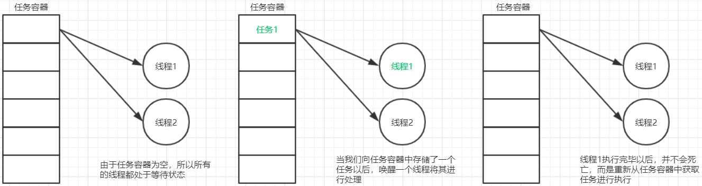
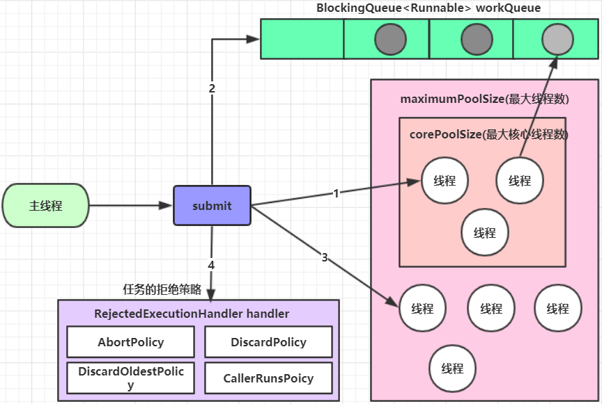
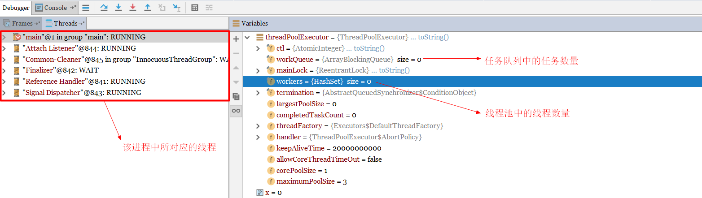
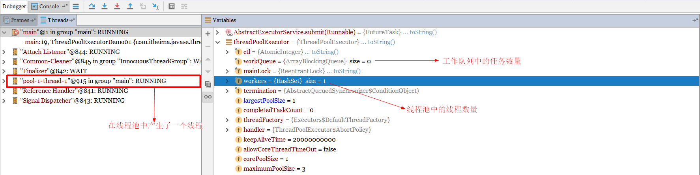
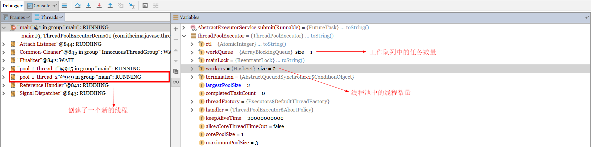
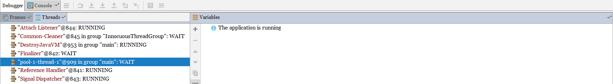

---
tags:
  - Java
  - 线程池
---

# 2 线程池

## 2.1 概述

提到池，大家应该能想到的就是水池。水池就是一个容器，在该容器中存储了很多的水。那么什么是线程池呢？线程池也是可以看做成一个池子，在该池子中存储很多个线程。

线程池存在的意义：

系统创建一个线程的成本是比较高的，因为它涉及到与操作系统交互，当程序中需要创建大量生存期很短暂的线程时，频繁的创建和销毁线程对系统的资源消耗有可能大于业务处理是对系

统资源的消耗，这样就有点"舍本逐末"了。针对这一种情况，为了提高性能，我们就可以采用线程池。线程池在启动的时，会创建大量空闲线程，当我们向线程池提交任务的时，线程池就

会启动一个线程来执行该任务。等待任务执行完毕以后，线程并不会死亡，而是再次返回到线程池中称为空闲状态。等待下一次任务的执行。

## 2.2 自定义线程池

### 2.2.1 线程池的设计思路

线程池的思路和生产者消费者模型是很接近的

1. 准备一个任务容器
2. 一次性启动多个(2个)消费者线程
3. 刚开始任务容器是空的，所以线程都在wait
4. 直到一个外部线程向这个任务容器中扔了一个"任务"，就会有一个消费者线程被唤醒
5. 这个消费者线程取出"任务"，并且执行这个任务，执行完毕后，继续等待下一次任务的到来

在整个过程中，都不需要创建新的线程，而是循环使用这些已经存在的线程。



### 2.2.2 代码实现

实现思路：

- 创建一个线程池类(ThreadPool)
- 在该类中定义两个成员变量poolSize(线程池初始化线程的个数) , BlockingQueue<Runnable>(任务容器)
- 通过构造方法来创建两个线程对象(消费者线程)，并且启动
- 使用内部类的方式去定义一个线程类(TaskThread),可以提供一个构造方法用来初始化线程名称
- 两个消费者线程需要不断的从任务容器中获取任务，如果没有任务，则线程处于阻塞状态。
- 提供一个方法(submit)向任务容器中添加任务
- 定义测试类进行测试

线程池类

```java
public class ThreadPool {

    // 初始化线程个数
    private static final int DEFAULT_POOL_SIZE = 2 ;

    // 在该类中定义两个成员变量poolSize(线程池初始化线程的个数) , BlockingQueue<Runnable>(任务容器)
    private int poolSize = DEFAULT_POOL_SIZE ;
    private BlockingQueue<Runnable> blockingQueue = new LinkedBlockingQueue<Runnable>() ;

    // 无参构造方法
    public ThreadPool(){
        this.initThread();
    }

    // 有参构造方法，通过构造方法来创建两个线程对象(消费者线程)，并且启动
    public ThreadPool(int poolSize) {
        if(poolSize > 0) {
            this.poolSize = poolSize ;
        }
        this.initThread();
    }

    // 初始化线程方法
    public void initThread(){
        for(int x = 0 ; x < poolSize ; x++) {
            new TaskThread("线程--->" + x).start();
        }
    }

    // 提供一个方法(submit)向任务容器中添加任务
    public void submit(Runnable runnable) {

        try {
            blockingQueue.put(runnable);
        } catch (InterruptedException e) {
            e.printStackTrace();
        }

    }

    // 使用内部类的方式去定义一个线程类
    public class TaskThread extends Thread {

        // 提供一个构造方法，用来初始化线程名称
        public TaskThread(String name) {
            super(name);
        }

        @Override
        public void run() {

            while(true) {

                try {

                    // 两个消费者线程需要不断的从任务容器中获取任务，如果没有任务，则线程处于阻塞状态。
                    Runnable task = blockingQueue.take();
                    task.run();

                } catch (InterruptedException e) {
                    e.printStackTrace();
                }

            }

        }
    }

}
```

测试类

```java
public class ThreadPoolDemo01 {

    public static void main(String[] args) {

        // 创建线程池对象,无参构造方法创建
        // ThreadPool threadPool = new ThreadPool();
        ThreadPool threadPool = new ThreadPool(5);

        // 提交任务
        for(int x = 0 ; x < 10 ; x++) {
            threadPool.submit( () -> {
                System.out.println(Thread.currentThread().getName() + "---->>>处理了任务");
            });
        }

    }

}
```

使用无参构造方法创建线程池对象，控制台输出结果

```java
线程--->0---->>>处理了任务
线程--->1---->>>处理了任务
线程--->0---->>>处理了任务
线程--->1---->>>处理了任务
线程--->0---->>>处理了任务
线程--->1---->>>处理了任务
线程--->0---->>>处理了任务
线程--->1---->>>处理了任务
线程--->0---->>>处理了任务
线程--->1---->>>处理了任务
```

通过控制台的输出，我们可以看到在线程池中存在两个线程，通过这2个线程处理了10个任务。

使用有参构造方法创建线程池对象，传递的参数是5，控制台输出结果

```
线程--->3---->>>处理了任务
线程--->4---->>>处理了任务
线程--->2---->>>处理了任务
线程--->0---->>>处理了任务
线程--->2---->>>处理了任务
线程--->4---->>>处理了任务
线程--->3---->>>处理了任务
线程--->1---->>>处理了任务
线程--->2---->>>处理了任务
线程--->0---->>>处理了任务
```

通过控制台的输出，我们可以看到在线程池中存在两个线程，通过这5个线程处理了10个任务。

## 2.3 JDK中线程池

### 2.3.1 Executors

JDK对线程池也进行了相关的实现，在真实企业开发中我们也很少去自定义线程池，而是使用JDK中自带的线程池。

我们可以使用Executors中所提供的**静态**方法来创建线程池。

<font color="blue" size="3">**获取线程池的方法**</font>：

//通过不同的方法创建出来的线程池具有不同的特点。

```java
ExecutorService newCachedThreadPool(): 				创建一个可缓存线程池，可灵活的去创建线程，并且灵活的回收线程，若无可回收，则新建线程。
ExecutorService newFixedThreadPool(int nThreads): 	初始化一个具有固定数量线程的线程池
ExecutorService newSingleThreadExecutor(): 			初始化一个具有一个线程的线程池
									//做完一个，再做一个，不停歇，直到做完，老黄牛性格
ScheduledExecutorService newSingleThreadScheduledExecutor(): 初始化一个具有一个线程的线程池，支持定时及周期性任务执行
									//按照固定的计划去执行线程，一个做完之后按照计划再做另一个
```

这个方法返回的都是ExecutorService类型的对象(ScheduledExecutorService继承ExecutorService),而ExecutorService可以看做就是一个线程池，那么ExecutorService

给我们提供了哪些方法供我们使用呢？

<font color="blue" size="3">**ExecutorService中的常见方法**</font>：

```java
Future<?> submit(Runnable task)：	提交任务方法
void shutdown()：					关闭线程池的方法
```


<font color="blue" size="3">**案例1**</font>：演示newCachedThreadPool方法所获取到的线程池的特点

测试类

```java
public class ExecutorsDemo01 {

    // 演示Executors中的newCachedThreadPool返回的线程池的特点
    public static void main(String[] args) throws InterruptedException {

        // 获取线程池对象
        ExecutorService threadPool = Executors.newCachedThreadPool();

        // 提交任务
        threadPool.submit(() -> {
            System.out.println( Thread.currentThread().getName() + "---执行了任务");
        });

        // 提交任务
        threadPool.submit(() -> {
            System.out.println( Thread.currentThread().getName() + "---执行了任务");
        });

        // 不使用线程池了，还可以将线程池关闭
        threadPool.shutdown();

    }

}
```

控制台输出结果

```java
pool-1-thread-2---执行了任务
pool-1-thread-1---执行了任务
```

针对每一个任务，线程池为其分配一个线程去执行，我们可以在第二次提交任务的时候，让主线程休眠一小会儿，看程序的执行结果。

```java
public class ExecutorsDemo02 {

    // 演示Executors中的newCachedThreadPool返回的线程池的特点
    public static void main(String[] args) throws InterruptedException {

        // 获取线程池对象
        ExecutorService threadPool = Executors.newCachedThreadPool();

        // 提交任务
        threadPool.submit(() -> {
            System.out.println( Thread.currentThread().getName() + "---执行了任务");
        });

        // 线程休眠2秒，主线程休眠2秒，此时之前提交的任务应该已经执行完毕
        TimeUnit.SECONDS.sleep(2);

        // 提交任务
        threadPool.submit(() -> {
            System.out.println( Thread.currentThread().getName() + "---执行了任务");
        });

        // 不使用线程池了，还可以将线程池关闭
        threadPool.shutdown();

    }

}
```

控制台输出结果

```java
pool-1-thread-1---执行了任务
pool-1-thread-1---执行了任务
```

我们发现是通过一个线程执行了两个任务。此时就说明线程池中的线程"pool-1-thread-1"被线程池回收了，成为了空闲线程，当我们再次提交任务的时候，该线程就去执行新的任务。


<font color="blue" size="3">**案例2**</font>：演示newFixedThreadPool方法所获取到的线程池的特点

测试类

```java
public class ExecutorsDemo03 {

    // 演示newFixedThreadPool方法所获取到的线程池的特点
    public static void main(String[] args) {

        // 获取线程池对象,初始化一个具有固定数量线程的线程池
        ExecutorService threadPool = Executors.newFixedThreadPool(3);  // 在该线程池中存在3个线程

        // 提交任务
        for(int x = 0 ; x < 5 ; x++) {
            threadPool.submit( () -> {
                System.out.println(Thread.currentThread().getName() + "----->>>执行了任务" );
            });
        }

        // 关闭线程池
        threadPool.shutdown();
    }

}
```

控制台输出结果

```java
pool-1-thread-1----->>>执行了任务
pool-1-thread-2----->>>执行了任务
pool-1-thread-2----->>>执行了任务
pool-1-thread-2----->>>执行了任务
pool-1-thread-3----->>>执行了任务
```

通过控制台的输出结果，我们可以看到5个任务是通过3个线程进行执行的，说明此线程池中存在三个线程对象


<font color="blue" size="3">**案例3**</font>：演示newSingleThreadExecutor方法所获取到的线程池的特点

测试类

```java
public class ExecutorsDemo04 {

    // 演示newSingleThreadExecutor方法所获取到的线程池的特点
    public static void main(String[] args) {

        // 获取线程池对象,初始化一个具有一个线程的线程池
        ExecutorService threadPool = Executors.newSingleThreadExecutor();

        // 提交任务
        for(int x = 0 ; x < 5 ; x++) {
            threadPool.submit(() -> {
                System.out.println(Thread.currentThread().getName() + "----->>>执行了任务");
            });
        }

        // 关闭线程池
        threadPool.shutdown();
    }

}
```

控制台输出结果

```java
pool-1-thread-1----->>>执行了任务
pool-1-thread-1----->>>执行了任务
pool-1-thread-1----->>>执行了任务
pool-1-thread-1----->>>执行了任务
pool-1-thread-1----->>>执行了任务
```

通过控制台的输出结果，我们可以看到5个任务是通过1个线程进行执行的,说明此线程池中只存在一个线程对象。


<font color="blue" size="3">**案例4**</font>： 演示newSingleThreadScheduledExecutor方法所获取到的线程池的特点(初始化一个具有一个线程的线程池)

测试类

```java
public class ExecutorsDemo05 {

    // 演示：newSingleThreadScheduledExecutor方法所获取到的线程池的第一个特点(初始化一个具有一个线程的线程池)
    public static void main(String[] args) {

        // 获取线程池对象
        ScheduledExecutorService threadPool = Executors.newSingleThreadScheduledExecutor();

        // 提交任务
        for(int x = 0 ; x < 5 ; x++) {
            threadPool.submit(() -> {
                System.out.println(Thread.currentThread().getName() + "---->>执行了任务");
            });
        }

        // 关闭线程池
        threadPool.shutdown();
    }

}
```

控制台输出结果

```java
pool-1-thread-1---->>执行了任务
pool-1-thread-1---->>执行了任务
pool-1-thread-1---->>执行了任务
pool-1-thread-1---->>执行了任务
pool-1-thread-1---->>执行了任务
```

通过控制台的输出结果，我们可以看到5个任务是通过1个线程进行执行的,说明此线程池中只存在一个线程对象。


<font color="blue" size="3">**案例5**</font>： 演示newSingleThreadScheduledExecutor方法所获取到的线程池的特点(支持定时及周期性任务执行)

ScheduledExecutorService中和定时以及周期性执行相关的方法

```java
/*
	定时执行
	command: 任务类对象
	delay  : 延迟多长时间开始执行任务, 任务提交到线程池以后我们需要等待多长时间开始执行这个任务
	unit   : 指定时间操作单元
*/
public ScheduledFuture<?> schedule(Runnable command,long delay, TimeUnit unit);

/*
	周期性执行
	command: 		任务类对象
	initialDelay: 	延迟多长时间开始第一次该执行任务, 任务提交到线程池以后我们需要等待多长时间开始第一次执行这个任务
	period:        	下一次执行该任务所对应的时间间隔
	unit: 			指定时间操作单元
*/
public ScheduledFuture<?> scheduleAtFixedRate(Runnable command, long initialDelay, long period, TimeUnit unit);
```

测试类1(演示定时执行)

```java
public class ExecutorsDemo06 {

    // 演示newSingleThreadScheduledExecutor方法所获取到的线程池的特点(支持定时及周期性任务执行)
    public static void main(String[] args) {

        // 获取线程池对象
        ScheduledExecutorService threadPool = Executors.newSingleThreadScheduledExecutor();

        // 提交任务,10s以后开始执行该任务
        threadPool.schedule( () -> {
            System.out.println(Thread.currentThread().getName() + "---->>>执行了该任务");
        } , 10 , TimeUnit.SECONDS) ;

        // 关闭线程池
        threadPool.shutdown();
    }

}
```

测试类2(演示周期性执行)

```java
public class ExecutorsDemo07 {

    // 演示newSingleThreadScheduledExecutor方法所获取到的线程池的特点(支持定时及周期性任务执行)
    public static void main(String[] args) {

        // 获取线程池对象
        ScheduledExecutorService threadPool = Executors.newSingleThreadScheduledExecutor();

        // 提交任务,10s以后开始第一次执行该任务，然后每隔1秒执行一次
        threadPool.scheduleAtFixedRate( () -> {
            System.out.println(Thread.currentThread().getName() + "---->>>执行了该任务");
        } , 10 ,1, TimeUnit.SECONDS) ;

    }

}
```

### 2.3.2 ThreadPoolExecutor

#### 1) 基本使用

刚才我们是通过Executors中的静态方法去创建线程池的，通过查看源代码我们发现，其底层都是通过ThreadPoolExecutor构建的。比如：newFixedThreadPool方法的源码

```java
public static ExecutorService newFixedThreadPool(int nThreads) {

    // 创建了ThreadPoolExecutor对象，然后直接返回
	return new ThreadPoolExecutor(nThreads, nThreads,0L, TimeUnit.MILLISECONDS, new LinkedBlockingQueue<Runnable>());
}
```

那么也可以使用ThreadPoolExecutor去创建线程池。

ThreadPoolExecutor最完整的构造方法：

```java
public ThreadPoolExecutor(int corePoolSize,
                              int maximumPoolSize,
                              long keepAliveTime,
                              TimeUnit unit,
                              BlockingQueue<Runnable> workQueue,
                              ThreadFactory threadFactory,
                              RejectedExecutionHandler handler)
```

参数说明

```java
corePoolSize：   核心线程的最大值，不能小于0
maximumPoolSize：最大线程数，不能小于等于0，maximumPoolSize >= corePoolSize
keepAliveTime：  空闲线程最大存活时间,不能小于0
unit：           时间单位
workQueue：      任务队列，不能为null
threadFactory：  创建线程工厂,不能为null
handler：        任务的拒绝策略,不能为null
```

案例演示通过ThreadPoolExecutor创建线程池

```java
public class ThreadPoolExecutorDemo01 {

    // 演示基本使用
    public static void main(String[] args) {

        // 通过ThreadPoolExecutor创建一个线程池对象
        ThreadPoolExecutor threadPoolExecutor = new ThreadPoolExecutor(1 , 3 , 60 , TimeUnit.SECONDS ,
                new ArrayBlockingQueue<Runnable>(3) , Executors.defaultThreadFactory() , new ThreadPoolExecutor.AbortPolicy()) ;

        /**
         * 以上代码表示的意思是：核心线程池中的线程数量最大为1,整个线程池中最多存在3个线程,空闲线程最大的存活时间为60,时间单位为秒,阻塞队列使用的是有界阻塞队列
         * 容量为3,使用默认的线程工厂;以及默认的任务处理策略
         */

        // 提交任务
        threadPoolExecutor.submit( () -> {
            System.out.println(Thread.currentThread().getName() + "------>>>执行了任务");
        });

        // 关闭线程池
        threadPoolExecutor.shutdown();

    }

}
```

#### 2) 工作原理

接下来我们就来研究一下线程池的工作原理，如下图所示




当我们通过submit方法向线程池中提交任务的时候，具体的工作流程如下：

1. 客户端每次提交一个任务，线程池就会在核心线程池中创建一个工作线程来执行这个任务。当核心线程池中的线程已满时，则进入下一步操作。
2. 把任务试图存储到工作队列中。如果工作队列没有满，则将新提交的任务存储在这个工作队列里，等待核心线程池中的空闲线程执行。如果工作队列满了，则进入下个流程。
3. 线程池会再次在非核心线程池区域去创建新工作线程来执行任务，直到当前线程池总线程数量超过最大线程数时，就是按照指定的任务处理策略处理多余的任务。


举例说明：

假如有一个工厂，工厂里面有10个工人(正式员工)，每个工人同时只能做一件任务。因此只要当10个工人中有工人是空闲的，来了任务就分配给空闲的工人做；当10个工人都有任务在做时，

如果还来了任务，就把任务进行排队等待；如果说新任务数目增长的速度远远大于工人做任务的速度，那么此时工厂主管可能会想补救措施，比如重新招4个临时工人进来；然后就将任务也分配

给这4个临时工人做；如果说着14个工人做任务的速度还是不够，此时工厂主管可能就要考虑不再接收新的任务或者抛弃前面的一些任务了。当这14个工人当中有人空闲时，而新任务增长的速度

又比较缓慢，工厂主管可能就考虑辞掉4个临时工了，只保持原来的10个工人，毕竟请额外的工人是要花钱的。


这里的工厂可以看做成是一个线程池，每一个工人可以看做成是一个线程。其中10个正式员工，可以看做成是核心线程池中的线程，临时工就是非核心线程池中的线程。当临时工处于空闲状态

的时候，那么如果空闲的时间超过keepAliveTime所指定的时间，那么就会被销毁。


#### 3) 案例演示

接下来我们就通过一段代码的断点测试，来演示一下线程池的工作原理。

案例代码

```java
public class ThreadPoolExecutorDemo01 {

    public static void main(String[] args) {

        /**
         * 核心线程数量为1 ， 最大线程池数量为3, 任务容器的容量为1 ,空闲线程的最大存在时间为20s
         */
        ThreadPoolExecutor threadPoolExecutor = new ThreadPoolExecutor(1 , 3 , 20 , TimeUnit.SECONDS ,
                new ArrayBlockingQueue<>(1) , Executors.defaultThreadFactory() , new ThreadPoolExecutor.AbortPolicy()) ;

        // 提交3个任务，此时会产生一个核心线程,一个临时工线程，队列中会存在一个任务，20s后临时工线程被回收，核心线程不会被回收
        for(int x = 0 ; x < 3 ; x++) {
            threadPoolExecutor.submit(() -> {		// 断点位置
                System.out.println(Thread.currentThread().getName() + "---->> 执行了任务");
            });
        }

    }

}
```

初次debug方式启动线程，查看变量值



由于此时还没有提交任务，因此线程池中的线程数量为0，工作队列的任务数量也为0；提交一个任务


再次查看各个值的变化



再次提交一个任务


再次查看各个值的变化


此时会把第二个任务存储到工作队列中，因此工作队列的值为1了。再次提交一个任务


再次查看各个值的变化



此时3个任务都以及提交完毕，断点跳过。经过20s以后，再次查看该进程中的线程。



我们发现非核心线程已经被线程池回收了。

#### 4) 任务拒绝策略

RejectedExecutionHandler是jdk提供的一个任务拒绝策略接口，它下面存在4个子类。

```java
ThreadPoolExecutor.AbortPolicy: 		    丢弃任务并抛出RejectedExecutionException异常。是默认的策略。
ThreadPoolExecutor.DiscardPolicy： 		   丢弃任务，但是不抛出异常 这是不推荐的做法。
ThreadPoolExecutor.DiscardOldestPolicy：    抛弃队列中等待最久的任务 然后把当前任务加入队列中。
ThreadPoolExecutor.CallerRunsPolicy:        调用任务的run()方法绕过线程池直接执行。
```

注：明确线程池对多可执行的任务数 = 队列容量 + 最大线程数


<font color="blue" size="3">**案例演示1**</font>：演示ThreadPoolExecutor.AbortPolicy任务处理策略

```java
public class ThreadPoolExecutorDemo01 {

    public static void main(String[] args) {

        /**
         * 核心线程数量为1 ， 最大线程池数量为3, 任务容器的容量为1 ,空闲线程的最大存在时间为20s
         */
        ThreadPoolExecutor threadPoolExecutor = new ThreadPoolExecutor(1 , 3 , 20 , TimeUnit.SECONDS ,
                new ArrayBlockingQueue<>(1) , Executors.defaultThreadFactory() , new ThreadPoolExecutor.AbortPolicy()) ;

        // 提交5个任务，而该线程池最多可以处理4个任务，当我们使用AbortPolicy这个任务处理策略的时候，就会抛出异常
        for(int x = 0 ; x < 5 ; x++) {
            threadPoolExecutor.submit(() -> {
                System.out.println(Thread.currentThread().getName() + "---->> 执行了任务");
            });
        }

    }

}
```

控制台输出结果

```java
Exception in thread "main" java.util.concurrent.RejectedExecutionException: Task java.util.concurrent.FutureTask@566776ad[Not completed, task = java.util.concurrent.Executors$RunnableAdapter@edf4efb[Wrapped task = com.itheima.javase.thread.pool.demo04.ThreadPoolExecutorDemo01$$Lambda$14/0x0000000100066840@2f7a2457]] rejected from java.util.concurrent.ThreadPoolExecutor@6108b2d7[Running, pool size = 3, active threads = 3, queued tasks = 1, completed tasks = 0]
	at java.base/java.util.concurrent.ThreadPoolExecutor$AbortPolicy.rejectedExecution(ThreadPoolExecutor.java:2055)
	at java.base/java.util.concurrent.ThreadPoolExecutor.reject(ThreadPoolExecutor.java:825)
	at java.base/java.util.concurrent.ThreadPoolExecutor.execute(ThreadPoolExecutor.java:1355)
	at java.base/java.util.concurrent.AbstractExecutorService.submit(AbstractExecutorService.java:118)
	at com.itheima.javase.thread.pool.demo04.ThreadPoolExecutorDemo01.main(ThreadPoolExecutorDemo01.java:20)
pool-1-thread-1---->> 执行了任务
pool-1-thread-3---->> 执行了任务
pool-1-thread-2---->> 执行了任务
pool-1-thread-3---->> 执行了任务
```

控制台报错，仅仅执行了4个任务，有一个任务被丢弃了


<font color="blue" size="3">**案例演示2**</font>：演示ThreadPoolExecutor.DiscardPolicy任务处理策略

```java
public class ThreadPoolExecutorDemo02 {

    public static void main(String[] args) {

        /**
         * 核心线程数量为1 ， 最大线程池数量为3, 任务容器的容量为1 ,空闲线程的最大存在时间为20s
         */
        ThreadPoolExecutor threadPoolExecutor = new ThreadPoolExecutor(1 , 3 , 20 , TimeUnit.SECONDS ,
                new ArrayBlockingQueue<>(1) , Executors.defaultThreadFactory() , new ThreadPoolExecutor.DiscardPolicy()) ;

        // 提交5个任务，而该线程池最多可以处理4个任务，当我们使用DiscardPolicy这个任务处理策略的时候，控制台不会报错
        for(int x = 0 ; x < 5 ; x++) {
            threadPoolExecutor.submit(() -> {
                System.out.println(Thread.currentThread().getName() + "---->> 执行了任务");
            });
        }

    }
}
```

控制台输出结果

```java
pool-1-thread-1---->> 执行了任务
pool-1-thread-1---->> 执行了任务
pool-1-thread-3---->> 执行了任务
pool-1-thread-2---->> 执行了任务
```

控制台没有报错，仅仅执行了4个任务，有一个任务被丢弃了


<font color="blue" size="3">**案例演示3**</font>：演示ThreadPoolExecutor.DiscardOldestPolicy任务处理策略

```java
public class ThreadPoolExecutorDemo02 {

    public static void main(String[] args) {

        /**
         * 核心线程数量为1 ， 最大线程池数量为3, 任务容器的容量为1 ,空闲线程的最大存在时间为20s
         */
        ThreadPoolExecutor threadPoolExecutor;
        threadPoolExecutor = new ThreadPoolExecutor(1 , 3 , 20 , TimeUnit.SECONDS ,
                new ArrayBlockingQueue<>(1) , Executors.defaultThreadFactory() , new ThreadPoolExecutor.DiscardOldestPolicy());

        // 提交5个任务
        for(int x = 0 ; x < 5 ; x++) {

            // 定义一个变量，来指定指定当前执行的任务;这个变量需要被final修饰
            final int y = x ;
            threadPoolExecutor.submit(() -> {
                System.out.println(Thread.currentThread().getName() + "---->> 执行了任务" + y);
            });

        }

    }
}
```

控制台输出结果

```java
pool-1-thread-2---->> 执行了任务2
pool-1-thread-1---->> 执行了任务0
pool-1-thread-3---->> 执行了任务3
pool-1-thread-1---->> 执行了任务4
```

由于任务1在线程池中等待时间最长，因此任务1被丢弃。


<font color="blue" size="3">**案例演示4**</font>：演示ThreadPoolExecutor.CallerRunsPolicy任务处理策略

```java
public class ThreadPoolExecutorDemo04 {

    public static void main(String[] args) {

        /**
         * 核心线程数量为1 ， 最大线程池数量为3, 任务容器的容量为1 ,空闲线程的最大存在时间为20s
         */
        ThreadPoolExecutor threadPoolExecutor;
        threadPoolExecutor = new ThreadPoolExecutor(1 , 3 , 20 , TimeUnit.SECONDS ,
                new ArrayBlockingQueue<>(1) , Executors.defaultThreadFactory() , new ThreadPoolExecutor.CallerRunsPolicy());

        // 提交5个任务
        for(int x = 0 ; x < 5 ; x++) {
            threadPoolExecutor.submit(() -> {
                System.out.println(Thread.currentThread().getName() + "---->> 执行了任务");
            });

        }

    }

}
```

控制台输出结果

```java
pool-1-thread-1---->> 执行了任务
pool-1-thread-3---->> 执行了任务
pool-1-thread-2---->> 执行了任务
pool-1-thread-1---->> 执行了任务
main---->> 执行了任务
```

通过控制台的输出，我们可以看到次策略没有通过线程池中的线程执行任务，而是直接调用任务的run()方法绕过线程池直接执行。

## 相关笔记

- [[线程状态]]
- [[并发工具类]]
- [[多线程基础]]

