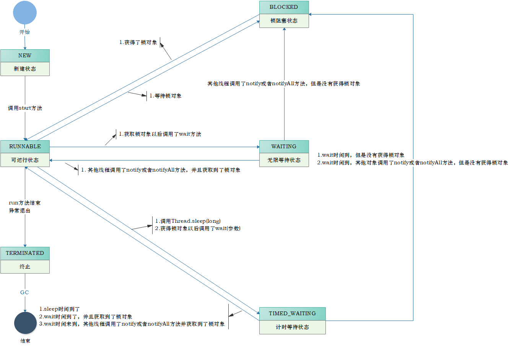

---
tags:
  - Java
  - 线程状态
---

# 1 线程状态

## 1.1 状态介绍

当线程被创建并启动以后，它既不是一启动就进入了执行状态，也不是一直处于执行状态。线程对象在不同的时期有不同的状态。那么Java中的线程存在哪几种状态呢？Java中的线程

状态被定义在了java.lang.Thread.State枚举类中，State枚举类的源码如下：

```java
public class Thread {

    public enum State {

        /* 新建 */
        NEW ,

        /* 可运行状态 */
        RUNNABLE ,

        /* 阻塞状态 */
        BLOCKED ,

        /* 无限等待状态 */
        WAITING ,

        /* 计时等待 */
        TIMED_WAITING ,

        /* 终止 */
        TERMINATED;

	}

    // 获取当前线程的状态
    public State getState() {
        return jdk.internal.misc.VM.toThreadState(threadStatus);
    }

}
```

通过源码我们可以看到Java中的线程存在6种状态，每种线程状态的含义如下

| 线程状态      | 具体含义                                                     |
| ------------- | ------------------------------------------------------------ |
| NEW           | 一个尚未启动的线程的状态。也称之为初始状态、开始状态。线程刚被创建，但是并未启动。还没调用start方法。MyThread t = new MyThread()只有线程象，没有线程特征。 |
| RUNNABLE      | 当我们调用线程对象的start方法，那么此时线程对象进入了RUNNABLE状态。那么此时才是真正的在JVM进程中创建了一个线程，线程一经启动并不是立即得到执行，线程的运行与否要听令与CPU的调度，那么我们把这个中间状态称之为可执行状态(RUNNABLE)也就是说它具备执行的资格，但是并没有真正的执行起来而是在等待CPU的度。 |
| BLOCKED       | 当一个线程试图获取一个对象锁，而该对象锁被其他的线程持有，则该线程进入Blocked状态；当该线程持有锁时，该线程将变成Runnable状态。 |
| WAITING       | 一个正在等待的线程的状态。也称之为等待状态。造成线程等待的原因有两种，分别是调用Object.wait()、join()方法。处于等待状态的线程，正在等待其他线程去执行一个特定的操作。例如：因为wait()而等待的线程正在等待另一个线程去调用notify()或notifyAll()；一个因为join()而等待的线程正在等待另一个线程结束。 |
| TIMED_WAITING | 一个在限定时间内等待的线程的状态。也称之为限时等待状态。造成线程限时等待状态的原因有三种，分别是：Thread.sleep(long)，Object.wait(long)、join(long)。 |
| TERMINATED    | 一个完全运行完成的线程的状态。也称之为终止状态、结束状态     |

各个状态的转换，如下图所示：



## 1.2 案例演示

为了验证上面论述的状态即状态转换的正确性，也为了加深对线程状态转换的理解，下面通过三个案例演示线程间中的状态转换。

### 1.2.1 案例一

本案例主要演示TIME_WAITING的状态转换。

需求：编写一段代码，依次显示一个线程的这些状态：NEW -> RUNNABLE -> TIME_WAITING -> RUNNABLE ->  TERMINATED

为了简化我们的开发，本次我们使用匿名内部类结合lambda表达式的方式使用多线程。

代码实现

```java
public class ThreadStateDemo01 {

    public static void main(String[] args) throws InterruptedException {

        //定义一个内部线程
        Thread thread = new Thread(() -> {
            System.out.println("2.执行thread.start()之后，线程的状态：" + Thread.currentThread().getState());
            try {
                //休眠100毫秒
                Thread.sleep(100);
            } catch (InterruptedException e) {
                e.printStackTrace();
            }
            System.out.println("4.执行Thread.sleep(long)完成之后，线程的状态：" + Thread.currentThread().getState());
        });

        //获取start()之前的状态
        System.out.println("1.通过new初始化一个线程，但是还没有start()之前，线程的状态：" + thread.getState());

        //启动线程
        thread.start();

        //休眠50毫秒
        Thread.sleep(50);

        //因为thread1需要休眠100毫秒，所以在第50毫秒，thread处于sleep状态
        //用main线程来获取thread1线程的状态，因为thread1线程睡眠时间较长
        //所以当main线程执行的时候，thread1线程还没有睡醒，还处于计时等待状态
        System.out.println("3.执行Thread.sleep(long)时，线程的状态：" + thread.getState());

        //thread1和main线程主动休眠150毫秒，所以在第150毫秒,thread早已执行完毕
        Thread.sleep(100);

        System.out.println("5.线程执行完毕之后，线程的状态：" + thread.getState() + "\n");

    }

}
```

控制台输出

```java
1.通过new初始化一个线程，但是还没有start()之前，线程的状态：NEW
2.执行thread.start()之后，线程的状态：RUNNABLE
3.执行Thread.sleep(long)时，线程的状态：TIMED_WAITING
4.执行Thread.sleep(long)完成之后，线程的状态：RUNNABLE
5.线程执行完毕之后，线程的状态：TERMINATED
```

### 1.2.2 案例二

本案例主要演示WAITING的状态转换。

需求：编写一段代码，依次显示一个线程的这些状态：NEW -> RUNNABLE -> WAITING -> RUNNABLE -> TERMINATED

```java
public class ThreadStateDemo02 {

    public static void main(String[] args) throws InterruptedException {

        //定义一个对象，用来加锁和解锁
        Object obj = new Object();

        //定义一个内部线程
        Thread thread1 = new Thread(() -> {
            System.out.println("2.执行thread.start()之后，线程的状态：" + Thread.currentThread().getState());
            synchronized (obj) {
                try {

                    //thread1需要休眠100毫秒
                    Thread.sleep(100);

                    //thread1100毫秒之后，通过wait()方法释放obj对象是锁
                    obj.wait();

                } catch (InterruptedException e) {
                    e.printStackTrace();
                }
            }
            System.out.println("4.被object.notify()方法唤醒之后，线程的状态：" + Thread.currentThread().getState());
        });

        //获取start()之前的状态
        System.out.println("1.通过new初始化一个线程，但是还没有start()之前，线程的状态：" + thread1.getState());

        //启动线程
        thread1.start();

        //main线程休眠150毫秒
        Thread.sleep(150);

        //因为thread1在第100毫秒进入wait等待状态，所以第150秒肯定可以获取其状态
        System.out.println("3.执行object.wait()时，线程的状态：" + thread1.getState());

        //声明另一个线程进行解锁
        new Thread(() -> {
            synchronized (obj) {
                //唤醒等待的线程
                obj.notify();
            }
        }).start();

        //main线程休眠10毫秒等待thread1线程能够苏醒
        Thread.sleep(10);

        //获取thread1运行结束之后的状态
        System.out.println("5.线程执行完毕之后，线程的状态：" + thread1.getState() + "\n");

    }

}
```

控制台输出结果

```java
1.通过new初始化一个线程，但是还没有start()之前，线程的状态：NEW
2.执行thread.start()之后，线程的状态：RUNNABLE
3.执行object.wait()时，线程的状态：WAITING
4.被object.notify()方法唤醒之后，线程的状态：RUNNABLE
5.线程执行完毕之后，线程的状态：TERMINATED
```

### 1.2.3 案例三

本案例主要演示BLOCKED的状态转换。

需求：编写一段代码，依次显示一个线程的这些状态：NEW -> RUNNABLE -> BLOCKED -> RUNNABLE -> TERMINATED

```java
public class ThreadStateDemo03 {

    public static void main(String[] args) throws InterruptedException {

        //定义一个对象，用来加锁和解锁
        Object obj2 = new Object();

        //定义一个线程，先抢占了obj2对象的锁
        new Thread(() -> {
            synchronized (obj2) {
                try {
                    Thread.sleep(100);              //第一个线程要持有锁100毫秒
                    obj2.wait();                          //然后通过wait()方法进行等待状态，并释放obj2的对象锁
                } catch (InterruptedException e) {
                    e.printStackTrace();
                }
            }
        }).start();

        //定义目标线程，获取等待获取obj2的锁
        Thread thread = new Thread(() -> {
            System.out.println("2.执行thread.start()之后，线程的状态：" + Thread.currentThread().getState());
            synchronized (obj2) {
                try {
                    Thread.sleep(100);              //thread3要持有对象锁100毫秒
                    obj2.notify();                        //然后通过notify()方法唤醒所有在ojb2上等待的线程继续执行后续操作
                } catch (InterruptedException e) {
                    e.printStackTrace();
                }
            }
            System.out.println("4.阻塞结束后，线程的状态：" + Thread.currentThread().getState());
        });

        //获取start()之前的状态
        System.out.println("1.通过new初始化一个线程，但是还没有thread.start()之前，线程的状态：" + thread.getState());

        //启动线程
        thread.start();

        //先等100毫秒
        Thread.sleep(50);

        //第一个线程释放锁至少需要100毫秒，所以在第50毫秒时，thread正在因等待obj的对象锁而阻塞
        System.out.println("3.因为等待锁而阻塞时，线程的状态：" + thread.getState());

        //再等300毫秒
        Thread.sleep(300);

        //两个线程的执行时间加上之前等待的50毫秒总共是250毫秒，所以第300毫秒，所有的线程都已经执行完毕
        System.out.println("5.线程执行完毕之后，线程的状态：" + thread.getState());

    }

}


//---------------------代码简化--------------------------------------------
Object obj = new Object();

        Thread t1 = new Thread(()->{
            synchronized (obj){
                try {
                    Thread.sleep(1000);
                } catch (InterruptedException e) {
                    e.printStackTrace();
                }
            }
        });
        t1.start();


        Thread t2 = new Thread(()->{
            System.out.println("线程开启之后的状态" + Thread.currentThread().getState());
            synchronized (obj){
                System.out.println("进入之后的状态" + Thread.currentThread().getState());
            }
        });


        System.out.println("创建线程对象后,但是不调用start方法的状态" + t2.getState());
        t2.start();
        Thread.sleep(100);
        System.out.println(t2.getState());
        Thread.sleep(2000);
        System.out.println(t2.getState());
```

控制台输出结果

```java
1.通过new初始化一个线程，但是还没有thread.start()之前，线程的状态：NEW
2.执行thread.start()之后，线程的状态：RUNNABLE
3.因为等待锁而阻塞时，线程的状态：BLOCKED
4.阻塞结束后，线程的状态：RUNNABLE
5.线程执行完毕之后，线程的状态：TERMINATED
```

通过上面3个案例的代码演示，我们可以证明开始章节说所述的线程状态以及线程状态转换都是正确的。

## 相关笔记

- [[线程池]]
- [[多线程基础]]

