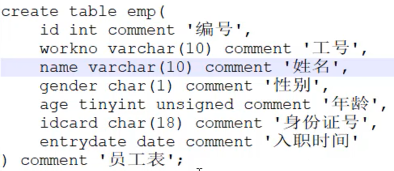
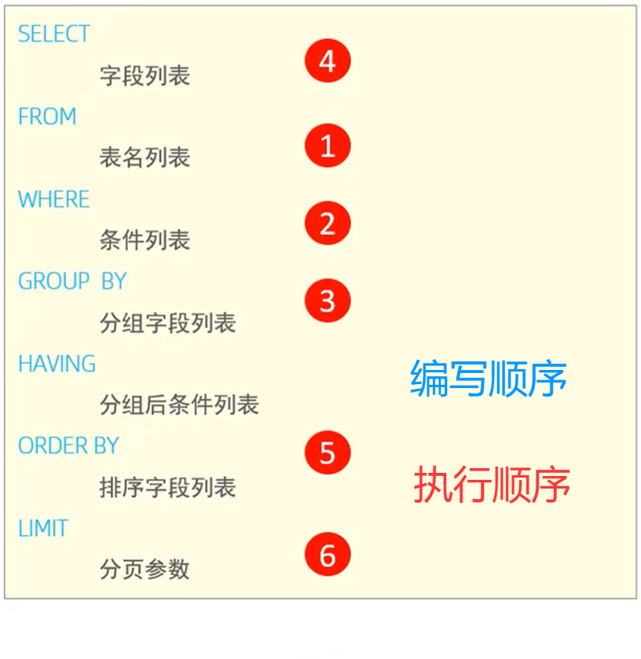
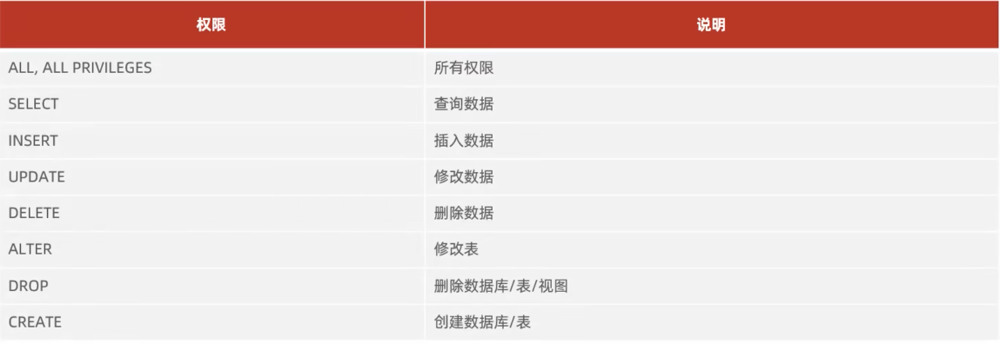

---
tags:
  - MySQL
  - SQL
---

# SQL

## SQL通用语法
 - SQL可以多行书写，以分号结尾
 - 关键字使用**大写**以规范
 - 注释为：--XXX或#XXX（MySQL特有）；多行：/* XXX */
## DDL(数据定义语言)
### 数据库操作
#### 查询
```
	查询所有数据库
	show databases;

	查询当前数据库
	select database();
```
#### 创建
```
 create database [if not exists] 数据库名 [default charset 字符集][collate 排序规则];
```
#### 删除
```
	drop atabase[if exists] 数据库名;
```
#### 使用
```
	use 数据库名;
```
### 表操作
#### 查询
```
	查询当前数据库所有表
	show tables;

	查询表结构
	desc 表名;

	查询指定表的建表语句
	show create table 表名;
```
#### 创建
```
	create table 表名(
		字段1 字段1类型[comment 字段1注释],
		字段2 字段2类型[comment 字段2注释],
		...
		字段n 字段n类型[comment 字段n注释]
	)[comment 表注释];
```

#### 修改
```
	添加字段
	alter table 表名 add 字段名 类型(长度) [comment 注释][约束];

	修改数据类型
	alter table 表名 modify 字段名 新数据类型(长度)

	修改字段名和字段类型
	alter table 表名 change 旧字段名 新字段名 类型(长度) [comment 注释][约束];

	删除字段
	alter table 表名 drop 字段名;

	修改表名
	alter table 表名 rename to 新表名;
```
#### 删除
在删除表时，表中数据也会一并删除
```
	删除表
	drop table[if exists] 表名;

	删除指定表，并重新创建该表
	truncate table 表名;
```
## DML(数据操作语言)
### 添加数据
```
	给指定字段添加数据
	insert into 表名(字段名1,字段名2,...) values(值1,值2,...);

	给全部字段添加数据
	insert into 表名 valuse(值1,值2,...);
```
### 修改数据
```
	update 表名 set 字段名1=值1,字段名2=值2,...[where 条件];
```
### 删除数据
```
	delete from 表名 [where 条件];
```
## DQL(数据查询语言)
### 查询多个字段
```
	select 字段1,字段2,... from 表名;
	select * from 表名;
```
### 设置别名
```
	select 字段1 [as 别名1],字段2[as 别名2]... from 表名;
```
### 去重查询
```
	select distinct 字段列表 from 表名;
```
### 条件查询
```
	select 字段列表 from 表名 where 条件列表;
```
### 聚合函数
```
	select 聚合函数() from 表名;
	常见聚合函数：
		count  统计数量
		max	   最大值
		min    最小值
		avg    平均值
		sum    求和
	null值不参与其运算
```
### 分组查询
```
	select 字段列表 from 表名 [where 条件] group by 分组字段名 [having 分组后过滤条件];
```
where和having区别
1. 执行时机不同：where是分组前过滤，不满足where条件，不参与分组；而having是分组后对结果进行过滤
2. 判断条件不同：where不能对聚合函数进行判断，而having可以

### 排序查询
```
	select 字段列表 from 表名 order by 字段1 排序方式1,字段2 排序方式2;
```
1. 排序方式：asc(升序),desc(降序)；
2. 若是多个字段排序，当第一个字段相同时，才会根据第二个字段进行排序

### 分页查询
```
	select 字段列表 from 表名 limit 起始索引,查询记录数;
```
注意：
1. 起始索引从零开始，起始索引=(查询页码-1)*每页显示记录数。
2. 分页查询为方言，MySQL中是limit。
3. 若查询第一页，起始索引可以省略，直接简写为limit 10.

### 顺序


## DCL(数据控制语言)
### 管理用户
#### 查询用户
```
use mysql;
select * from user;
```
#### 创建用户
```
create user '用户名'@'主机名' identified by '密码';
```
#### 修改用户密码
```
alter user '用户名'@'主机名' identified with mysql_native_password by '新密码';
```
#### 删除用户
```
drop user '用户名'@'主机名';
```
***
### 权限控制
1. 多个权限之间，使用逗号分隔
2. 授权时，数据库名和表名可以使用*进行通配，代表所有
#### 查询权限
```
show grants for '用户名'@'主机名';
```
#### 授予权限
```
grant 权限列表 on 数据库名.表名 to '用户名'@'主机名';
```
#### 撤销权限
```
revoke 权限列表 on 数据库名.表名 form '用户名'@'主机名';
```
#### 权限列表


## 相关笔记

- [[函数]]
- [[约束]]

