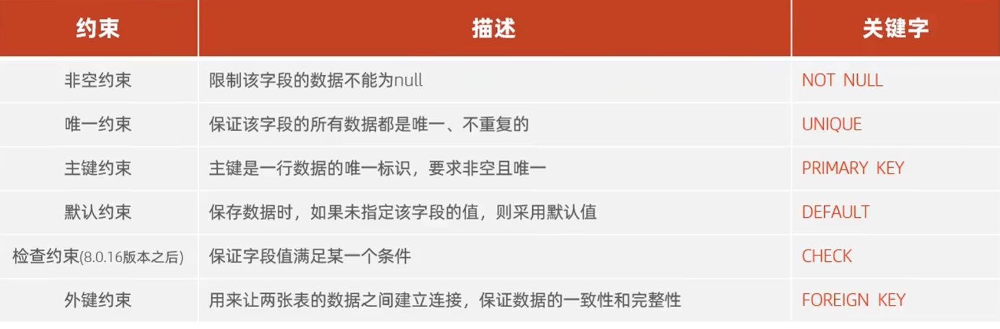
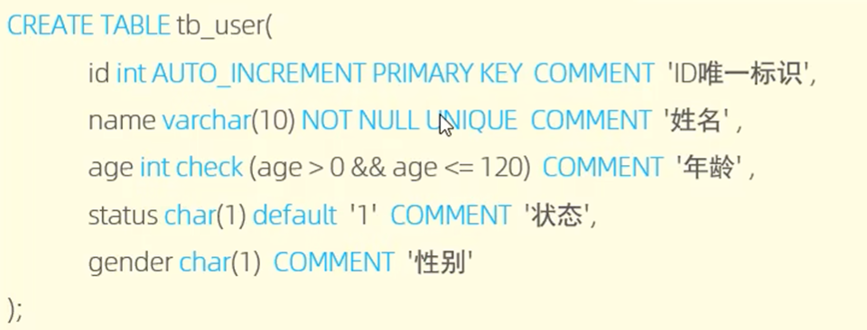
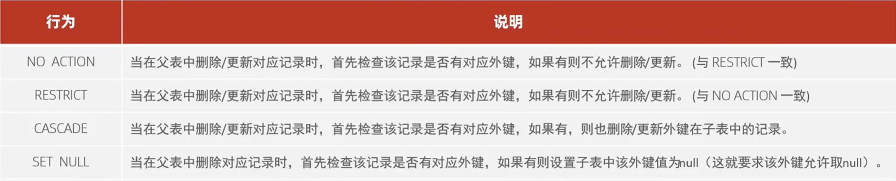

---
tags:
  - MySQL
  - 约束
---

# 约束


约束是作用在表中字段上的，可以在创建表/修改表的时候添加约束

示例：


## 外键约束
### 添加外键
```
creat table 表名(
	字段名 数据类型,
	...
	[constraint] [外键名称] foreign key(外键字段名) references 主表(主表列名)
);

alter table 表名 add constraint 外键名称 foreign key (外键字段名) references 主表(主表列名);
```
### 删除外键
```
alter table 表名 drop foreign key 外键名称;
```
### 删除/更新行为

语法：
```
alter table 表名 add constraint 外键名称 foreign key (外键字段) references 主表名(主表字段名) on update ... on delete ...;
```

## 相关笔记

- [[SQL]]

